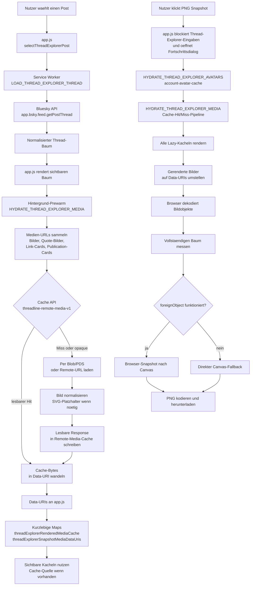

# Threadline Technische Hinweise

**Deutsch** | [English](TECHNICAL.md)

Diese Datei bündelt die technischeren Hintergrundinformationen, die nicht im schnellen Einstieg des Haupt-README stehen sollen.

## Verantwortungspruefung — 2026-11-08

Die fruehere Fertigmeldung war voreilig. Der getestete Auslagerungsstand mit 857 Unit-/Vertragstests und 150 Chromium-Faellen belegte keine durchgaengig korrekte Verantwortungs- und Zustandsverteilung. App/Cache bleiben `0.4.357`/`v376`; das Zwischenstandslabel ist korrigiert.

Die Nacharbeit entfernt 43 unbenutzte Funktionen und 18 Fassaden fuer importierte Funktionen. Uebersetzungsmetadaten gehoeren ins HTML; der generische Renderer bekommt nur Dokument, Uebersetzung und Sprache. Post-Edit-Dialog und optionale DM-Freischaltung gehoeren ihren Domaenencontrollern. Profil-/URL-/Engagement-/Editmodelle liegen in Sharedmodulen. Optimistische Likes und ihre private Menge laufender Anfragen gehoeren dem Interaktionscontroller. Explorer-Quelle/Layout/Viewport/aufgeklappte Knoten haben einen gemeinsamen Controller-Zustand statt sieben gespiegelter Globals.

Die [Verantwortungs- und Zustandspruefung](docs/MODULARIZATION-AUDIT.md) mit vollstaendigem Funktionsinventar dokumentiert Nachweise, verbleibende Grenzen und Abnahmekriterien. Der Architekturabschluss bleibt bis zur Klaerung dieser Grenzen offen; gruene Regressionstests allein schliessen ihn nicht ab.

## Threadpublishing Und Record-Interaktionen

`js/worker/interaction-service.js` kapselt Interaktionsgates, Recordloeschung, Likes und Unlikes. `js/worker/publish-service.js` kapselt sequenzielles Posten, Medienuploads, Facets, Replyverkettung, Gates und Teilfehlerprojektion. Session, Transport/PDS-Basis, bestehende Normalisierungs-/URI-/Regel-/Facet-/Uploadadapter, Blob-Konstruktor und ISO-Uhr sind explizit. Bisherige Publish-/Like-/Unlikeeinstiege delegieren an lazy Dienste; Altkoerper entfernt, Texte zentralisiert und beide Skripte importiert/precached.

Erhalten bleiben Validierungs-/Authreihenfolge, Threadgate vor Postgate, gemeinsame Rkeys, Rate-Limit-Prioritaet, Mentioncache je Lauf, Bildlimit, Vierbild-/Galeriegrenze, Card-/Bildexklusivitaet, Uploadreihenfolge, Root-/Parentreferenzen und Sprachnormalisierung. Ein Post zaehlt erst nach Gateeinrichtung als abgeschlossen; ein Gatefehler kann einen erstellten Post ausserhalb der abgeschlossenen Liste hinterlassen. Spaetere Fehler behalten PARTIAL_PUBLISH-Zaehler/Rate-/Retry-/Statusdetails. Kein Rollback ergaenzt; optionale nutzerinitiierte Ruecknahme, sofortige Referenzerfassung und Abgleich unklarer Timeout-Ergebnisse sind jetzt TODO-Punkte.

## Replyberechtigung Und Post-Editpruefung

`js/worker/reply-models.js` kapselt Replymodus, explizite Mentionerkennung und Threadgate-Berechtigung. `js/worker/post-check-service.js` kapselt Replyziel- und Repo-Editmetadatenpruefung mit expliziten Session-, URL-/Identitaets-, Transport-, Root-/Threadsammlungs-, PDS- und Fehleradaptern. Zwei bestehende Workereinstiege delegieren an eine lazy Instanz; alte Koerper entfernt, Meldungen zentralisiert und beide Skripte importiert/precached.

Erhalten bleiben Authentifizierung vor URLverarbeitung, bisherige Follower-/Following-Viewersemantik, Mentionabgleich, unbekannte Listenregeln als Warnung, neuester eigener Post im Threadmodus, ausgewaehlte/Root-Fallbackmetadaten und Fehler bei blockierten Zielen. Threadlesen behaelt Tiefe 100, parentHeight 0, einen Retry und 20s Timeout. Editpruefung behaelt codierte URL-/Akteur-/Lade-/Recordfehler, Autor-PDS-Auswahl, unauthentifizierte Repo-Record-Requestoptionen und bisherige Mu-kompatible Editfelder. Diese Ablaeufe lesen ausschliesslich Postdaten.

## Gespeicherte Einstellungen Und Entwurfsablaeufe

`js/worker/settings-models.js` kapselt gespeicherte Linkkarten/Provider/Proxy/Usage, Suchergebnisse, Segmentoverrides, Postinghistory, Replyziele, Explorerzustand und Resize-/Expertenflags. Publikationsmetadaten und ISO-Uhr sind explizit. `js/worker/settings-service.js` kapselt Appzustandsladen und Entwurfs-/Einstellungsspeicherung mit expliziten Speicher-, Bildpersistenz-, Feldnormalisierungs-, Konto- und Frontendadaptern. Bisherige Workernamen sind an Modellinstanz und drei Ablaufdelegationen gebunden; alte Implementierungen entfernt, beide Skripte importiert/precached.

Erhalten bleiben Legacy-Stringentwuerfe und Localefallback, Einstellungsbild-/Entwurfskartenprioritaet, bisherige Rohreferenzen, Null-zu-Nullzahl-Koerzierung, feldbezogene Patch-/Resetregeln, Compact-Persistenz, unbekannte Felder und Sprachwerte inklusive skalarer Legacysprachen. Entwurf speichert Bildbytes vor Metadaten und bereinigt danach; Einstellungen schreiben zuerst Einstellungen, dann Locale und bereinigen zuletzt. Schreibfehler werden weitergereicht und ueberspringen spaetere Bereinigung. Keine Schema-/Standardwert-/Migrationsaenderung.

## Richtext Und Mention-Ablaeufe

`js/worker/richtext-models.js` kapselt UTF-16-/UTF-8-Offsetumrechnung, Bytebereich-Ueberlappung, Link-/Hashtag-/Mentionkandidaten und Mention-Suchvarianten/-Ranking. Encoder und konfigurierte Handle-Suffixe sind explizit. `js/worker/richtext-service.js` kapselt Mentionfacets, kombinierte Richtextfacets, Vorschau-Handleaufloesung und Account-Typeahead. Session, Resolver, Request/Basis, Profilnormalisierung und Parsermodelle sind explizit. Bestehende Publish-/Vorschau-/Suchaufrufer delegieren; gemeinsamer Hashtagparser bleibt fuer Archiv-/Suchmodelle verfuegbar. Alte Implementierungen entfernt, beide Skripte importiert/precached.

Erhalten bleiben Regexgrenzen/Punktuation, UTF-8-Indizes, Link-/Mention-/Tag-Ueberlappungsprioritaet, Facetsortierung, undefined-Facets bei Klartext, doppelte erfolgreiche Mentions, eindeutige unaufgeloeste Handles, Resolvercache je Lauf, optionale Vorschauauthentifizierung, sequenzielle strikte/breite Suchvarianten, tolerierte Einzelsuchfehler, erste DID-Metadaten, Ranking-/Gleichstandsregeln und Zwoelferlimit. Postingverhalten und externe Kontodaten unveraendert.

## Medienexport-Scan Und Downloadablaeufe

`js/worker/media-export-service.js` kapselt Akteurauswahl, Autorfeed-Scan, Archiv-/Hashtagauswahl, Manifestaufbau und Einzelassetdownload. Session, Request/Basis, Archivfilter/-postadapter, Hashtagpruefung, vorhandene Medienmodelle, CID-/URL-Downloads, Timeout, Endung, ISO-Uhr und Heartbeattimer sind explizit. Untergrenzen-Abbruchregeln liegen jetzt in `media-export-models.js`. Bestehende Scan-/Downloadworkereinstiege delegieren an eine lazy Instanz; Altimplementierungen und unbenoetigte Fassadenhelfer entfernt. Neues Skript importiert/precached, bisherige Fortschritts-/Fehlertexte zentralisiert.

Erhalten bleiben 100er-Postseiten, Eigentuemerfilter, Hashtagcaches je Scan, unterschiedliche Postlisten-/Medien-ID-Deduplizierung, abschliessende Datumssortierung, Jahres-/Datumsabbruch nach Seitenverarbeitung und bisherige Manifest-/Schema-/Versionsfelder. Downloads authentifizieren vor Itempruefung, bevorzugen CID vor URL, behalten 30s Timeout und 10s Heartbeat mit finally-Bereinigung, bisherige Endungsfallbacks und urspruengliche Bytereferenzen/Metadaten. Transport- und Speicherformate unveraendert.

## Explorer-Reaktionen Und Medienexportmodelle

Zwei weitere Einheiten sind ausgelagert. `js/worker/explorer-reaction-service.js` kapselt Likes-/Reposts-/Quotesladen, Akteurnormalisierung/-filterung und stabile DID-oder-Handle-Deduplizierung. Session/Refresh, Request/Basis und Akteurnormalisierung sind explizit. URI-Pruefung bleibt vor Authentifizierung, Typpruefung nach Authrefresh; Limits, optionale CID, Cursortrimmen, Endpunkte und Fehlerweitergabe bleiben erhalten. Bestehender Workereinstieg delegiert an eine lazy Instanz; Meldungen sind zentralisiert.

`js/worker/media-export-models.js` kapselt UTC-Dateizeitstempel, Postordner, indizierte Pfadstamme und Bild-/Video-/Card-Manifesteintraege. Vorhandene Archiv-Embedextraktoren und Blob-CID-Adapter werden wiederverwendet. Bisherige Invalid-Date-Sentinels, Rkey-Bereinigung/-Laenge, Quellindizes, Bild-/Video-/Card-Reihenfolge, Altlimits, Dimensionen, MIME-Hinweise, Typfilter und Thumbnail-CID-/URL-Formen bleiben erhalten. Der Scan nutzt schmale Ordner-/Eintragsdelegationen; Scan-/Downloadsteuerung bleibt separate Arbeit. Alte Implementierungen entfernt, beide Skripte importiert/precached.

## Explorer-Avatar- Und Medienhydrierung

`js/worker/explorer-hydration-service.js` kapselt Avatarhydrierung, lesbaren Mediencache, Cache-/Downloaddeadlines, Direkt-/Blobfallback, periodischen Fortschritt und Medienhydrierung. Auth/Refresh, Avatarspeicher/-modelle, Cache-/Responsezugriff, Downloads, Blob-URL-Parser, Bildnormalisierung, Konvertierung, Parallelitaet, Uhren und Timer sind explizit. Autoren-/Medieneintrags-Sammlung erweitert `explorer-models.js`; rekursive Sammlung behaelt erste Medien-URL-Zuordnung und explizite Eintragsprioritaet. Bisherige Avatar-/Mediennachrichten und der gemeinsame Timeoutaufrufer delegieren an eine lazy Instanz. Alte Koerper entfernt, neues Skript importiert/precached.

Erhalten bleiben Avatar-TTL und Same-DID-Ersetzung, vier Avatar-/16 Medienworker, 1,5s Cache-Match-/Bodydeadlines, 12s Direkt-/30s Itemdeadlines, 5s Fortschrittsheartbeat, bekannte Blobroute vor Direktabruf, Einzelfehlertoleranz, SVG-Platzhalternormalisierung, Fortschrittszaehler und Heartbeatbereinigung. Cacheschreiben startet waehrend der Hydrierung und bleibt asynchron; die Hydrierung wartet nicht auf dessen Abschluss. Cache-Match-/Bodyfehler werden Cachemisses; Cacheoeffnungsfehler behalten ihre bisherige Weitergabe. Avatarergebnisse behalten TTL/Zaehler und speichern Assets unter dem gemeinsamen Avatarschluessel.

## Explorer-Feedregeln Und Laden

`js/worker/explorer-feed-models.js` kapselt gespeicherte/gepinnte Quellen, Beziehungsquellen/-endpunkte/-profilregeln, stabile Chronologie, Actor-Modi und gespeicherte Suchparameter. `js/worker/explorer-load-service.js` kapselt Quellenanreicherung, Timeline-/Generator-/Such-/Beziehungsfeeds, Actorfeeds, Post-URL-Aufloesung und ausgewaehlte/vollstaendige Threadwurzeln. Session/Refresh, Transport/Basis, Handle-/URL-/Graph-/Fehleradapter und Feed-/Postmodelle sind explizit. Fuenf bestehende Workereinstiege delegieren an einen lazy Dienst; Altimplementierungen entfernt, beide Skripte importiert/precached. Bisherige Meldungen zentral in `adapter-messages.js`.

Erhalten bleiben Legacy-/aktuelle Pin-Praeferenzen mit saved-Array-Prioritaet, 25 Quellenanreicherungen mit Einzelfallback, Achtergruppen von Beziehungsprofilen mit Einzelfehlertoleranz, strikte Beziehungsflags, 12-Post-Autorvorschauen, stabile Chronologie, 25-URI-Existenzbatches, Actor-URI-Deduplizierung und Fuenfseitenlimit, Vierseitenlimit fuer Timeline/Suche, Suchwurzel-Deduplizierung sowie bisherige Cursor-/Ziel-/Seitengroessenregeln. Threadladen behaelt Authrefresh, Tiefe/Elternhoehen, Abbruch bei geloeschtem Anker und Auswahlpfadmerge. Erforderliche Transport-/Authfehler bleiben sichtbar.

## Worker-Record- Und Baummodelle Des Thread Explorers

`js/worker/explorer-models.js` kapselt normalisierte Akteure, Post-Editmetadaten, Post-/Quote-/Medienrecords, geloeschte Anker, rekursive Baeume, Elternketten, Auswahlpfad-Zusammenfuehrung, URI-Suche und Postzaehlung. Standard.site-Metadaten sind ein expliziter Adapter. Die Record-/Baum-API mit ergaenzten Hydrierungs-Sammlungshelfern wird nach klassischen Imports vor Archiv-/Analyseverdrahtung an bestehende Workernamen gebunden. Archivaufrufer fuer Editmetadaten nutzen dieselbe Implementierung; alte Workerkoerper sind entfernt, Modul importiert/precached.

Erhalten bleiben direkte Bildprioritaet vor Galerie/Medien, Quote-Embedprioritaet, Array-/Viewer-/Replyreferenzen, Platzhalterformat, Ersetzen vorhandener ausgewaehlter Replies beim Elternaufbau, Geschwisterreihenfolge sowie Ziel-/angehaengte Knotenidentitaet beim Pfadmerge. Geloeschte Anker bleiben suchbar und werden nicht gezaehlt. Modelle enthalten keinen Netzwerk-/Speicherzugriff. Feed-/Threadladen liegt inzwischen in `explorer-load-service.js`; Medien-/Avatarhydrierung verbleibt fuer die naechste Auslagerung im Worker.

## Worker-Bildmodelle Des Composers

`js/worker/composer-image-models.js` kapselt Worker-Bildedit/-Recordnormalisierung, Inline-Segmentnormalisierung und Metadatenprojektion. ID-Erzeugung und Segmentlimit sind explizite Abhaengigkeiten; der Worker bindet bisherige Funktionsnamen an eine Modellinstanz. Bildspeicher und Einstellungs-/Entwurfsaufrufer nutzen dieselbe Instanz. Alte Modellkoerper sind entfernt, das Skript ist importiert/precached.

Frontend `shared-images.js` und Worker unterscheiden sich derzeit: Frontendedits enthalten `fitMode`, Validierung enthaelt Dimensionen und die Annahme von Inline-Daten unterscheidet sich. Workermetadaten erlauben fehlende Inline-Daten und behalten nur ihre bisherigen Edit-/Validierungsfelder. Diese Auslagerung erhaelt beide Formate; eine Vereinheitlichung wuerde das Speicherverhalten aendern. Unterschiede sind durch einen Vergleichsvertrag abgesichert und separat in TODO erfasst.

Verbleibende Workerbereiche: Thread-Explorer-Record-/Baum-/Feedmodelle und Laden/Hydrierung, Richtext/Mentions, Medienexport, Einstellungs-/Entwurfssteuerung sowie Posting-/Replyablaeufe. Thread-Explorer-Record-/Baummodelle sind inzwischen ausgelagert; als Naechstes deren Ladedienste auslagern. Normalisierungsvergleich und Verhaltensaenderungen getrennt behandeln.

## Composer-Bildpersistenz

`js/worker/composer-image-store.js` kapselt Composer-Bildblobs lesen/schreiben/auflisten/loeschen, Referenzsammlung, Speicherwiederverwendung, Hydrierung und Bereinigung. Datenbankoeffnung, bestehende Bild-/Segment-/Metadaten-Normalisierer, Blob-/Data-URL-Konvertierung, allgemeiner Lesezugriff, Blob-Konstruktor, ISO-Uhr, Store-/Schluesselnamen und Meldungen sind explizit. Bisherige saveDraft/saveSettings/getAppState-Aufrufer delegieren ueber den Worker; alte Bildspeicherkoerper und unbenoetigte Fassadenhelfer sind entfernt. Skript importiert/precached, bestehende Fehler zentral in `adapter-messages.js`.

Datenbankschema und Abschlussgrenzen bleiben erhalten: Mehrfachlesen endet nach allen Request-Erfolgen, Schluesselliste nach Request-Erfolg, Schreiben/Loeschen erst nach Transaktionsabschluss. Lesen dedupliziert normalisierte IDs; Schreiben verwendet passende vorhandene Blob-/Groessen-/Typdatensaetze wieder. Hydrierung bevorzugt Inline-Daten, konvertiert gespeicherte Blobs und verwirft Bilder ohne Daten. Bereinigung behaelt die Vereinigung von Entwurfs- und Einstellungsreferenzen. Normalisierungs- und Konvertierungsregeln bleiben erhalten.

## Laden Der Netzwerk-Arbeitsbereiche

`js/worker/network-workspace-service.js` kapselt Netzwerk-Slices, Accountfokus, gemeinsame Mutuals und normalisierte Profilzusammenfuehrung. Session, Profilrequest/Basis, Graphwellen/-seiten/-gesamtsammlungen, Follow-Zeitpunkte, Aktivitaets-/Likedaten, Stichprobengroessen und Fortschrittstexte sind explizite Abhaengigkeiten. Bisherige Workereinstiege delegieren an eine lazy Instanz; alte Koerper sind entfernt. Der Dienst ist importiert/precached, sichtbare Texte liegen zentral in `adapter-messages.js`.

Erhalten bleiben: 100..500 Slice-Limit, Profilanfrage parallel zu sequenziellen Follower-/Following-Wellen, tolerierter Slice-Profilfehler samt bisherigen Fallbackmetadaten/-flags, eigene/fremde Viewer-Beziehungsflags, sequenzielle Fokusphasen mit zwoelf Profilen je Vorschau, frueher Mutuals-Abbruch bei fehlenden/gleichen Akteuren, vier vollstaendige Graphsammlungen, Duplikatzusammenfuehrung, Schnittmengenreihenfolge nach zentralen Followern sowie Fortschritts-/Fehlerweitergabe. Profilmerging behaelt nichtleere Metadaten/Zaehler und kumulative Beziehungsflags.

## Gemeinsamer Netzwerkdatenzugriff

`js/worker/network-data-service.js` kapselt aktuelle Autor-Poststichproben, benachrichtigungsbasierte gegenseitige Likes, Aktivitaetsfenster, normalisierte Graphseiten/-wellen und Follow-Record-Zeitpunkte. Request/Basis-URL, Profilnormalisierung, URI-Parser, Uhr, Stichprobengroessen und Zeitfenster sind explizite Abhaengigkeiten. Klassische Workeraufrufer delegieren an eine lazy Instanz; Analyse und Thread Explorer behalten den gemeinsamen Graphseitenadapter. Altimplementierungen sind entfernt, das Skript ist importiert/precached und Graphfortschrittstexte liegen in `adapter-messages.js`.

Bisherige Regeln bleiben: Autorfilter, Cursorabbruch, 100er-Postseiten, acht Benachrichtigungsseiten, eindeutige Likeziele, vollstaendige Seitenverarbeitung vor Altersabbruch, inklusive Aktivitaetsgrenzen samt zukuenftigen Zeitstempeln, erste Graphanfrage auch bei Nullziel, Fortschritt nach jeder Graphseite und Follow-Record-Anfragen ohne neuen Basis-Override. Transport- und Observerfehler werden weitergereicht. Netzwerk-Slice-/Fokus-/Mutuals-Steuerung und Profilzusammenfuehrung liegen inzwischen in `network-workspace-service.js`.

## Lebenszyklus Gespeicherter Konten

`js/worker/account-service.js` kapselt Kontowechsel, Metadatenimport, Entfernen, Logout und Sessionpruefung. Speicher, Session-Erneuerung, Kontomodelle, Frontendfallback, Archivbereinigung und ISO-Uhr sind explizite Abhaengigkeiten. Worker-Einstiege delegieren; alte Implementierungen sind entfernt. Fehlerprioritaet bleibt offline, fehlendes Passwort, ungueltige Zugangsdaten, abgemeldet. Logout behaelt das gespeicherte App-Passwort und leert Archivsession/-katalog nur beim aktiven Konto. Entfernen behaelt die bisherige Auswahl der ersten verbleibenden Session. Der Dienst ist importiert und precached; Meldungen liegen in `adapter-messages.js`.

## Login-, Session- und Identitaetsdienste

`session-service.js` kapselt Login, Session-Erneuerung, Aktualisierung mutabler Authreferenzen und JWT-Dekodierung/-Gueltigkeit. Transport, URL/Frontend, Identitaet, Avatar/Cache, Authspeicher/-modelle, Uhren, Base64-Dekodierung, Warnungen und klassische ensure/login-Bruecken sind explizit. Verhalten bleibt erhalten: Mu.social-E-Mailfehler und DID-/Handle-PDS-Aufloesung, urspruenglicher createSession-Credentialpayload, Frontendprioritaet, Avatarpersistenz, explizite/aktive Ziel-DID, 30s JWT-Puffer, No-exp-/No-payload-Regeln, Refresh vor App-Passwort-Login, Warnung/Fallback und aktive Kontoauswahl. Fehler im bisherigen Refreshblock behalten dessen umfassende Fallbackbehandlung.

`identity-service.js` kapselt Handleaufloesung, DID-Dokumente, PDS-Auswahl/-Cache, Avatar-/Frontendhelfer und Konnektivitaet. Fetch/Request, URL-/Fehler-/Speicherzugriff, AbortController und Timer-/Cleanupadapter sind injiziert. Positive/negative Handlecaches, bisherige PLC-/Web-URLregeln, 8s-Standard/1s-DID-Minimum, erster PDS-Treffer und gecachte Fallbacks bleiben erhalten. DID-Timer werden weiterhin beim Zurueckgeben des JSON-Promise freigegeben; keine neue Body-Deadline. Konnektivitaet behaelt 8s-Abbruch und bestehende Fehlercodes. Beide Services werden nach verfuegbaren Workerabhaengigkeiten lazy verdrahtet; klassische Client-/Session-/JWT-Funktionen bleiben dokumentierte schmale Delegationen. Altkoerper entfernt, beide Skripte importiert/precached, bestehende Texte zentralisiert.

## Gemeinsamer Worker-Transport, Authmodelle und Speicher

`transport-service.js` kapselt XRPC-Anfragen, GET-Serialisierung und Rate-Limit-Header. Browserfetch, klassische GET-zu-Request-Verdrahtung, URLSearchParams-Erzeugung, Servicefehler, Uhr, Standard-API und bestehende Meldungen sind explizit. Klassische Namen in `atproto-client.js` bleiben schmale veraenderliche Delegationen an einen lazy erzeugten Service und erhalten bestehende Interzeptoren. Requestoptionen-/Headerprioritaet, JSON-/Text-/Leerantworten, Metadaten, 401-Codes, Sekunden-/Datums-Retry-After und skalare/Array-Queryregeln bleiben gleich.

`auth-models.js` enthaelt Service-URL-/Sicherheitsregeln, Konto-/Zustandsnormalisierung, oeffentliche Konto-/Antwortprojektion und Upsert. Standardservice/-frontend, Frontendinferenz, Fehler und ISO-Uhr sind injiziert. Legacy-Einzelkonto, aktive DID, Sessionidentitaet, Duplikatregeln und Ausgabe ohne Zugangsdaten bleiben erhalten. `storage-service.js` kapselt bisherige Storeanlage und allgemeine/Auth-Lese-/Schreib-/Loeschoperationen. Datenbank-/Storekonfiguration, IndexedDB-Zugriff und Authnormalisierung sind explizit. Schema zwei, Bild-keyPath id, nullish Allgemeinwerte, falsy Authfallback, Oeffnen vor Auth-Schreibnormalisierung und Abschluss bei Request-Erfolg bleiben erhalten. Fehler injizierter Normalisierer werden als Rejection weitergereicht; keine neue Transaktionsabschluss-Semantik. `adapter-messages.js` zentralisiert bestehende Texte. Altimplementierungen entfernt, vier klassische Skripte importiert und precached.

## Vollstaendiger Worker-Analyseblock

Die Worker-Analyse ist jetzt als zusammenhaengender Block ausgelagert. `analysis-models.js` enthaelt Kontomatching, Facet-/Quote-/Medien-/Replyregeln, Frequenzranking, Normalisierung gespeicherter Analysezustaende und einen veraenderlichen Feedseiten-Akkumulator. Der gemeinsame AT-URI-Parser ist explizit. Der Akkumulator erhaelt Datumsgrenzen vor Postausschluessen, Frequenzen nur fuer akzeptierte Texte, doppelte Facets/Sprachen, Reply-/Quotefilter, Postreihenfolge und Grenzen. Der gespeicherte Snapshot behaelt sein bewusst reduziertes Schema.

`analysis-service.js` kapselt Kontopruefung/-laden, Sessionwahl gespeicherter Konten, ganze Graphsammlung, authentifizierte Mute-/Blocklisten, Profilanreicherung und einen privaten DID-Profilcache. Sitzung/Speicher, Request/Basis, Handleaufloesung, vorhandene Netzwerk-Profilnormalisierung, Graphseitentransport, Servicefehler-Factory, Uhr und positive Grenzwerte sind explizit. Regeln bleiben erhalten: 100..2000 akzeptierte Posts, 100er-Postseiten, maximal 200 Feedseiten, 100er-Graphseiten mit 5000er-Grenze samt bisheriger letzter Seitenueberschreitung, 25er-DID-Batches, tolerierte Anreicherungsfehler, deleted-Flags fuer unaufgeloeste Marker, parallele Graphwarnungen und private Listen nur mit gespeichertem Quellkonto. `analysis-messages.js` zentralisiert die bisherigen Texte.

15 alte Funktionskoerper und der globale Cache sind entfernt. Suche erhaelt denselben Facetvertrag, Settings denselben Snapshotnormalisierer und der Netzwerkvergleich dieselbe gemeinsame Graphoperation. Dispatcher bindet neue check/load-Methoden; alle drei klassischen Skripte sind importiert und precached. Allgemeine Netzwerkseiten-Normalisierung, Transport/Auth/Speicher und UI-Fehlerklassifikation bleiben explizite Einstiegsadapter statt duplizierter Analyselogik.

## Worker-Threadimport per URL

`archive-import-service.js` bietet die eingefrorenen Operationen `load`, `collect`, `enrich` und `result`. Quellparser/Handleaufloesung, Sitzung/Transport/Basis-URL, vorhandene Archivmodelle, Assetservice, Laufsteuerung, Meldungen und Exportuhr/-version sind explizit. Die Sammlung behaelt DID-Direktzugriff, Pfadstandard, Root-/Reply-Erkennung, tolerierte Einstiegsrequestfehler, Missing-Post-Ergebnis und fruehe Abbruchgrenze. Threadanfragen behalten depth 100 und parentHeight 0, ohne neue Auth-Refresh-/Retryregeln. Die Auswahl nutzt die vorhandenen Gesamtbaum-/Pfad-/Autormodelle.

Die Metadatenanreicherung verwendet den gemeinsamen Archiv-Postbuilder und erhaelt Rohdatenreferenzen, letzten Eintrag bei URI-Duplikaten, Autoren-/Countfallbacks und absteigende Datumssortierung. `archive-asset-service.attachThreadAssets` behaelt die sequenziellen Importregeln: gemeinsame Avatare, ein Kartenversuch mit 5s Deadline, zwei Bildversuche mit 350ms Pause, normalisierte Ausgabebytes, Vorschau jedes fuenften Bildes und Abbruch zwischen Posts. Die abweichende parallele Wellenpolicy wird nicht uebernommen. Ergebnisaufbau behaelt unterschiedliche Missing-/Fruehabbruch-/Abschlussformate, Arrayreferenzen und Konto-/Quellautormetadaten. Unerwartete Thread-/Observerfehler propagieren weiterhin mit dem bisherigen Laufverhalten; keine neue Wiederherstellungspolicy. Alte Einstiegsimplementierung entfernt, neues klassisches Skript importiert und precached, bestehende Meldungen zentralisiert.

## Worker-Archivassets und Wellenabschluss

Der vorhandene `archive-asset-service.js` bietet neben gemeinsamen Avataren jetzt `attachLinkCards` und `attachImages`. Blob-/CID-, Embedbild-, Laufpruefungs-, Public-URL-, Data-URL- und Warteadapter sind explizit und werden je Operation geprueft. Linkkarten behalten zwei Versuche, 350ms Pause, 5s Downloaddeadline, Pfadduplikatregeln, Caches sowie Fortschritt/Flags. Der alte Erfolgspfad verwendete ein dort nicht definiertes `normalizedBlob`; Assets verwenden nun korrekt das normalisierte `blob`. Ein Vertrag prueft absichtlich abweichende normalisierte Bytes.

Bilder behalten Aufgabenreihenfolge, begrenzte Parallelitaet, Pause-/Abbruchpruefung, Wiederholung/Ueberspringen, Metadaten-/Pfadregeln, Vorschauen und Fortschritt. Ein Live-Zaehleradapter erhaelt partielle Aenderungen bei Fehlern. Der bisherige Unterschied zwischen normalisierten Deskriptor-/Vorschaudaten und urspruenglichen Assetbytes bleibt bewusst erhalten und getestet. `archive-wave-service.finalize` buendelt alle Wellenabschlusswege und aufgefangenen Fehler; Lauf-Freigabe erfolgt vor Ergebnisaufbau, partielle Posts werden bei Fehlern sortiert. Abbruch-/Fehlermeldungen und Fallbackklassifikation bleiben gleich; Livezustand bleibt explizite Einstiegsverdrahtung.

## Worker-Archivseiten, Metriken und Avatare

`archive-wave-service.js` bietet die eingefrorenen Operationen `readPage` und `enrichMetrics`. Requests, Auth-Erneuerung, XRPC-Basis, Wiederholungen, kooperative Laufpruefung, Batches, Auswahl, Hashtagzugriffe und Meldungen sind explizite Abhaengigkeiten. Die Seitensammlung erhaelt Repo-/Feed-Unterschiede, fremde Autorfilter, Rohdatenreferenzen, aelteste Zeitstempel vor der Auswahl und Aufrufer-Caches. Ein Live-Adapter fuer Cursor und Ueberspringzaehler behaelt Teilfortschritt bei Hashtagfehlern; ausgewaehlte Records werden erst nach erfolgreicher Seite uebernommen.

Metriken behalten 25er-Batches, Updates bekannter Posts, Autorenfallbacks, jede zweite Batchvorschau und Fortschrittstexte. Abbruch kehrt fuer Sortierung, Laufabschluss und Ergebnisaufbau zum Einstieg zurueck. Teilupdates sowie Transport-/Observerfehler bleiben sichtbar. `archive-asset-service.js` stellt `attachAvatars` gemeinsam fuer Wellen und Threadimport bereit; Download, Bildnormalisierung, Dateiendung, begrenzte Parallelitaet und Caches sind explizit. URL-Gruppierung, Sluglimit, Pfadduplikate und Leeren bei einzelnen Downloadfehlern bleiben erhalten. Altimplementierungen entfernt, beide klassischen Skripte importiert und precached; bestehende Texte zentral in der Archiv-Meldungsdatei.

## Worker-Archivwellen-Vorbereitung

`archive-source-service.js` verwaltet die Profilaufloesung durch `createThreadlineArchiveSourceService({request, base})`. Der aktive Kontofallback fragt kein Profil ab; explizite Quellen-DID hat Vorrang vor Handle. Uebergebener Authzustand, Profiltrimmen/-fallbacks und Eigene-Konto-Kennung behalten ihr bisheriges Verhalten. `sw.js` bindet den bisherigen Quellenhelfer nach den Imports an den Service; alter Funktionsrumpf ist entfernt, das klassische Skript ist vorgecacht.

Das vorhandene `archive-models.js` liefert jetzt eine vierte eingefrorene API `wave`. `wave.restore` erstellt initiale Recordliste, Raw-/Postmaps und begrenzte Cursor-/Seiteneingaben. Flache Postkopien, neue Count-/Image-Container, rohe/nested Identitaeten, doppelte Recordreihenfolge und letzter Map-Eintrag bleiben erhalten. `wave.result` erstellt Manifest und Fortsetzungssitzung aus aktuellem Zustand mit expliziter Exportzeit/-version. Zurueckgegebene Post-/Assetarrays und Filter behalten ihre Identitaeten; Status-/Fehlerfelder und bisheriger fester Sitzungsindex eins bleiben. Alte lokale Wiederherstellungs-/Ergebnisimplementierungen sind entfernt; im Welleneinstieg bleiben Zustandszuweisungen und eine duenne Ergebnisdelegation.

Zehn neue Vertraege und 79 Alt-/Neu-Vergleiche pruefen Quellentransport, Wiederherstellung, Schemata und neun vollstaendige Wellenfixtures. Browserfaelle bedienen den echten Wellenaufrufer fuer completed/cancelled/paused mit kontrollierter Authentifizierung, Speicherung, Netzwerk und Avatarassets. Diese Fixtures nehmen keine Live-Sammlung oder persistente/Offline-Wiederherstellung ab.

## Worker-Archiv-Threadservice

`js/worker/archive-thread-service.js` verwaltet Root-/Thread-Hashtagzugriffe, Medien-Hashtagauswahl, Threadfehler-Klassifikation, begrenzte Threadanfragen und Antwortkontexterweiterung. `sw.js` erzeugt `createThreadlineArchiveThreadService` nach Archivmodellen/Laufsteuerung und bindet die sieben bisherigen Helfernamen. Modelle, erneuerte Authentifizierung, Transport/Basis-URL, kooperative Laufpruefung, AbortController-/Timererzeugung und -freigabe, Deadline-/Retrystandardwerte sowie bestehende Meldungen sind explizite Adapter. Sieben Altimplementierungen sind entfernt, das klassische Skript ist importiert/vorgecacht. Fortschritts-/Fehlermeldungen stehen jetzt in der vorhandenen Archiv-Meldungsdatei.

URI-bezogene Aufrufer-Caches, direkte Tagprioritaet, Root-/Gesamtthreadumfang und Missing-Post-Caching bleiben erhalten. Hashtag-Anfragen teilen einen Auth-/Transporthelfer. Begrenzte Anfragen erzeugen weiterhin Controller/Deadline vor der Auth-Erneuerung je Versuch, verwenden standardmaessig 15 Sekunden und einen Retry und geben jeden Timer im finally frei. Letzter Transportfehler und Timeout-/Fortschrittswortlaut bleiben erhalten. Die Kontexterweiterung verwendet einen eindeutigen Root-Snapshot, prueft Abbruch zwischen Roots, ueberspringt fehlende/zu langsame Konversationen und reicht echte Archivmodelle/Rohrecords an den bisherigen Upsert-Callback weiter. Das bisherige Raw-Record-Mapargument bleibt ohne zusaetzliche Mutation akzeptiert.

Zwoelf neue Vertraege und 59 Alt-/Neu-Vergleiche fuer Antwortformen, Caches, Auth-/Transport, Timerreihenfolge/-bereinigung, Timeoutretries, Observerfehler, Abbruch, Ueberspringen und Upserts bestanden. Zwei neue Browserfaelle laden das echte `sw.js` ueber beide Einstiege, pruefen saemtliche Bindungen/Cacheeintrag und fuehren echte AbortController-Deadlines mit kontrollierten Auth-/Netzwerkantworten aus. Vollstaendige Live-Archivwellen/Threadimports und Offline-Abnahme bleiben separat.

## Worker-Archivmodelle

`js/worker/archive-models.js` verwaltet eingefrorene APIs fuer Archivfilter, Threadauswahl/-sammlung, Post-/Embedmodelle und die oben beschriebene Wellenvorbereitung. `createThreadlineArchiveModels` erhaelt vorhandenen Hashtag-Normalisierer/-Parser/-Textfacetparser, AT-URI-Parser, Permalinkbuilder, Site-/Edit-Metadatenhelfer und Bildlimit. Das Modell greift nicht auf Netzwerk oder Speicher zu. `sw.js` erzeugt es nach den klassischen Worker-Imports und bindet die bisherigen 17 Helfernamen; der Wellenaufrufer verwendet die zwei zusaetzlichen Wellenmethoden direkt. Alte Implementierungen sind entfernt und das Modul ist vorgecacht.

Bisherige Vertraege bleiben erhalten: Quellen-/Enumstandardwerte, normalisierte OR-Hashtags, Jahres-/inklusive UTC-Datumspruefung, fehlende Root-/Parentverweise, Eigenthread-/Hauptpfadauswahl, DFS-Reihenfolge und Duplikate, Vorrang expliziter Node-Replies, Bildlimit, Video-/Cardprioritaeten, Rohdaten-/Arrayreferenzen, Permalinkfallback und truthy Merge-Prioritaeten. Gemeinsame Knoten-/Replyhelfer ersetzen drei wiederholte Implementierungen. Die Auslagerung fuehrt weder Graph-Zyklusbehandlung noch Schemamigration ein. Neue Funktionen sind dokumentiert und ohne Ternaries.

14 neue Vertragstests laden die echte Worker-Importkette und gemeinsame Adapter. Weitere 841 Alt-/Neu-Modellvergleiche stimmen fuer Werte, Mutationen und Fehlerkategorien ueberein. Zwei neue Browserfaelle laden das echte `sw.js` ueber beide Einstiege, pruefen saemtliche Helferbindungen und Cacheeintrag und fuehren Unicode-/Datums-/Eigentuemer-/Baum-/Embed-/Schema-/Referenzfaelle ohne Live-Netzwerk aus.

## Worker-Archivlaufsteuerung

`js/worker/archive-run-control.js` verwaltet privaten Zustand je Lauf, Start/Finish, Pause-/Fortsetzen-/Abbruchbefehle, kooperative Warteabschnitte, Anfragewiederholungen und freiwillige Feed-Pausen. Scheduler, Servicefehler-Erzeugung und bestehende Textvorlagen in `archive-run-messages.js` sind explizite Abhaengigkeiten. `sw.js` bindet die sechs bisherigen Helfernamen an den Controller und delegiert den Lauflebenszyklus in Archivwellen/Threadimports; sechs alte Implementierungen und die offene Zustandsmap sind entfernt. Beide Skripte werden klassisch importiert und vorgecacht.

Das Verhalten bleibt erhalten: Pauseabfrage nach 350 ms, Warteabschnitte von hoechstens einer Sekunde, Retryklassifikation nach HTTP-Status/Meldung, Retry-After vor gedeckeltem 30/45/60-Sekunden-Backoff, vier Standardwiederholungen, Fortschritt/Checkpoints und freiwillige 3/10-Sekunden-Pausen nach 25/100 Seiten mit Expertenmodus-Ausnahme. Abbruch waehrend des letzten Warteabschnitts wird weiterhin erst am naechsten Kontrollpunkt erkannt. Laufidentitaet, unbekannte Befehle, Reset/Bereinigung und Servicefehlercodes behalten ihre bisherigen Regeln.

Zwoelf neue Vertragstests und 100 Alt-/Neu-Ablaufvergleiche bestanden; sie pruefen Zustandsabgrenzung, Lebenszyklus, Pause/Fortsetzen/Abbruch, leere/ungueltige Wartezeiten, Abschnittsgrenzen, Retryklassifikation/-limits, Backoff, Fortschritt und Feed-Schwellen. Zwei neue Browserfaelle laden das echte `sw.js` ueber beide Einstiege, pruefen reale Controllerbindungen und Timer fuer Pause/Fortsetzen/Abbruch sowie einen kontrollierten Requestretry; virtuelle Wartezeiten sichern laengere Retry-/Feed-Pausen ab.

## Worker-DM-Service

`js/worker/dm-service.js` verwaltet Chat-Zugriffspruefung, paginierte Partnerlisten, fehlende Profile und Avatarhydrierung sowie Archivsammlung fuer den ausgewaehlten Partner. `sw.js` erzeugt `createThreadlineDmService` nach den gemeinsamen DM-Modellen und bindet vier Operationen an die bestehenden Messagehandler. Authentifizierung, Chat-/Profiltransport, XRPC-Basis, Kontoavatarabfrage, Remote-/Blobdownloads, CID-/Dateiendungsaufloesung, ISO-Uhr, Zufalls-IDs, Cacheversion und Textformatierung sind explizite Adapter. Fuenf alte Funktionsimplementierungen sind entfernt. Beide neuen klassischen Worker-Skripte werden importiert und im Shellcache gefuehrt; App-/Cacheversion sind `0.4.357`/`v376`.

Partnerpagination und Auswahl neuester Kontaktdaten, optionales Asset-Ueberspringen, 25er-Profilbatches, kopierte Hydrierungseingaben, deduplizierte Avatarpfade, fehlertolerante Assets, Partnercache-Fallback, Nachrichtenseiten, inklusive UTC-Datumsgrenzen, Absenderanreicherung und URL-/CID-Cardbilder bleiben erhalten. Bisherige Cachemutationen und Teilnehmerzaehlung sind unveraendert. Beide Partnerpfade nutzen einen gemeinsamen Avatar-Anhaengehelfer. `dm-messages.js` zentralisiert bestehende deutsche Fortschritts-/Fehlermeldungen und formatiert literale Platzhalter; die Auslagerung fuehrt keinen Sprachwechsel ein. Neuer Servicecode verwendet dokumentierte Funktionen und if/else ohne Ternaries.

Elf neue Vertragstests pruefen Pflichtadapter, Texte, Auth-/Transportfehler, Pagination, neueste Kontakte, leere/ungueltige Collections, Profilbatches, Eingabekopien, Assetfehler/-duplikate, Cache-/Fallbacksammlung, UTC-Grenzen und Carddownloads. 80 direkte Vergleiche mit dem bisherigen Worker-Code stimmen fuer Daten, Cacheeffekte, Transportaufrufe und Fortschritt in Erfolgs-, Leer-, ungueltigen und Fehlerfaellen ueberein. Zwei neue Browserfaelle laden die echte `sw.js`-Importkette in klassischen Workern, pruefen Aufruferverdrahtung/Cacheassets und fuehren Sammlung/Hydrierung/Export ueber beide Seiteneinstiege mit kontrollierten Adaptern aus.

## HTML-Archiv-Bereinigung

Die erste Bereinigung entfernte die ungenutzte Inline-Implementierung `buildArchiveHtmlDocument` und ihre private Toolbar-Textfunktion: 1.188 Zeilen Altcode. Die nachfolgend beschriebene Auslagerung verwaltet inzwischen auch den aktiven Template-Export. `app.js` liefert den aktiven Katalog, gemeinsame Adapter und die Zusammenstellung der Module.

`tests/browser-archive-export.test.cjs` prueft vollstaendige und kompakte Downloads ueber die echten Exportbuttons mit Einstieg ueber beide Anwendungsseiten. Kontrollierte Worker-Antworten liefern einen Thread aus zwei Posts und ein lokales Bild. Das heruntergeladene HTML wird im Browser geoeffnet, um Thread-Gruppierung, unveraenderten Klartext, eingebettete beziehungsweise nachladbare Bilder, die Suchfunktion und das Ausbleiben von Seitenfehlern zu pruefen. Live-Archivsammlung und Offline-Cache-Aktivierung sind damit nicht abgenommen.

## Aktiver HTML-Archivexport

Drei Domaenenmodule verwalten jetzt den aktiven Export:

- `archive-html-models.js` verwaltet Parent-vor-Child-Gruppierung, begrenzte Tiefen, Hashtag-/Linksammlungen, Datums-/URL-Anzeigedaten, Uebersetzungs-Teilmengen, Dokumentmetadaten und die 48-MiB-Empfehlung fuer eingebettete Bilder. Gruppierung und URL-Kuerzung werden auch von bestehenden PDF-/DM-Aufrufern importiert; eine zweite lokale Implementierung bleibt nicht bestehen. Scope-Texte verwenden vorhandene Uebersetzungsschluessel statt eingebautem deutschen Text. Zyklische Parent-Daten fuehren bei der Tiefenberechnung nicht mehr zu unbegrenzter Rekursion.
- `archive-html-rendering.js` klont wiederverwendbare Strukturen aus `templates/archive-html-fragments.html` und befuellt sie mit DOM-Methoden und `textContent`. Postkarten, Gruppen, Bildmodi, Edit-Marker, externe Karten, Linkzeilen, Metadaten und Tags behalten CSS-Selektoren und Interaktionsdaten des Clients. Bestehende Shell und Client-Skript bleiben die Huelle der eigenstaendigen Datei. Shell-Platzhalter werden in einem Durchlauf ersetzt; Platzhalter-Text aus archivierten Inhalten wird nicht erneut interpretiert. Bootstrap-JSON behaelt die Maskierung von Script-Grenzen.
- `archive-html-export.js` verwaltet den gecachten Loader fuer drei Template-Dateien und die Exportsteuerung. Avatar-Ergaenzung, Data-URL-Kodierung, Rendering, Fortschritt, UI-Pausen, Dateierzeugung und Ausgabe sind explizite Adapter. Vollstaendig, angefordert kompakt, groessenbedingt kompakt und ein erneuter Render-Versuch bei String-Groessenfehlern behalten die bisherigen Fortschritts-, Dateinamen- und Fehlerregeln. Im Einstieg bleiben Katalogdelegation und Factory-Verdrahtung.

Fragment-Datei und Module stehen im Cache. Neun neue Unit-/Vertragstests pruefen Reihenfolge, Zyklen, leere/ungueltige Modelle, Datums-/URL-Grenzen, exakte Groessenschwelle, Template-Cache/-Fehler und Export-/Fallback-/Ausgabezweige. Sechsunddreissig direkte Vergleiche stimmen mit bisherigen Modellen, Groessenregeln und Exportablaeufen ueberein.

Vier gezielte Browserfaelle pruefen beide Seiteneinstiege, vollstaendiges/kompaktes HTML, ZIP-Download/-Wiederimport, echte Archiv-/Analyse-PDFs und direkte Template-Randfaelle. Sie sammeln Seitenfehler und pruefen unveraenderten HTML-/Script-/Platzhaltertext, Metadaten-Maskierung, Edit-Dialoge, Kartenbilder/-Fallbacks, Linklisten, wiederholtes Rendering und leere Ausgabe. Die Testdaten mit langem Namen zeigten einen mobilen Ueberlauf durch intrinsische Mindestbreiten; begrenzte Grid-Spalten, verkleinerbare Namensbereiche und Textumbruch halten den Inhalt im Layout. Geometrie wird bei 390 und 1100 Pixeln geprueft; ein mobiler Screenshot wurde kontrolliert. Die Tests verwenden kontrollierte Worker-Antworten und pruefen keine Live-Archivsammlung oder Offline-Cache-Aktivierung. Der bekannte unabhaengige Thread-Explorer-Screenshot-Fehler liegt ausserhalb dieses gezielten Laufs.

## Gemeinsamer ZIP-Codec

`js/shared/shared-zip.js` verwaltet die ZIP-Erzeugung im Speicher, inkrementelles Schreiben, CRC-32, UTC-DOS-Zeitfelder, Verzeichnisaufbau und den bisherigen Leser lokaler ZIP-Eintraege. Der einzige Export `createStoredZipCodec` erhaelt UTF-8-Kodierung, Uhr und lokalisierte Fehlertext-Callbacks und liefert `build`, `parse` und `createWriter`. Der Leser unterstuetzt weiterhin nur unkomprimierte lokale Eintraege; die Auslagerung erweitert weder Kompressions-/ZIP64-/Data-Descriptor-Unterstuetzung noch die Integritaetspruefung.

Archivimport/-export und Medien-Streaming verwenden nun dieselbe Codec-Instanz. Katalog-Serialisierung sowie Medien-Fortschritt und -Abbruch liegen inzwischen in den nachfolgend beschriebenen Archivmodulen; `app.js` liefert Dateidialog- und Zustandsadapter. Die alten ZIP-Implementierungen wurden entfernt, der Fehlertext fuer einen geschlossenen Writer in allen drei Sprachen zentralisiert und das Modul in den Service-Worker-Shell-Cache aufgenommen. Die gemeinsamen PDF- und Canvas-Grenzen sind nachfolgend beschrieben.

Acht Vertragstests pruefen Pflichtadapter, UTF-8-Namen, binaere/leere Nutzdaten, Standard-CRC-32, UTC-Zeitfelder, Verzeichnispositionen, Byte-Teilansichten, doppelte Namen, nicht unterstuetzte Header/Kompression, identische Streaming-/Speicherausgabe, wiederholtes Schliessen und Schreibfehler. Ein Vergleich mit der bisherigen Implementierung bestand 45 Pruefungen fuer ZIP-Bytes, gelesene Inhalte und Streaming-Bytes mit fuenf Archivfaellen und drei Zeitpunkten. Die Browser-Exporttests laden nun ein echtes ZIP herunter, importieren es ueber das Dateifeld und erzeugen erneut HTML mit Einstieg ueber beide Seiten. Echte Medienscans, natives Dateidialog-Streaming, Live-Accounts und Offline-Cache-Aktivierung sind damit nicht abgenommen.

## Explorer-Ansichtspraeferenzen Und Gespeicherte Suchen

Der vorhandene Explorer-Controller liefert jetzt eine gemeinsame optionale Storage-Factory fuer Orientierung und Ansicht. Storage/Schluessel, Normalisierer und Fallback sind explizit. Restore-Zuweisungen und der Wiederherstellungszeitpunkt beim Oeffnen des Explorers bleiben unveraendert.

`search-models.js` verwaltet Saved-Search-URLparser, Labels/Metadaten, Normalisierung, Lookup und Konstruktion aus URL/Vollfiltern durch `createSavedSearchModels`. Uebersetzung, gemeinsame Preference-/URL-/Labelhelfer und ISO-/Timestamp-/Zufallsadapter werden injiziert. Host-/Pfad-/Querypruefung, gross-/kleinschreibungsabhaengiger Sortwert, Legacy-/Vollfilterfelder, preferencesensitive Duplikate, ID-Format und 100-Eintraege-Limit bleiben erhalten. Der Einstieg erzeugt die Factory nach den gemeinsamen Suchmodellen; alte Implementierungen und ungenutzte Parser-Hilfsdelegationen sind entfernt.

Das vorhandene Renderingmodul verwaltet Saved-Search-Liste und Kontextfelder. Eintragsaktionen bleiben Seitenadapter. Suchkontext blendet URL-/Add-Steuerungen aus; Archiv/Explorer behalten sie. Bestehende Templates und Literaltext werden weiterverwendet. Das Entfernen-SVG steht jetzt in beiden HTML-Templates statt per innerHTML erzeugt zu werden; der aufruferfreie String-Iconbuilder ist entfernt.

`createSavedSearchController` im vorhandenen `search-controller.js` verwaltet jetzt Speichern voller Suchfilter, URL-Hinzufuegen, Entfernen und Anwenden in Suche/Explorer/Archiv. Collectionzugriff, Modelle, Preference-Normalisierung/-Gleichheit, Speicherung, Uhr, Status/Dialog und Workspace-Effekte sind explizite Adapter. Zustandszuweisungen und DOM bleiben im Einstieg. Filterbasierte gegenueber gross-/kleinschreibungsunabhaengigen URL-Duplikatregeln, Leerpruefung, Bereinigung aktiver Verweise vor Speicherung, Nutzungstimestamps und Legacy-/Vollfilterauswahl behalten ihr bisheriges Verhalten. Die Suchinvalidierung erfolgt synchron vor dem ersten Speicher-Await; Formularuebernahme setzt weiterhin Ergebnisse zurueck und speichert ein zweites Mal. Der Einstieg erzeugt den Controller nach Modellen und Suchlaufcontroller. Sechs alte Ablaufimplementierungen und zwei ungenutzte Konstruktor-Delegationen sind entfernt.

Neun weitere Vertragstests pruefen Pflichtadapter, jeden relevanten Filterzweig, Duplikate, ungueltige URLs/IDs, Verweisbereinigung, Anwendungs-/Speicherreihenfolge, Invalidierung bei verzoegerter Speicherung und Speicherfehler. 60 Alt-/Neu-Ablaufvergleiche bestanden. Vier weitere Browserfaelle ueber beide Einstiege pruefen echte URL-Hinzufuegen-/Duplikat-/Fehleraktionen, Archiv-/Explorer-Auswahl, Entfernen aktiver Verweise mit Reload sowie verspaetete Suchantworten mit kontrollierten Worker-/Settings-Antworten.

Elf neue Vertragstests pruefen Storage/Fallback, URL-/Parsergrenzen, deterministische IDs/Uhren, Formate/Duplikate/Limits, Legacy-Labels/Metadaten, Lookup und Dialogkontexte. 74 Alt-/Neu-Vergleiche bestanden. Vier neue Browserfaelle ueber beide Einstiege pruefen echte lokale Ansichtsspeicherung/Reload/Explorer-Open-Restore und echte Saved-Search-Save-/Load-/Reload-/Remove-Aktionen, Literaltext, SVG-Templates, Kontexte und mobile Buttongrenzen.

## Explorer-Auswahlspeicher, Favoritenmodelle Und Replies

`thread-explorer-controller.js` verwaltet optionalen Auswahlspeicher mit injiziertem Storage/Schluessel, aktivem Konto/Quelle, Quellennormalisierung und ISO-Uhr. Schema, Quellenwiederherstellung und bisherige Kontoregel bleiben erhalten: Ein explizites Speicherkonto wird nur bei ebenfalls explizitem, abweichendem aktivem Konto verworfen. Gesperrter Speicher, ungueltiges JSON und fehlende Auswahl werden toleriert. Zuweisungen beim Restore bleiben Seitenadapter.

`thread-explorer.js` erzeugt Such-/Root-Favoritenmodelle ueber explizite Autorenlabel-, Vorschau-, Web-App- und Uhradapter. Feld-/Schemaverhalten bleibt erhalten, einschliesslich Suchfeld-Trim versus ungetrimmten Thread-Feldern und gewaehlter Reply-URI bei Root-Favoriten. Beide Seitenaufrufer delegieren an einen Builder. Dasselbe Modul verwaltet jetzt rekursive Knoten-/Elternsuche ohne Aenderung von Identitaet oder Traversierungsreihenfolge.

`thread-explorer-rendering.js` rendert geladene Replies ueber das vorhandene Actor-Template. Labels bleiben Literaltext; Rolle, Tabstop und Enter-/Space-Aktivierung bleiben erhalten. Auswahl/Persistenz/Render/Fokus/Dialog-Close sind explizite Seiten-Callbacks; der Renderer laedt keinen neuen Thread.

Zehn neue Vertragstests pruefen Speicherschema, Konto-/Quellenwiederherstellung, ungueltigen/gesperrten Speicher, deterministische Favoritenfelder, fehlende Identitaeten und Baumdurchlauf. 96 direkte Alt-/Neu-Vergleiche bestanden. Vier neue Browserfaelle ueber beide Einstiege verwenden echtes LocalStorage und Reloads, verwerfen andere Konten, bedienen Reply-Templates nach erneutem Rendering per Maus/Enter/Space und pruefen leere Ausgabe und mobile Grenzen. Bestehende Such-/Favoritenablaeufe verwenden ebenfalls den gemeinsamen Builder.

## Explorer-Feedmodelle, Auswahl Und Favoriten

Das vorhandene `thread-explorer.js` verwaltet Feed-Zusammenfuehrung, optionale Root-Gruppierung, Zeitstempel und stabile Sortierung neuester Posts zuerst. Erste Objektidentitaet, created/indexed/Null-Zeitstempelfallback und Quellreihenfolge bei gleichen Zeiten bleiben erhalten. Die Auswahlregel behaelt aktuell, bedarfsweise gelesene gespeicherte Auswahl, dann ersten Feed-Eintrag bei, mit exakter URI-Mitgliedschaft und Outside-Feed-Option. Auswahl-Persistenzadapter bleiben auf der Seite.

Favoritennormalisierung liegt ebenfalls dort; erste Root-Fundstelle, Archivfelder, 260-Zeichen-Vorschau und 100-Eintraege-Limit bleiben erhalten. Das Controllermodul teilt Insert/Remove/Persist zwischen Such- und Thread-Aufrufern; Seitenadapter behalten Status-/Workspace-Updates. Das Renderingmodul befuellt das bestehende Favoritentemplate mit Literaltext und injizierten Load-/Remove-Handlern. Alte Implementierungen und doppelte Speicherlogik sind entfernt. Suchkarten lesen den aktuellen Favoriten-Getter jetzt beim Rendering statt die Startliste festzuhalten; Speichern/Entfernen aktualisiert den Speicherstern.

Zehn neue Vertragstests pruefen Feed-Reihenfolge/Identitaet/ungueltige Eingaben, Auswahl und bedarfsweisen Speicherzugriff, Favoritenformat/-limits, Persistenz des aktualisierten Zustands und Fehler. 187 direkte Alt-/Neu-Modellvergleiche bestanden. Vier neue Browserfaelle ueber beide Einstiege pruefen Feed-Template-Reihenfolge, Auswahl, erneutes Favoritenrendering ohne doppelte Events, Literaltext und echte Such-Save-/Reload-/Dialog-/Remove-Ablaufe inklusive Speicherstern und mobilen Buttongrenzen. Worker-/Settings-Speicherung sind kontrollierte Fixtures.

## Explorer-Feedquellen, Galerie-Vollbild Und Fokus

Der gezielte Browserabschluss verwendet 60s Falllimit. Ein vorheriger 30s-Lauf scheiterte bereits bei der Seitennavigation; das Projekt-Standardlimit bleibt unveraendert.

`thread-explorer-controller.js` verwaltet kontobezogenes Laden gepinnter Feeds. Gemeinsamer Feedzustand bleibt explizit; doppelte Starts fuer dasselbe Konto werden uebersprungen. Ein neues Konto kann eine laufende Anfrage ersetzen; alte Konto-/Logout-Antworten duerfen weder Feedzustand uebernehmen noch den Ladezustand des Ersatzlaufs loeschen. Bestehende 60s-Anfrage, leere/Fehlerzustaende und Cache pro Konto bleiben erhalten. `thread-explorer-rendering.js` rendert das Select ueber das vorhandene Optiontemplate mit Literaltext und explizitem Quellen-/Disabledzustand.

Der Galerie-Vollbildcontroller verwaltet native Vollbildversuche, iOS-/API-Fallback, Escape/Pfeile und Close-Prioritaet. Der Fallbackmerker ist privat; Browser/Geraet, natives Vollbild und visuelle/Dialogadapter werden injiziert. Body-/Elementklassen bleiben Seitenverdrahtung. Native Erfolgs-/Fehler-/Exit-Pfade sind mit Adaptern getestet; echtes Betriebssystem-Vollbild wird nicht behauptet.

Der Fokuscontroller verwaltet exakte URI-Suche, Auswahl-/Root-/Cluster-Ziele und gemessenes Reveal. Das Layoutmodul berechnet Pan aus DOM-Rechtecken und Ausrichtung. Reveal gleicht jetzt Seiten- und Viewport-Controllerkoordinaten vor dem Rendering ab; Zentrierung und 24px-Standardabstand bleiben erhalten.

Zehn neue Vertragstests und 96 Alt-/Neu-Panvergleiche bestanden. Vier neue Browserfaelle pruefen alte Kontoantworten, echte Select-Templates/Literaltext und gerenderte Karten-Zentrierung bei 390/1100 Pixeln ueber beide Einstiege. Bestehende echte Galeriefaelle pruefen zusaetzlich abgelehntes natives Vollbild und Escape aus dem Fallback vor dem Dialogschliessen. Der gezielte Block bestand 540 Unit-/Vertragstests und 28 Browserfaelle; Syntax, Encoding, Assetvertraege und Diff-Whitespace bestanden.

## Explorer-Toolbar, Galerieauswahl Und Renderplanung

`thread-explorer-rendering.js` verwaltet Toolbar-Verfuegbarkeit, Kontoeingabe/-felder, Moduslabels, Speicherstatus und ARIA-Darstellung. Controls, normalisierter Workspacezustand, Uebersetzung und Hinweis-/Feed-Rendering sind explizite Eingaben. Eine aktive Kontoeingabe bleibt unangetastet. Drei Vertragstests und 256 direkte Alt-/Neu-Vergleiche pruefen Kombinationen von Auth, Baum/Laden, Konto-/Fokusmodus, Orientierung, Speicherstatus und Vollbild.

Das vorhandene `thread-explorer.js` verwaltet Galerie-Bilder/Index und Auswahlsteuerung durch `createThreadExplorerGalleryController`. Thumbnail-Template, Normalisierer und Galerierenderer werden weiterverwendet. Open/Render/Step/Current behalten Clamp, Wrap-around und leere/ungueltige Eingaben bei; der Bildfehler-Fallback liest das aktuelle Controllerbild. Drei neue Vertragstests pruefen Auswahl und Ersetzen. Vollbildverhalten liegt inzwischen im oben beschriebenen Controller; native/DOM-Integration bleibt injiziert.

`thread-explorer-controller.js` verwaltet Kantenframes und Fokusframes/-timer. Kantenanfragen werden zusammengefasst und pruefen Cluster-/Drag-/Traegheitssperren beim Ausfuehren erneut. Eine neue Fokusanforderung entfernt alte Frames und den Nachlauf, behaelt aber zwei Layoutframes und den 80ms-Nachlauf bei. Drei Tests pruefen Sperren, Ersetzen und Abbruch. Alte Seitenimplementierungen und Auswahl-/Frame-Globals sind entfernt.

## Explorer-Lazy- Und Snapshot-Hydration

Das vorhandene `thread-explorer-hydration.js` verwaltet jetzt den Lazy-Karten-Observer mit Prepare, Reset und erzwungener Snapshot-Hydration. Root/Stage, gewaehlte URI, Force-Modus, Observer-Erzeugung und Karten-Hydration werden injiziert. Observer-Rand von 900px und Threshold null bleiben erhalten. Gewaehlte/erzwungene Karten und Browser ohne Observer werden sofort hydriert; geloeschte Anker werden uebersprungen. Reset entwertet jetzt vorgemerkte Meldungen des alten Observers, damit diese weder alte Karten hydrieren noch einen Ersatzobserver verwenden.

Dasselbe Modul verwaltet Snapshot-Avatar-Anfragen, den 120s-Timeout, Phasenfilter, uebersetzte Zaehler, Fortschritt von 5 bis 17 Prozent und optionale Fehler versus Abbruch. `thread-explorer-media-hydration.js` verwaltet den Snapshot-Medienfortschritt von 18 bis 27 Prozent ueber dem vorhandenen Transportablauf; 420s-Timeout und Ergebnis-/Fehler-/Abbruchregeln bleiben erhalten. Uebersetzung, Anfrage, Fortschritt, Abbruch und Asset-Ergebnisse sind explizite Adapter. Cache-Initialisierung und DOM-/Asset-Verdrahtung bleiben auf der Seite. Die aufruferfreie Medien-Prewarm-Funktion und ihr exklusiver Controller-/Generationszustand wurden nach Aufruferpruefung entfernt.

Zehn neue Vertragstests pruefen Observer-Wiederverwendung/-Reset, alte Meldungen, gewaehlte/erzwungene/Fallback-/geloeschte Karten, Payloads, leere/ungueltige Zaehler, Ergebnisidentitaet, optionale Fehler und Abbruch. 36 direkte Alt-/Neu-Vergleiche stimmen fuer Snapshot-Anfragen, Fortschritt und Ergebnisse ueberein. Vier neue Browserfaelle ueber beide Einstiege verwenden echte IntersectionObserver-Ereignisse und gerenderte Templates, erzwingen Snapshot-Inhalte, dekodieren echte lokale PNGs, weisen Avatare Antworten/Quotes zu und pruefen Abbruch vor/waehrend einer Anfrage. Transportantworten bleiben kontrolliert.

## Explorer-Ankerzoom, Reset Und Karten-Nachbarschaften

`thread-explorer-controller.js` verwaltet jetzt Absolut-, Punkt- und Viewport-Mittelpunkt-Zoom sowie einen separaten Reset-Controller mit privatem Timer und Zoom-Merker. Viewport-Messung, Zustandsaenderung, Rendering, Kantenplanung und Timer sind explizite Adapter. `thread-explorer-layout.js` berechnet die Ankertransformation: Nach Begrenzung auf 0,01–2 bleibt derselbe Stage-Punkt unter dem Mauszeiger. Ungueltige Messungen/Anker werden verworfen. Ein gemeinsamer Seitenadapter synchronisiert die Koordinaten von Seite und vorhandenem Viewport-Controller.

Ein Reset-Klick passt nach 220ms ein; Doppelklick bricht dies ab und wechselt zwischen 100 Prozent und gemerktem Zoom am Viewport-Mittelpunkt, weiterhin mit 8 Prozent Restore-Minimum. Das Layoutmodul verwaltet auch Cluster-Knotensuche und Nachbarschaftsgrenzen fuer die gewaehlte Karte und ihre direkten Antworten. Enkel bleiben in Baum- und Clustermodus ausgeschlossen. Alte Seitenimplementierungen und Reset-Globals sind entfernt.

Zehn neue Vertragstests pruefen Ankerinvarianz, Clamp, ungueltige Werte, Controller-Abgleich, Reset-Ersetzen/-Abbruch/-Restore, Knotensuche und Nachbarschaftsgrenzen. 138 direkte Alt-/Neu-Vergleiche bestanden. Zwei neue Browserfaelle bedienen echte Seiten-Zoom-Buttons und gerenderte Template-Fixtures ueber beide Einstiege bei 390/1100 Pixeln. Messungen pruefen festen Anker, Skalierung, Rueckkehr und direkte Kindgrenzen; Reset-Ereignisse pruefen Fit-Abbruch und verzoegertes Einpassen. Das sind kontrollierte Fixtures, keine Vollbaum- oder Live-Konten-Abnahme.

## Explorer-Pan, Kartenfokus Und Worker-DM-Modelle

Das vorhandene `thread-explorer.js` verwaltet einen Pan-Controller mit privatem Frame-/Geschwindigkeitszustand und expliziten Frame-, Uhr-, Bewegungs-, Drag- und Darstellungsadaptern. Der Neustart erhaelt die beim Loslassen gemessene Geschwindigkeit: Der bisherige Startpfad loeschte sie vor der Schwellenpruefung. Abbruch entfernt geplante Frames; nach dem letzten Frame werden Kanten wieder gezeichnet. Vier Vertragstests pruefen Bewegung/Abbremsen, Schwellen, ungueltige Samples, Abbruch, Ersetzen und verspaetete Frames.

Das vorhandene `thread-explorer-controller.js` koordiniert verzoegerte Kartenauswahl, Maus-Doppelklick, Touch-Doppel-Tap und Fokus-Wiederherstellung. Timer und letzter Tap sind privat; Fokus-/Viewportzustand, Nachbarschaftsgrenzen, Fit, Selektion und Target-Pruefungen sind explizite Adapter. Die Rueckkehr aus dem Fokus synchronisiert auch den Viewport-Controller der Seite. Fuenf neue Vertragstests pruefen Ersetzen/Abbruch der Auswahl, ignorierte Ziele, fehlende Grenzen, die inklusive 320ms-Touchgrenze, Zoomlimits und Restore. DOM-Messungen bleiben Seitenadapter; die Nachbarschaftssammlung liegt inzwischen wie oben beschrieben im Layoutmodul.

`js/worker/dm-models.js` liefert eine eingefrorene klassische Worker-API fuer UTC-Datumsgrenzen, Filter, Konversationen, Nachrichten, Embed-/Facet-Prioritaeten und externe Linkkarten. Fehlende IDs verwenden einen injizierten UUID-Adapter. Raw-Identitaet, Feldprioritaeten und Archivformat bleiben erhalten; alte Implementierungen sind aus `sw.js` entfernt. Sieben neue Vertragstests und 100 direkte Alt-/Neu-Vergleiche bestanden. Das Asset ist im Cache und wird vor der Aufruferverdrahtung importiert.

Vier neue Browserfaelle ueber beide Einstiege verwenden gerenderte Kartentemplates fuer Pan-Bewegung/-Abbruch, Fokusgeometrie, Auswahl-Timing, Restore, native Controls und Touch-Ereignisse. Die klassischen Workerfaelle pruefen zusaetzlich echte DM-Aliase und UUID-/Datums-/Kartenoperationen ueber den `sw.js`-Import. Das sind kontrollierte Fixtures; echte Konten, Vollbaum und Offline-Betrieb sind damit nicht abgenommen.

## Worker-Suchfilter Und Suchlaeufe

`js/worker/search-filters.js` verwaltet lokale Text-/Phrasen-/Ausschluss-, Tag-, UTC-Datums-, Mention-, Sprach-, Domain-, URL-, Medien- und Posttypfilter sowie normalisierte Ergebnis-/Repostmetadaten und Sortierzeitstempel. Die Factory erhaelt Queryoperationen, den vorhandenen Facet-Extractor und den gemeinsamen Postnormalisierer explizit. Die eingefrorene API liefert nur `matches`, `item` und `timestamp`. Bisherige Tag-Praefixsuche und Behandlung unbekannter Datumswerte bleiben erhalten; alte Implementierungen sind aus `sw.js` entfernt.

`js/worker/search-service.js` verwaltet authentifiziertes Netzwerk-/Author-Feed-Paging, Variantenzusammenfuehrung, URI-Ausschluss, Fortschritt, Moduswahl und eine private Laufsteuerungs-Map. Queries, Filter, XRPC, Basis-URL und Authentifizierung werden injiziert. Endpunkte, Payloads, Cursorformate, Reihenfolge und Pagingregeln bleiben erhalten. Laeufe werden vor dem Warten auf Authentifizierung registriert, damit ein Abbruch waehrenddessen erhalten bleibt. Abgewartete Weiterleitung gibt Laufeintraege in `finally` frei, auch bei Varianten-, Validierungs-, Authentifizierungs- und Transportfehlern. Spaete oder unbekannte Steuerbefehle liefern `ok: false` und legen abgeschlossene Laeufe nicht wieder an. Der Worker-Einstieg bindet `load` und `control` an den vorhandenen Nachrichtendispatcher.

Acht neue Filter- und acht Service-Vertragstests pruefen Normal-/Grenz-/ungueltige Faelle, echte Query-/Filterkomposition, Transportargumente, Deduplizierung, Varianten, Author-/Repostmodi, Paginggrenzen, Abbruch mit Teilergebnissen und Freigabe. Einmalig wurden 107 Alt-/Neu-Filtervergleiche ausgefuehrt. Klassische Browser-Worker laden das echte `sw.js` ueber beide Seiten und pruefen echte Filter-/Facet-/Postadapter sowie die Serviceverdrahtung mit kontrolliertem Transport und Authentifizierung, einschliesslich Teilergebnis-Abbruch. Live-Konten, Service-Worker-Aktivierung und Offline-Verhalten bleiben eigene Abnahmen.

## Thread-Explorer-Viewport-Geometrie

Das vorhandene `thread-explorer-layout.js` verwaltet jetzt die Rueckrechnung gerenderter Rechtecke in Stage-Koordinaten, Inhaltsgrenzen, Rechteckzusammenfuehrung und gepolsterte/begrenzte Viewport-Anpassung. `app.js` misst das DOM und wendet Zoom/Pan ueber den vorhandenen Controller an; bisherige Mathematik und Merge-Implementierung sind entfernt. Gueltiges Verhalten, Abstaende und Standardzoomgrenzen von 0.08/1.85 bleiben erhalten. Ungueltige oder fehlende Messungen erzeugen keinen neuen Transform.

Sechs neue Vertragstests und 64 einmalige Alt-/Neu-Vergleiche pruefen negative Koordinaten, versteckte Karten, Grenzen, Standardwerte, Zentrierung und ungueltige Rechtecke. Zwei Browserfaelle verwenden gerenderte Kartenfixtures aus Templates auf beiden Einstiegen bei 390/1100 Pixeln. Gemessene Karten bleiben im Viewport; die Rueckrechnung liefert ihre urspruenglichen Koordinaten. Repraesentative Fixture-Screenshots wurden visuell kontrolliert. Dies prueft Viewport-Geometrie, nicht das gesamte Thread-Explorer-Layout oder den bekannten Vollbaum-Snapshot-Timeout.

Vorheriger Block: Anwendung `0.4.344`, Cache `v363`, 485 Unit-/Vertragstests und zehn gezielte Browserfaelle bestanden.

## Worker-Suchplanung

`js/worker/search-queries.js` verwaltet die reine Modus-/Sortier-/Tag-/Sprachnormalisierung des klassischen Workers, Ausschluss-Queryformatierung, searchPosts-Parameter, Author-Feed-Fallbackentscheidung, Sprach-/Tag-Anfragekombinationen, Cursor pro Variante und URI-Ausschluss fuer Fortsetzungen. Ein eingefrorener `ThreadlineSearchQueries`-Namespace liefert 14 Operationen, die `sw.js` importiert und explizit bindet. Alte Deklarationen sind entfernt. Filter und Paging liegen jetzt in den oben beschriebenen Modulen; Authentifizierung und Speicherung bleiben explizite Adapter des Einstiegs. Bisherige Grenzen von acht Tags/drei Sprachen und Cursorformat bleiben erhalten. Ausschluss-Queries werden gegen den Seitenvertrag verglichen, ohne Modulformate zu aendern.

Sieben neue Vertragstests pruefen Normal-/Grenz-/ungueltige Eingaben, Serverparameter, Varianten, erschoepfte/fehlerhafte Cursor, URI-Deduplizierung und Seiten-/Worker-Querygleichheit. Ein einmaliger Alt-/Neu-Vergleich mit 33 Faellen bestand. Ein Browser-Worker importiert das echte `sw.js` und prueft die importierten Operationen ueber ihre wirklichen Worker-Aufrufer, einschliesslich lokaler Postfilterung. Dies simuliert keine Service-Worker-Installation, Cache-Aktivierung oder echte Netz-/Authentifizierungsablaeufe.

## Snapshot-Export-Ablauf

Das vorhandene Modul `thread-explorer-snapshot.js` verwaltet jetzt Fortschrittsdialog, privaten aktiven AbortController, Schutz vor Doppelstart, PNG-Auslieferung und abschliessendes Aufraeumen von Buttons/Dialog durch `createThreadExplorerSnapshotExportController`. Rendering, Dateiname, Download, Paint/Warten, Uebersetzung und Steuerungsaktualisierung sind explizite Adapter. Vorbereitungs-/Renderinghelfer und die Bestaetigung bei vielen Medien bleiben in ihren bisherigen Fachbereichen; der Einstieg delegiert Download/Abbruch und liefert echte Elemente. Alte Fortschritts-/Exportimplementierungen und der globale AbortController sind entfernt.

Fuenf neue Vertragstests pruefen Erfolg, Fortschrittsgrenzen, optionale fehlende Elemente, Render-/Auslieferungsfehler und Wiederholung, Doppelstart sowie Abbruch waehrend Paint/Rendering. Zwei gezielte Browserfaelle laden beide Seiten, bedienen den echten Fortschrittsdialog mit kontrolliertem PNG-Rendering, laden ein gueltiges PNG herunter und brechen einen zweiten Lauf ab. Seitenfehler und Dialoggrenzen bei 390 Pixeln werden erfasst; der Screenshot wurde visuell kontrolliert. Dies prueft den Ablauf mit kontrolliertem Renderer und behebt weder den bekannten Vollbaum-Snapshot-Screenshot-Timeout noch alle Medien-/Layoutfaelle.

## Suchformular Und Suchlauf

Der Einstieg verdrahtet drei explizite Grenzen: `search-models.js` fuer lokalisierte Zusammenfassungen/Fortschritt/Teil-URLs/gespeicherte Titel, `search-form.js` fuer Felder, URL-Import, Sprach-/Sortierregeln und private Timer mit 30/280 ms sowie `search-controller.js` fuer Worker-Seiten, Abbruch, Persistenz und Wiederherstellung. Der vorhandene Normalisierer in `search.js` verwaltet jetzt auch Posttyp-Aliasse und Fallbacks; die lokale Doppelimplementierung ist entfernt. Die gemeinsamen Ergebniszustandshelfer bleiben massgeblich.

Fortsetzungen vergleichen wirksame Suchfilter, ignorieren das Quell-URL-Feld und beruecksichtigen den impliziten eigenen Account. Beim Start wird die Kontoidentitaet aus demselben gespeicherten Paket vor Anwendung des globalen Authentifizierungszustands uebergeben. Leeren und gespeicherte Auswahl entwerten offene Antworten; spaeter Fortschritt, Ergebnisse, Fehler und Abbruchabschluss koennen einen neueren Lauf nicht ueberschreiben. Feldaenderungen aktualisieren Fortsetzungsbuttons, Sprachwechsel auch gesperrte Sortieroptionen. Nach allgemeiner Uebersetzung wird der geladene Status wiederhergestellt. Speicherformat und Worker-Nachrichtenvertraege bleiben erhalten.

## DM-HTML- Und PDF-Export

`dm-export-models.js` verwaltet Partner-/Kontakt-Zusammenfuehrung, Konversationstitel, Dateinamen, chronologische Nachrichtenanreicherung, gueltige Datumsbereiche, Vorschauprioritaeten und die Uebersetzungs-Teilmenge fuer HTML. `dm-pdf-rendering.js` verwaltet A4-Sprechblasenmessung, Paginierung, Canvas-Seiten und gemeinsame PDF-Linkannotationen. Zeichnung, Zeitformatierung, Assetdekodierung, Katalogmodelle und Canvas-Erzeugung sind explizite Adapter. Der bestehende Exportcontroller in `dm-archive.js` behaelt Fortschritt, Dateien und Auslieferung und wartet jetzt auf den HTML-Builder. Im Einstieg bleiben Delegationen fuer den aktuellen Katalog und die Factory-Verdrahtung; alte Implementierungen und der bisherige Inline-HTML-Richtexthelfer wurden entfernt.

`dm-html-rendering.js` laedt Shell, inerte Fragmenttemplates, CSS und Suchclient aus `templates/dm-html*` einmalig. Es klont Templates, setzt Literaltext/Attribute und serialisiert eine eigenstaendige Datei mit eingebetteten Assets, Styles und Skript. Einmalige Shell-Ersetzung erhaelt Platzhalter im Nachrichtentext; Bootstrap-JSON maskiert Script-Grenzen. Fehlgeschlagene Ladevorgaenge koennen wiederholt werden. Das Dokument nennt die aktive Sprache; regionale Browsersprachen werden fuer Suchstatus auf unterstuetzte Sprachcodes reduziert. Such-Sonderzeichen werden woertlich maskiert, Hervorhebungen verwenden ein Template. Lange Namen umbrechen innerhalb des Viewports; Absender und Handle stehen getrennt. Linkkarten ohne Vorschaubild nutzen die volle Textbreite. Alle sieben neuen Assets/Module sind im Cache `v357`, Anwendung `0.4.338`; Speicher- und Archivformate bleiben erhalten.

## Archiv-Quellvalidierung Und Template-Layout

`archive-source.js` verwaltet Quellnormalisierung, private Antwortversion/Entprellung, Worker-Pruefung, Profil-/Statuspersistenz und Auswahl aus dem gemeinsamen Picker. Wartezeit von 1800 ms und Worker-Vertrag bleiben erhalten. Eingabeaenderungen entwerten alte Antworten sofort, auch vor Beginn der verzoegerten Pruefung; Antworten vergleichen zusaetzlich den erfassten Feldwert. Sofortige Pruefung, Blur und Picker-Uebernahme loeschen die ausstehende Entprellung. Gemeinsame Input-/Change-Events und Kataloginvalidierung bleiben erhalten. Form-/Profil-/Speicher-/Timer-/Worker-Zugriff sind explizite Adapter.

Das vorhandene Workspace-Renderingmodul exportiert jetzt auch `createArchiveWorkspaceLayout`. Exportkarten, Werkzeugueberschrift, Inhaltsspalten und Aktionszeilen verwenden vier weitere Templates auf beiden Seiten. Vorhandene Bedienelemente werden verschoben und behalten Werte und Listener. Alter Heading-Builder, Layoutimplementierung und Validierungs-Token/-Timer sind aus dem Einstieg entfernt. Seiten-Events/Busy-Verdrahtung und globaler Profilzustand bleiben dort bewusst erhalten.

## Archiv-Arbeitsbereich Und Laufcontroller

`archive-workspace-models.js` verwaltet lokalisierte Laufstatus, Starthinweise, Heartbeat-Zeit, Aktivitaet, Kataloghinweise, Steuerungsverfuegbarkeit und Zusammenfassungszahlen. `archive-workspace-rendering.js` uebernimmt Quellidentitaet, Vorschau, Ablauf, Ergebnisse, Fortschritt und Arbeitsbereichsdarstellung. Sechs Templates auf beiden Einstiegen ersetzen den wiederholten DOM-Aufbau. Inhalte werden mit textContent eingesetzt; Exportaktionen sind explizite Adapter. HTML-Groessenrichtwert und Ergebnis-Exportverhalten bleiben erhalten.

`archive-run-controller.js` verwaltet Laden und Wiederaufnahme gespeicherter Wellen, Thread-URL-Import, Sitzung/Katalog-Persistenz, Pause/Fortsetzen/Abbruch, Leeren und Invalidieren. Wellen-/Thread-Fortschritt verwendet einen gemeinsamen Handler bei unveraenderter Steuerungsaktualisierung. Worker-Nachrichten, Timeouts, Nutzdaten und Speicherregeln bleiben erhalten, einschliesslich optionaler Katalog-Speicherwarnungen. Zustandszugriff/-patches, normalisierte Filter/Kataloge, UI-Aktualisierung, Uhr und Lauf-IDs sind explizite Abhaengigkeiten. Globale Zustaende, Formadapter und Event-/Busy-Verdrahtung bleiben im Einstieg. Quellvalidierung und dynamische Kartenanordnung sind inzwischen wie oben beschrieben modularisiert.

## Gemeinsame Binaer-Assets Und Katalog-Avatare

`shared-assets.js` verwaltet blockweise Base64-Kodierung, synchrone und FileReader-basierte Data-URLs, Binaer-Downloads, MIME-Dateiendungen und Bitmap-Dekodierung. Base64-, Blob-, FileReader-, Fetch-, Bitmap- und lokalisierte Fehleradapter werden explizit uebergeben. Bisheriges Leer-/MIME-/Byte-Ausschnitt-Verhalten bleibt erhalten; der Data-URL-Ersatzfehler stammt jetzt aus allen drei Uebersetzungen. Bitmaps werden weiterhin vom zeichnenden Aufrufer geschlossen. Backup, Thread Explorer, Accounts sowie Archiv-/DM-Exporte verwenden dieselben Implementierungen.

`archive-assets.js` uebernimmt Post-Avatar-Hydration und DM-Avatarpfade. Aktiver Accountzustand, vorhandener Primaerpartner-Resolver und Download-/Dateiendungsadapter sind explizite Abhaengigkeiten. Die Archiv-Hydration behaelt eigenen Account als Fallback, URL-Wiederverwendung pro Lauf, vorhandene Pfade und optionale Downloadfehler bei. DM uebernimmt ausschliesslich vorhandene Selbst-/Partner-/Kontakt-/Member-Pfade ohne weitere Downloads. Bei bestehenden Dateinamenskollisionen bleibt wie bisher das erste Asset erhalten. `resolveStoredAccountAvatar` erweitert das vorhandene Accountmodul um Pfad-, DID-/URL- und Remote-Prioritaeten einschliesslich bisheriger avatarPath-Aktualisierung. Cachezustand und Wiederherstellungsnachrichten bleiben im Einstieg.

## Katalogdateien Und Fortsetzbarer Medienexport

`archive-catalog.js` verwaltet Katalognormalisierung, ZIP-/JSON-/Gzip-JSON-Import sowie die ZIP-Ausgabe von Manifest, Posts und Assets. Die gemeinsame Thread-Tiefenberechnung ersetzt die doppelte Rekursion und begrenzt auch Zyklen. Ungueltige ZIP-Postdaten erhalten den lokalisierten Importfehler. Speicherformat, Post-Reihenfolge, Raw-Record-Ausschluss und bisherige Bildreferenz-Regeln bleiben erhalten; ZIP-Import rekonstruiert weiterhin nur Assets, die von Post-Bildern referenziert werden. Uebernahme in Anwendungszustand und Persistenz bleiben im Einstieg.

`archive-media-models.js` verwaltet stabile Actor-/Filter-/Medienart-Schluessel, die gemeinsame Teilgroesse von 250 Eintraegen, Wiederaufnahmepruefung, Sitzungen, Post-Ordner und Batch-Postauswahl. `archive-media-export.js` uebernimmt Sitzungs-IO, Scan-/Download-Nachrichten, sequenzielles ZIP-Streaming, Fehlerlisten, Dateidialog-Pause, Abbruch, Fortschritt und Sitzungspunkte. Worker-Requests, Dateidialog, ZIP-Writer, Account-/Options-/Signalzugriff, Hinweise und Uhr sind explizite Adapter. Busy-Zustand und Bedienelemente bleiben im Einstieg.

Sechzehn neue Vertragstests pruefen Formate, leere/ungueltige Eingaben, Byte-Ausschnitte, Thread-Zyklen, Teilgrenzen, Wiederaufnahme, Downloadfehler, Abbruch, Abschlussfehler und Dateiuebergabe. Sechs gezielte Browsertests decken beide Einstiege, echte ZIP-/JSON-/Gzip-Importe, HTML-/PDF-Downloads und einen Medienlauf mit 251 Eintraegen samt einem Downloadfehler und Dateidialog-Abbruch vor Teil zwei ab. Die Fortsetzung scannt nicht erneut und wiederholt den fertigen Teil nicht. Medienausgabe verwendet den echten ZIP-Writer mit kontrolliertem Schreib-/Dialogadapter; native Dialoge, Dateisystemrechte, echte Worker-Persistenz und Live-Downloads sind damit nicht abgenommen. Vierundvierzig direkte Alt-/Neu-Vergleiche bestaetigen Modelle, normale Kataloge, ZIP-Bytes, Fortschritt und Sitzungspunkte bei Abschluss, uebersprungenem Download, Dialog-Pause und Abbruch.

## Archiv-PDF-Layout, Rendering Und Baende

`archive-pdf-layout.js` verwaltet Bildraster/ALT-Platz, Vorschau-Messung, Kartenhoehen, begrenzte Thread-Einrueckung, A4-Paginierung und Bandaufteilung. Das injizierte Bildlimit und die bisherige Regel, komplette Threads ueber das Bandlimit hinaus zusammenzuhalten, bleiben erhalten. `archive-pdf-rendering.js` zeichnet Karten/Seiten, Avatare, Vorschauen und Bilder, kodiert JPEGs und liefert PDF-Linkflaechen. `archive-pdf-export.js` uebernimmt Avatar-Vorbereitung, sequenziellen Seiten-/Bandaufbau, Fortschritt und Dateiuebergabe. Umgebung und Zustand kommen ueber explizite Adapter; `app.js` behaelt Verdrahtung und einen kleinen Exportdelegaten. Gemeinsame PDF-/Text-/Canvas-Grundfunktionen werden weiterverwendet.

Altimplementierungen wurden entfernt und alle drei Module im Service-Worker-Cache ergaenzt. Band-/Seiten-/Postlink-/Ersatztiteltexte stammen jetzt fuer Deutsch, Englisch und Franzoesisch aus den Uebersetzungen. Zehn neue Vertragstests pruefen Grenzen, ungueltige Abhaengigkeiten, Bildlimit, leere/uebergrosse Seiten, Thread-Baende, Fortschritt, sequenzielle Uebergabe und Fehlerweitergabe. Drei gezielte Browsertests pruefen echte Downloads ueber beide Einstiege sowie Medien/Links in drei Sprachen mit Seitenfehler-Erfassung. Ein einmaliger Vergleich mit der vorherigen Implementierung bestaetigt gleiche JPEG-Bytes und Linkflaechen fuer drei Sprachseiten bei gleicher Beschriftung sowie gleiche Bildgeometrie, Kartenhoehen, Seiten- und Bandaufteilung. Der englische Seiten-Screenshot wurde visuell geprueft.

## Gemeinsame PDF-, Text- Und Canvas-Grundfunktionen

Drei gemeinsame Module ersetzen die bisherigen Implementierungen in `app.js`:

- `shared-pdf.js`: `createPdfFileBuilder` erhaelt den aktuellen Anwendungs-/Versionsnamen und die Uhr und liefert den A4-PDF-Writer fuer Archiv-, DM- und Analyseexport. Objektreihenfolge, JPEG-Streams, UTF-16BE-Metadaten, maskierte Link-Annotationen und UTF-8-Bytepositionen bleiben erhalten. Der ungenutzte separate Text-PDF-Writer wurde entfernt.
- `shared-pdf-text.js`: `createPdfTextLayout` erhaelt den bestehenden Facet-Resolver und bietet Link-Runs, Textumbruch mit aktiver Canvas-Schrift, Textzeichnung und A4-Linkkoordinaten. Auch der HTML-Richtext-Export verwendet dieselbe Linkaufloesung. Facet-Vorrang, URL-Satzzeichen, Leerzeilen und Aufteilung nach Codepoints bleiben erhalten.
- `shared-canvas.js`: Funktionen mit explizitem Canvas-Kontext zeichnen abgerundete Flaechen/Rahmen, vollstaendig eingepasste Bilder und kreisfoermig zugeschnittene Bilder. Archiv-/DM-Seitenlayout und Paginierung bleiben bei ihren bisherigen Aufrufern; die Analyse behaelt ihre Renderer-/Layoutmodule. Snapshot-spezifische Zeichnung bleibt unveraendert.

Alle drei Module stehen im Cache und haben zugeordnete Vertragstests. Neun neue Tests pruefen Adapter, normale/leere/ungueltige Eingaben, Text-/Linkgeometrie, Bildeinpassung, Unicode-Metadaten, Zeitzonen, PDF-Referenzen und bytegenaue Querverweistabellen. Siebenundvierzig direkte Vergleiche mit der bisherigen Implementierung stimmen fuer PDF-Bytes, Text-/Link-Runs, Umbruch, Zeichnungsaufrufe und Linkflaechen ueberein.

## Analyse-Berechnungen

Fuenf Analyse-Einheiten haben jetzt explizite Domaenengrenzen: `analysis-config.js` enthaelt mehrsprachige Wortlisten und Zeitklassen; `analysis-corpus.js` verwaltet Tokenisierung, Haeufigkeiten und Textmetriken; `analysis-similarity.js` berechnet Vektor-/Mengenueberlappungen; `analysis-temporal.js` verwaltet UTC-Profile, Histogramme und Zeitstempelvergleiche; `analysis-stylometry.js` verwaltet Wort-Chunks und Burrows Delta. Sprache und Uhr werden als Adapter uebergeben. `app.js` setzt die Analyzer zusammen und behaelt Account-/UI-Orchestrierung, aber keine doppelten Berechnungsimplementierungen. Alle fuenf Module stehen in der Service-Worker-Assetliste.

Die bisherigen Regeln bleiben erhalten, einschliesslich oberem mittlerem Zeitabstand, inklusiven Zeitfenstern, Mehrfachzuordnung von Zeitstempeln und Delta-Ergebnissen bei unzureichenden Stichproben. Ungueltige Chunk-Limits werfen nun einen Fehler statt eine unbegrenzte Zusammenfuehrungsschleife zu erlauben. Vertragstests decken normale, leere, mehrsprachige und ungueltige Eingaben ab. Browserintegration mit kontrollierten Worker-Antworten laedt beide Seiten, laedt zwei Analyse-Accounts, berechnet einen Vergleich, prueft endliche angezeigte Werte und setzt das Ergebnis zurueck; Seitenfehler werden gesammelt. Live-Anfragen, PDF-Export und Offline-Cache-Aktivierung werden damit nicht geprueft.

### Analyse-Accounts Und Vergleich

`analysis-accounts.js` verwaltet die Normalisierung von Worker-/Speicherdaten, das JSON-faehige Speicherformat und die Legacy-Netzwerkerkennung. Korpus- und Zeitberechnung sind explizite Adapter. Originalpostings bleiben von normalisierten Textstichproben getrennt; DID-Mengen werden nach dem Laden neu aufgebaut. Fehlende Moderationslisten bleiben von vorhandenen leeren Listen unterscheidbar. Netzwerk-Ladezustand und Fallback-Regeln bleiben erhalten.

`analysis-comparison.js` verwaltet das vollstaendige Vergleichsmodell: Metrikdistanzen, Text-/Stil-/Zeit-Aehnlichkeiten, Netzwerk-/Interaktionsueberlappungen, Moderationsverfuegbarkeit, direkte Beziehungen, gewichtete Scores, Konfidenz und Label-Schwellen. Die Metrikdefinitionen liegen jetzt in `analysis-config.js`. Berechnungsadapter und Definitionen werden bei der Initialisierung uebergeben; der Einstieg delegiert nur und uebernimmt Ergebnisse. Ueberfluessige Korpus-/Stil-/Zeit-Wrapper wurden entfernt.

Tests pruefen Normalisierung, JSON-Roundtrips, Legacy-Feldprioritaet, Vergleichszweige, fehlende Accounts und Score-/Konfidenzschwellen. Die Browserintegration speichert den Vergleich, laedt die Seite neu und bestaetigt die Wiederherstellung ohne weitere Account-Anfragen. Speicher und Worker-Antworten sind kontrolliert; echte IndexedDB-Persistenz und Live-Anfragen werden nicht geprueft.

### Analyse-Karten Und Listen-Rendering

`analysis-rendering.js` trennt Account-/Ergebnis-Anzeigemodelle von der DOM-Erzeugung. Account-Karten, Vergleichsergebnisse, Token-Chips, formatierte Statistikzeilen, Prozentbalken und betitelte Musterkarten verwenden wiederverwendbare Templates auf beiden Seiten. Uebersetzung, Zahlen-/Datumsformatierung, Avatare, Template-Klonfunktion und Zielcontainer sind explizite Adapter. Nur dynamische Balkenbreiten bleiben inline. Klassen, Reihenfolge und uebersetzte Texte bleiben erhalten; doppelte Token-Listen delegieren jetzt an denselben Renderer.

Modelltests pruefen fehlende Accounts/Ergebnisse, Namens-/Handle-Fallbacks, Datums-/Zeitraumtexte und vorhandenes beziehungsweise nicht verfuegbares Delta. Browsertests verwenden die echten Templates auf beiden Seiten in normaler und kompakter Oberflaeche. Geprueft werden unveraenderter Klartext bei HTML-Eingaben, Ersetzung beim erneuten Rendern, leere/ungueltige Listen, Balkengrenzen sowie Karten-/Balkenabmessungen bei mobiler Breite. Der produktive Lade-/Vergleichs-/Reload-/Reset-Test prueft ebenfalls den zusammengesetzten Renderer. Restliche Netzwerk-/Muster-Arbeitsbereichslogik und Export-Orchestrierung bleiben getrennte Folgeaufgaben.

### Fuenf Weitere Analyse-Rendering-Einheiten

Derselbe Renderer verwaltet jetzt Zeituebersichten samt Account-/Vergleichskarten, Profil-/Ueberlappungs-Heatmaps, taegliche UTC-Zeitachsen, aufgeloeste Netzwerkprofil-Karten und Metriktabellen. Die Formatierung der Uebersichts-/Profil-/Metrikdaten hat exportierte DOM-freie Modelle. Ein gemeinsamer Vier-Spalten-Renderer erzeugt Metrik- und Zeitvergleichstabellen mit den vorhandenen Kopf-/Zeilentemplates. Uebersetzte Tabellenmodelle werden explizit uebergeben.

Heatmaps teilen Achsen-/Zelltemplates, behalten die Mindestintensitaet 0.08 und verwenden die bestehende Ueberlappungsberechnung mit dem bisherigen Zehn-Minuten-Fenster. Zeitachsen behalten UTC-Markierungen, begrenzte Punktpositionen und Stunden-Tooltips. Profilkarten behalten Lazy-Avatare, Handle-/DID-Fallback, Anteil und optionalen Geloescht-Status. Metriken behalten Prozent-/Zahlenformatierung sowie die nur nach oben begrenzte Differenz. Dynamische Intensitaeten/Positionen bleiben inline; Strukturen liegen in Templates auf beiden Seiten. Alte Diagramm-/Account-Builder wurden aus dem Einstieg entfernt.

Unit-Tests pruefen leere/ungueltige Modelle und Formatgrenzen. Browsertests pruefen 84 Heatmap-Zellen, Ueberlappungs-/Leerdiagramme, fuenf Zeitmarkierungen, Punktgrenzen, geloeschte Profile, Vier-Spalten-Formatierung, teilweise/vergleichende Zeitansichten und Ersetzung ohne Duplikate in beiden Darstellungsmodi auf beiden Seiten. Heatmap-Zellgrenzen werden bei mobiler Breite geprueft. Live-Anfragen, PDF-Darstellung und echte Touch-Geraete sind nicht Bestandteil dieser kontrollierten Tests.

### Musterdefinitionen, Tabellenmodelle Und Vollstaendige Musteransichten

Fuenf weitere Einheiten liegen in Modulen: geordnete Korpus-/Netzwerk-Metadaten in `analysis-config.js`, Netzwerk- und Zeitvergleichsmodelle in `analysis-table-models.js` sowie vollstaendiges Netzwerk-/Muster-Rendering in `analysis-rendering.js`. UI und bestehende PDF-Zeilenadapter nutzen dieselben uebersetzten Tabellenmodelle. Netzwerk-Berichtsdefinitionen verwenden explizite Medien-Metadaten statt eines DOM-Builder-Callbacks. Die PDF-Seitenerzeugung ist in diesem Schritt noch nicht ausgelagert.

Netzwerkzeilen behalten vollstaendige/teilweise Ladezustaende, Moderationsverfuegbarkeit, Ueberlappungszaehler, direkte Beziehungen, Markeranteile und Bewertungstexte. Zeitvergleiche behalten fehlende Medianwerte, Vektor-Aehnlichkeit, Fuenf-Minuten-Fenster und aktive Stunden. Netzwerkansichten behalten die erste Warnung, Neuladehinweise, drei Detailwerte, dreizehn Tabellenzeilen und vierzehn geordnete Musterkarten. Korpusansichten behalten vierundzwanzig Account-Karten, fehlende Accounts, Emoji-Leertext, getrennte Anfang-/Ende-Listen und gemischte Statistikformate. Strukturen nutzen vorhandene Templates plus ein Netzwerk-Summary-Template auf beiden Seiten; ungenutzte Listen-/Karten-Wrapper wurden entfernt.

Vertragstests pruefen Metadaten-Reihenfolge, Modellgrenzen und Verfuegbarkeitszweige. Zweiundsiebzig direkte Vergleichspruefungen in drei Sprachen stimmten vor dem Entfernen mit den alten Tabellen-Buildern ueberein. Browsertests pruefen leere/teilweise/vollstaendige Ansichten, Moderation und Warntexte, Klartext, erneutes Rendern ohne Duplikate, Kartenzahlen und den produktiven Vergleichs-/Reload-Ablauf. PDF-Aufrufer wurden angepasst und auf Syntax geprueft; PDF-Export und Live-Anfragen wurden nicht ausgefuehrt.

### Zehn Analyse-Controller-Einheiten

`analysis-controller.js` verwaltet zehn zusammenhaengende Bereiche: sprachabhaengige Formatierung, aktiver Account/Optionen, Status und Feldhinweise, Button-Zustaende, Speicher-Snapshot, Wiederherstellung, Account-Validierung, einzelnes Laden, Vergleich und Reset. Der explizite Live-State-Adapter nutzt den bestehenden Anwendungszustand ohne Schemawechsel. DOM-Controls, Worker-Transport, Normalisierung/Vergleich, Speicherung, Rendering, Fehlerausgabe und Sprache werden uebergeben. Die Initialisierung folgt den Berechnungsmodulen; schmale Delegationen erhalten bisherige Aufrufer inklusive PDF-Formatierung.

Validierung behaelt Tokens je Slot, Inline-Fehler und 30 Sekunden Timeout. Laden behaelt 180 Sekunden Timeout, Fortschrittszuordnung, sequenzielle A-/B-Anfragen, unterdrueckte Logs bei erwarteten Fehlern und die Freigabe des Busy-Zustands nur durch den aktuellen Request. Reset entwertet Ladeantworten und stellt die bisherigen Defaults her. Gespeicherte Vergleichszusammenfassungen werden aus normalisierten Accounts neu berechnet; alte Netzwerkdatensaetze verhindern weiterhin den Vergleich und zeigen den Neuladehinweis. PDF-Seitenrendering wurde hier nicht verschoben.

Vertragstests pruefen Sprachwechsel, Account-Prioritaet, Optionsgrenzen, Auth-/Busy-/Ergebniszustaende, Speichern/Wiederherstellen, leere/fehlgeschlagene Validierung, ueberholte Validierungsantworten, Fortschritt, Reset waehrend des Ladens, Vergleichsreihenfolge und erwartete/unerwartete Fehler. Browserintegration laedt beide Seiten und prueft Laden, Vergleich, Speichern/Reload und Reset. Echte Worker-/PDS-/IndexedDB-Abläufe, PDF-Export und saemtliche moeglichen Request-Rennen sind nicht Bestandteil dieser kontrollierten Tests.

### Zehn Analyse-Berichts- Und Layout-Einheiten

`analysis-report-models.js` verwaltet Dateinamen, Metrik-/Delta-Zeilen, Score-Uebersichten, Token-/Statistiktexte, Korpus- und Netzwerk-Kartenpaare. Geordnete Metadaten und das Metriktabellenmodell werden mit der UI geteilt. Uhr, Texte, Formatierung und Metadaten sind explizite Eingaben. Grenzen von acht Tokens/acht Balken/sechs Profilen sowie bisheriges Verhalten bei fehlenden Accounts bleiben erhalten.

`analysis-report-layout.js` verwaltet Karten-, Score-/Info- und Heatmap-Messungen, Musterseiten-Aufteilung, Tabellenzeilenmessung und Tabellenseiten-Aufteilung. Canvas-Erzeugung und Textumbruch werden uebergeben. Die beiden bisherigen Musterseitenpfade nutzen nun dieselbe Implementierung. Schriftgroessen, Zeilenhoehen, Abstaende, Mindesthoehe, Spaltenanteile und Behandlung uebergrosser Zeilen bleiben erhalten. Die nachfolgend beschriebene Renderer-Auslagerung vervollstaendigt den aktiven Canvas-Exportpfad.

Dreissig direkte Vergleiche stimmten vor dem Austausch mit den bisherigen Berichtsmodellen und Seitenlayouts ueberein. Unit-Tests pruefen Metadatengrenzen, fehlendes/Null-Delta, Karteninhalte, Messhoehen, leere/uebergrosse Seiten und exakte Kapazitaetsgrenzen. Die Edge-Integration klickt nun nach Wiederherstellung eines Vergleichs den echten Exportbutton, empfaengt den PDF-Download und prueft Dateiname, PDF-Kopf, EOF und Mindestgroesse. Dadurch werden echte Canvas-/Schriftmessung und Berichtserzeugung ausgefuehrt; PDF-Seiten werden nicht visuell geprueft, Live-Accounts nicht getestet.

### Vollstaendiger Aktiver Analyse-PDF-Renderer

`analysis-pdf-rendering.js` verwaltet jetzt A4-Canvas-Grundseite, gecachte anonyme Avatar-Ladevorgaenge, Text-/Profil-/Balkenkarten, Score-Zeilen, UTC-Heatmaps, Uebersichts-/Tabellen-/Zeit-/Musterseiten, JPEG-Seitenzusammenbau und PDF-Ausgabe. Die Anwendung uebergibt Live-Leseadapter fuer Accounts/Vergleich, Modelle/Layout/Tabellen, gemeinsame Canvas-Funktionen, Textumbruch, Uhr/Formatierung, Fetch-/Bitmap-Adapter sowie PDF-/Datei-/Ausgabefunktionen. In `app.js` bleiben Initialisierung und Exportdelegation; gemeinsame Archiv-/PDF-Helfer bleiben gemeinsam.

Seitenreihenfolge, Nummerierung, Bildnamen/-abmessungen, JPEG-Qualitaet, Standardtitel, Download-Praeferenz und Erfolgs-/Fehlerablauf bleiben erhalten. Avatar-Promises werden je Renderer einschliesslich fehlgeschlagener Abrufe gecacht. Drei ungenutzte Text-PDF-Builder sowie ungenutzte Export-Wrapper und der alte Cache wurden entfernt statt erneut ausgelagert.

Vertragstests pruefen Zeichnungszweige, A4-Geometrie, Heatmap-Farben, Abrufe ohne Credentials, Avatar-Deduplizierung/Fallback, Ausgabereihenfolge, fehlenden Vergleich und Ausgabefehler. Die Edge-Integration exportiert den echten zehnseitigen Testbericht nach ignoriertem `test-results/`. Poppler rendert den Bericht zur exemplarischen Sichtpruefung. Dabei gefundene Altfehler wurden korrigiert: Zeit-Hinweise werden mit ihrer Zeichenschrift vermessen und die Balkenlabel-Spalte anhand echter Textbreiten dimensioniert. Beide Korrekturen haben Regressionstests. Berichte mit langen Namen/vielen Bildern, andere echte Accounts und alle Sprach-/Seitenkombinationen sind mit diesem Beispiel nicht visuell verifiziert.

### Analyse-Events Und Arbeitsbereichs-Lebenszyklus

Die Analyse-Eventlogik liegt jetzt in `analysis-controller.js`: eigene Accounts einsetzen, Eingaben und Validierungstokens invalidieren, Blur-Validierung, Enter-Vergleich, Filterwechsel sowie Export-Busy-/Fehlerrueckmeldung. Der vorhandene Event-Binder erhaelt nach der Factory-Initialisierung das Handler-Objekt statt Einstiegspunkt-Closures. Fuenfzehn ungenutzte Account-/Options-/Render-/Aktionsdelegationen wurden entfernt.

`createAnalysisWorkspaceController` in `analysis.js` verwaltet Seitenwechsel-/Auth-Pruefung, Shell-Uebergaenge, geordnetes Abschnittsrendering und Analyse-Labels/Platzhalter. Live-Zustand, Renderer, Tabellenmodelle, Controller und Shell-Aktionen werden explizit uebergeben. Zustandsschema, Renderreihenfolge und Texte bleiben erhalten; `app.js` behaelt Initialisierung und notwendige globale Integrationsdelegationen.

Vertragstests pruefen Account-/Eingabe-Events, slotbezogene Invalidierung, Enter-Verhalten, Export-Erfolg/Fehlerbereinigung, Navigation/Auth, Renderreihenfolge und aktuelle Sprachtexte. Die Browserintegration bedient eigene-Account-Buttons, Enter-Vergleich, Eingabe-Invalidierung, Speicherung/Reload und PDF-Export im produktiven Aufbau; beide Seiten sammeln Initialisierungsfehler. Echte Anmeldung und native Geraeteinteraktion werden nicht geprueft.

## Archiv-Daten Und Einstellungen

`archive-preferences.js` trennt lokale Kalenderverarbeitung, monatsendsichere Monatsverschiebung, uhrbasierte Defaults, Begrenzung nach bevorzugter Zeitraumkante, Datumseingabe-Grenzen, Filter-/Quelldaten, PDF-/Ladewellenoptionen und Wiederherstellung. Uhr, Monatslimit, Live-Zustand, Tag-Normalisierung und UI-Aktualisierungen werden explizit uebergeben. Die Regeln fuer drei Kalendermonate, Scope-/Inhalts-/Importmodi, gueltige Select-Werte, Checkbox-Defaults und Speicherstruktur bleiben erhalten. Das Modul steht im Service-Worker-Cache; alte Implementierungen sowie ungenutzte Imports/Quellen-Wrapper wurden entfernt.

Vertragstests pruefen ungueltige Daten, Schaltjahre, Monatsenden, From-/To-/Auto-Grenzen, Defaults, gueltige/ungueltige Auswahlwerte, Metadaten und Callback-Reihenfolge. Achtundvierzig direkte Vergleiche entsprechen der bisherigen Zeitraum-/Eingabegrenzen-Implementierung. Die Edge-Integration oeffnet echte Archiv-Controls, prueft Januar-/April-Monatsgrenzen, aendert Inhalts-/Bildoptionen und stellt sie nach Speicherung/Reload wieder her. Analyse-/PDF-/Netzwerk-Regressionen bleiben enthalten. Worker-Speicherung ist kontrolliert; echte Archivabrufe und Live-Accounts werden nicht ausgefuehrt.

## Netzwerk-Berechnungen

`tools/network.js` verwaltet Profilzusammenfuehrung, Score-Rangfolge und Relevanzgrenze, Relations-/Textfilter, Ergebnislimits sowie locale-abhaengige alphabetische Sortierung. Die bestehenden Regeln bleiben erhalten: leere Profilfelder und Null-Zaehler ersetzen keine bereits geladenen Werte, Beziehungen werden zusammengefuehrt, Suchergebnisse bleiben score-sortiert und Listen alphabetisch sortiert.

Viewport- und Inhaltsgrenzen sind zustandsfreie Berechnungen im selben Modul. Zoomgrenzen und die gemeinsame Clamp-Funktion werden uebergeben; `app.js` uebernimmt nur den zurueckgegebenen Pan-Zustand. Fokus-Previews sind explizite Eingaben. Fit-Padding, Knotengroessen und Fokusinsel-Abstaende sind unveraendert. Der bereits vorhandene Service-Worker-Asset-Eintrag bleibt gueltig.

Vertragstests pruefen Zusammenfuehrung, Filter, Limits, Sortierties, Zoom-/Pan-Grenzen und Fokusgeometrie. Browser-Integration bedient echte Netzwerk-Controls mit kontrollierten Worker-Daten und prueft nach Fokuswechsel die Kreisgrenzen im SVG-Viewport. Beide Seiten werden mit Laufzeitfehler-Erfassung geladen; Live-Netzwerkabfragen sind damit nicht getestet.

### Netzwerk-Fokus-Controller

Der Netzwerk-Baustein `createNetworkFocusController` verwaltet Profilsuche/-zusammenfuehrung, begrenzte Preview-Listen, Auswahl und Common-Filter sowie Fokus- und gemeinsame-Mutuals-Anfragen. Zustand/Maps, Transport, Fortschritts-/Statusanzeige und Eingabeupdates sind explizite Adapter. Viewer-/Node-/Fokus-/Preview-Suchprioritaet, Request-Timeouts, Same-Target-Sperre und die Zuordnung der Lade-Markierung bleiben erhalten. Auswahlbezogene Fortschritte/Fehler gelten nur fuer das Request-Ziel; `app.js` enthaelt keine zweite Ladefolge.

Vertragstests pruefen leere/fehlende Profile, Deduplizierung, Auswahl-/Filterwechsel, Antwort-Normalisierung, Request-Fehler und ueberlappende Request-Abschluesse. Der Browsertest laedt zusaetzlich gemeinsame Mutuals, filtert sie und hebt den Filter durch Auswahlwechsel auf. Worker-Antworten sind kontrolliert; echte PDS-Daten und reale Netzwerk-Rennen sind damit nicht geprueft.

### Netzwerk-Laden, Geometrie Und Controls

`createNetworkDataController` in `network.js` verwaltet die komplette Slice-Ladefolge: Actor-Auswahl/-Reset, Cursor, Fortschritt, Profilzusammenfuehrung, Zaehler, Busy-Zustand und Fehleranzeige. Zustand und vorhandene Reset-/Transport-/UI-Funktionen sind explizite Adapter. Append-Verhalten, Request-Limits/-Timeouts und stille Fehlerbehandlung bleiben unveraendert.

`network-layout.js` verwaltet stabile Relationsplaetze, Lane-/Ringabstaende, Dichte, Kreis-/Squircle-Punkte und -Pfade, Label-Kandidaten und Fokusinsel-Abmessungen. Der Controller liest aktuelle Form/Maps ueber einen Adapter, auch nach Map-Austausch beim Reset. Zahlenregeln und 72-Segment-Pfad bleiben erhalten; das Modul ist in der Service-Worker-Assetliste. `renderNetworkLoadControls` in `network-ui.js` verwaltet uebersetzte Lade-/Reset-/Own-Account-Buttonzustaende.

Vertragstests pruefen Cursor-Nutzung, Actor-Wechsel, Append-/No-Op-/Fehlerpfade, stabile Plaetze, Relationswechsel, Reset-Maps, dichte Layouts und Controls. Der Browsertest laedt mit dem gelieferten Cursor eine zweite Welle, stellt die gespeicherte Squircle-Einstellung wieder her und prueft fokussierte SVG-Grenzen. Der Form-Button bleibt absichtlich per CSS verborgen; der Test simuliert keinen Nutzerklick darauf. Echte Worker-/PDS-Interaktion und Offline-Cache-Aktivierung sind damit nicht getestet.

### Netzwerk-Buehnenbedienung

`createNetworkStageController` in `network-ui.js` verwaltet verankerten Zoom, Pointer-Pan, Form-/Reset-Aktionen, natives Vollbild mit App-Fallback, Fokus-/Listen-/Gruppenschalter, Escape-/Fullscreen-Lifecycle und die zweistufige Scroll-Wiederherstellung. Die vorhandenen Event-Binder erhalten seine Handler-Gruppen; Inline-Kopien sind aus `app.js` entfernt. Zustand, Geometrie/Viewport, Rendering, Persistenz und Animation-Frames sind explizite Adapter. Die Initialisierung erfolgt nach Layout-/Daten-/Fokus-Controllern.

Vertragstests pruefen Pointer-/Workspace-Zuordnung, Zoomgrenzen und Anker, Vollbild-Erfolg/-Ablehnung/Fallback, Panel-Schalter sowie automatische gegen manuelle Scroll-Ereignisse. Browser-Integration bedient Mausrad-Zoom und Pointer-Drag, oeffnet/schliesst den App-Vollbild-Fallback, schaltet Panels und nutzt Escape. Echte native Betriebssystem-Vollbild-Interaktion wird damit nicht behauptet.

### Netzwerk-Arbeitsbereich-Rendering

`createNetworkWorkspaceRenderer` in `network-rendering.js` verwaltet Filter/Zaehler, gruppierte Ergebnislisten und Arbeitsbereichspraesentation (Panels, Icons, Aktiv-/ARIA-Zustaende und Sortiercontrols). Vorhandene DOM-Controls, Zustand/Aktionen/Uebersetzungen und die gemeinsame Template-Klonfunktion sind explizite Adapter. Intro-/Gruppen-/Eintrag-/Pagination-/Leer-Strukturen und das Fokus-Toggle-Icon haben passende Templates auf beiden Seiten. Profilnamen und Account-Hinweise werden als Klartext gesetzt, nicht als HTML.

Gruppenreihenfolge, alphabetische Sortierung, Own-/Foreign-Account-Hinweise, Auswahl-/Pagination-Callbacks, Stage-Gruppenbegrenzung und Scroll-Wiederherstellung bleiben erhalten. `app.js` koordiniert weiterhin die separaten Buehnen-/Fokus-Renderer, erzeugt aber keine zweite Listen-/Control-Struktur. Das neue Modul ist in der Service-Worker-Assetliste.

Unit-Tests pruefen Filter-Fallback, Zaehler, optionale Controls, Panel-/ARIA-Zustaende, leere Ergebnisse und fehlende Templates. Browsertests rendern echte Templates auf beiden Seiten, pruefen untrusted Labels, einzelne Aktionen nach erneutem Rendern, Pagination-Sperre, Stage-Gruppierung und Button-Grenzen. Die bestehenden Netzwerk-Interaktionstests bedienen die echte Zusammensetzung mit kontrollierten Worker-Antworten.

### Vollstaendige Netzwerk-Fokuskarte

`network-focus-rendering.js` trennt das komplette Fokus-Anzeigemodell vom Template-Rendering. Profil-/Viewer-Fallback, Avatar-Aufloesung, Aktionssperren, Score-Aufschluesselung, gemeinsame-Mutuals-Metadaten, Relationsdaten, Aktivitaetsfenster, Own-Account-Like-Samples, Beschreibung und Preview-/Ladehinweise sind explizite Modellfelder/-Abschnitte. Die zwei gleichen Entry-Point-Datumsformatter sind durch einen gemeinsamen Fokus-Datumshelfer ersetzt. Own-/Foreign-Metadatensichtbarkeit und Reihenfolge bleiben unveraendert.

Shell-/Statistik-/Metadaten-/Beschreibungs-Templates liegen auf beiden Seiten. Texte werden mit `textContent` gesetzt; Aktionen bekommen explizite Lade-, Common-Mutuals- und Workspace-Adapter. `app.js` enthaelt nur Renderer-Delegation und Zusammensetzung. Das neue Modul wird precached. Mindestbreiten und vererbter Wortumbruch verhindern, dass lange untrennbare Namen/Texte die Fokuskarte verbreitern.

Tests pruefen gueltige/ungueltige Datums- und Aktivitaetsdaten, Account-Fallbacks, Metadatenreihenfolge und Own-/Foreign-Sichtbarkeit, fehlende Templates, sichere Profil-/Beschreibungstexte, genaue Aktionspayloads und Handler nach erneutem Rendern. Browser-Geometriepruefungen halten Statistik-Karten innerhalb einer schmalen Fokuskarte; echte Netzwerk-Auswahl/Common-Filter bleiben mit kontrollierten Worker-Antworten getestet.

### Vollstaendige Netzwerk-SVG-Buehne

`network-stage-rendering.js` verwaltet die komplette SVG-Szene: Glow/Orbits, Verbindungen, Viewer, Profilknoten, gemeinsame-Mutuals-Ringe/-Linien, Fokusinsel und Vorschauen. SVG-Templates mit korrektem Namensraum auf beiden Seiten definieren wiederkehrende Strukturen; Attribute und Labels werden mit DOM-APIs gesetzt. Zeichenreihenfolge, Radien, Farben und Geometrie bleiben erhalten. Auswahl, Hover, Zustand, Layout und Uebersetzungen sind explizite Adapter. Die Viewer-Initialen kommen jetzt aus der Uebersetzungsebene (DU/YOU/VOUS) statt aus einem hartcodierten deutschen Text.

Die gemeinsame SVG-Knotenbindung erhaelt Pointer-Propagationsschutz, Hover-Zuordnung und Enter-/Space-Aktivierung inklusive Preview-Relation/-Ladekontext. In `app.js` verbleibt keine SVG-Ebenen-/Knotenerzeugung; der allgemeine SVG-Adapter bleibt, weil andere Arbeitsbereiche ihn verwenden. Das neue Modul wird precached.

Vertragstests pruefen Relationsfarben, Auswahlradien, unbekannte/ungueltige Eingaben, Hover-Zuordnung, Tastaturaktivierung, Preview-Payloads und fehlende Templates. Browser-DOM-Tests auf beiden Seiten pruefen SVG-Namensraeume, Zeichenreihenfolge, sichere Titel, Common-Linien/-Ringe, einzelne Aktionen nach erneutem Rendern und leere Szenen. Die Produktionsintegration prueft weiterhin Fokusgeometrie, Zoom/Pan und Stage-Controls mit kontrolliertem Worker.

### Netzwerk-Arbeitsbereich-Controller

`network-controller.js` buendelt fuenf Einheiten: Daten-Reset/Account-Zuordnung; Own-/Foreign-Labels, Actor-Auswahl und Gruppen-Pagination; Filter-/Such-/Account-/Sortier-/Reset-Handler; seitenuebergreifende Navigation und geordnete Renderfolge; Status/Hover und optionale Form-Persistenz. Globale Zustandsfelder bleiben explizit in `app.js` zusammengesetzt; Fachablaeufe und Handler liegen im Controller. Speicherhelfer sind eigenstaendig, damit die Formeinstellung bereits vor der Controller-Zusammensetzung lesbar bleibt.

Der Daten-Reset erzeugt neue Maps, leert Cursor/Fokus/Pan und delegiert Common-Mutuals-Bereinigung. Der Ansichts-Reset behaelt Profile und Zoom. Actor-Fallback, Own-/Foreign-Beziehungslabels, Pagination-Payloads, Initiallade-/Auth-/Navigations-Gates, Renderreihenfolge und Pending-Fokus-Sperre bleiben erhalten. Der Controller entsteht nach Renderer-/Daten-/Fokus-Abhaengigkeiten und erhaelt native/Navigation/UI-Adapter explizit. Das neue Modul wird precached; Speicherschluessel und Versionsdateien bleiben unveraendert.

Vertragstests pruefen alle fuenf Einheiten inklusive unterschiedlicher Resets, gesperrtem Speicher, genauen Event-Payloads, Sortier-Fallbacks, Renderfolge und No-Op-Gates. Die Browser-Integration setzt ohne Datenverlust zurueck, laedt einen fremden Account per Enter, prueft dessen Beziehungslabel und kehrt zum angemeldeten Account zurueck. Echte PDS-Abfragen, native Speicherpersistenz und Worker-Cache-Aktivierung sind mit kontrolliertem Worker nicht behauptet.

## Grenzen Des Anwendungsstarts

`app-storage.js` verwaltet den verpflichtenden Hauptzustand, vier optionale Startspeicher und serialisierte Einstellungs-Schreibzugriffe. Fehler optionaler Ladevorgaenge bleiben nichtfatal; Fehler des Hauptzustands gehen an die Wiederherstellung. Einstellungssnapshots werden vor dem Eintritt in die Schreibwarteschlange erfasst.

`app-state.js` normalisiert Einstellungen und koordiniert die Wiederherstellung der Bereiche in der bisherigen Reihenfolge. Lokale Theme-/Dichte-Werte haben Vorrang. Die Reply-Uebergabe per URL hat Vorrang vor dem Browserspeicher; die Layoutmigration wird vor Aktivierung des Arbeitsbereichs gespeichert. Fehler geben die Arbeitsbereichswiederherstellung trotzdem frei, ohne eine erfolgreiche Backup-Erinnerung zu planen.

`app-bootstrap.js` registriert den Worker und startet nach dessen Bereitschaft Wiederherstellung, Sitzungspruefung, laufende Sitzungschecks und Update-Pruefung. Der Controllerwechsel beruecksichtigt Seitenwechsel, ignoriert Datenschutz-Navigation und verhindert doppelte Reloads. `app.js` stellt Adapter zusammen und uebernimmt explizite Zustandspatches, ohne eine zweite Start-Orchestrierung zu behalten.

Vertragstests pruefen Fehler, Fallbacks und Reihenfolge. Der Browsertest durchlaeuft die echte Startverdrahtung auf beiden Seiten mit kontrolliertem Worker-Transport; echte IndexedDB- und Offline-Wiederherstellung sind damit nicht getestet.

## Gemeinsame Darstellung Und Navigation

`app-shell.js` verwaltet Anzeige-Cache, Wiederherstellung, Synchronisierung, URL-Uebergabe, Body-Klassen und uebersetzte Einstellungsschalter. Beide Cache-Werte werden vor dem Rendern einer Aenderung uebernommen, damit keine veralteten Werte zurueckgeschrieben werden. Fehlende oder ungueltige Cache-Eintraege ueberschreiben beim Abgleich keine laufenden Einstellungen. Speicher- und URL-Zugriffe sind explizite Adapter.

`app-navigation.js` verwaltet vorgemerkte Ziele bei Worker-Reloads: speichern, lesen, verbrauchen und nach Erreichen des Zielpfads entfernen. Der Einstieg behaelt Zustand und Adapter.

`app-layout-state.js` verwaltet Breiten-Normalisierung/Migration, CSS-Geometrie, responsive Sidebar-Beschriftung/Klassen, Zuruecksetzen und Pointer-Drag-Lebenszyklus. Zustand, native Events und Speicherung sind explizite Adapter. Erneutes Ziehen ersetzt alte Listener; Abbruch, Zuruecksetzen und der Wechsel zur mobilen Ansicht entfernen aktive Drag-Listener. Der Einstieg behaelt nur Zustandsadapter und schlanke Render-Aufrufe. Es entstehen keine neuen Cache-Dateien oder Speicherschemata.

Layout-Vertragstests pruefen Grenzen, ungueltige Werte, Abbruch, eingeklappte Abstaende und Media-Wechsel. Der Browsertest prueft echte Pointer-Drags, Zuruecksetzen, gleiche eingeklappte Geometrie beider Dichten und mobile Stapelung auf beiden Seiten. Er erfasst Laufzeitfehler und verwendet einen kontrollierten Worker-Transport, keine echten Geraete oder Offline-Speicherung.

Vertragstests pruefen ungueltige Werte und gesperrten Speicher. Der Edge-Test prueft beide Seiten, echte Einstellungsklicks, Hin-/Rueckwechsel, Reload und URL-Uebergabe gegen widersprechenden Worker-Zustand. Dieser kontrollierte Transport prueft keine echten Service-Worker-Update-Rennen oder Offline-Wiederherstellung.

## Controller Des Anwendungslebenszyklus

Update-Anzeige, Versionspruefung, Drosselung automatischer Checks und Worker-gestuetzter Reload liegen in `createApplicationUpdateController` in `app-bootstrap.js`. Parallelpruefungs- und Reload-Sperren sind privat; Browser-Navigation, Timer und Registrierung sind explizite Adapter.

`app-session.js` verwaltet Sitzungspruefung, Konto-/Identitaetsaktualisierung, Avatar-Wiederherstellung, Offline-Verhalten, Passwort-Reparatur und das Fuenf-Minuten-Pruefintervall. Hinzu kommen Endpoint-Normalisierung, Login-Fehlertexte, Login-Dialog/Formular sowie Kontowechsel, An-/Abmeldung und bestaetigtes Entfernen. `shared-accounts.js` rendert die Sidebar mit `account-switcher-item-template` und expliziten Zustands-, Avatar-, Uebersetzungs- und Aktionsadaptern. Im Entry-Point-Renderer verbleiben keine eingebetteten Kontoaktionen. Worker-Protokoll und gespeichertes Kontoschema bleiben unveraendert; Workspace-Aktualisierung und native APIs sind injizierte Abhaengigkeiten.

Vertragstests sichern Endpoint-/Fehler-Fallbacks, Passwortbereinigung, Request-/Busy-Ablauf, Offline-/Reparaturverhalten, abgebrochenes Entfernen und Aktionsfehler. Browser-Integration bedient Login, Logout, Kontowechsel, Pruefung und Entfernen auf beiden Seiten mit kontrollierten Worker-Antworten und Laufzeitfehler-Erfassung. Renderer-Tests pruefen untrusted Labels und erneutes Binden ohne doppelte Aktionen. Echte Anmeldung und IndexedDB-Persistenz werden damit nicht getestet.

`createApplicationInstallController` in `app-shell.js` verwaltet den Installationsprompt und die Button-Verfuegbarkeit einschliesslich iOS-Anleitung und Standalone-Modus. `createApplicationLifecycleHandlers` in `app-initialization.js` koordiniert Sichtbarkeit/Fokus, Darstellungsabgleich, Viewport-Groessenaenderungen und Installationsereignisse. `app.js` stellt nur Controller und native Adapter zusammen.

Vertragstests pruefen Normal-, Grenz-, Parallel- und Fehlerfaelle. Der Browsertest laedt beide angemeldeten Seiten mit kontrolliertem Worker, oeffnet den Passwort-Reparaturdialog, verarbeitet einen synthetischen Installationsprompt, zeigt Update-Metadaten und fuehrt einen echten URL-Reload durch. Live-Authentifizierung, echte Betriebssystem-Installation und Worker-Aktivierung/Offline-Rennen sind damit nicht getestet.

## Hilfe-Modulgrenzen

`app-help-topics.js` enthaelt den Themenkatalog aus Uebersetzungsschluesseln statt des grossen Switch-Blocks im Einstieg. `app-help.js` verwaltet Dialog, sprachabhaengige README-Auswahl/Laden/Cache, Fehleranzeige und delegierte Themenklicks. Themenabsatz und Liste verwenden `help-topic-template` mit reinem Text. Anfrage-Generationen verhindern, dass spaete README-Antworten ein neueres Thema oder einen geschlossenen Dialog ueberschreiben.

`app-help-markdown.js` verwaltet die bewusste Markdown-zu-HTML-Grenze. URL-Kontext und Text-Escaping sind explizite Abhaengigkeiten. Rohes HTML wird maskiert; unterstuetzte zentrierte README-Bloecke verwenden erzeugte Marker statt beliebiges Quell-HTML als vertrauenswuerdig zu behandeln. Link-/Bild-Protokolle werden geprueft und erzeugte Attribute maskiert. Der allgemeine HTML-Escaper bleibt eine einzelne injizierte Implementierung.

Vertragstests pruefen Katalog, Sprach-Fallback, Markup, unsichere URLs/HTML, Cache, Fehler und Abbruch. Browsertests laden beide Seiten, pruefen alle Themen auf Deutsch/Englisch/Franzoesisch, lokalisierte README-Pfade, sichere Template-Texte und verspaetete Anfragen. Die neuen Module sind im Service-Worker-Shell-Cache enthalten; es gibt keine Speichermigration.

## Composer-Dokumentgrenzen

Die fachliche Composer-Auslagerung ist nach der Modulgrenze des Projekts abgeschlossen: Anwendungszustand, native API-Adapter und die Zusammenstellung der Abhaengigkeiten bleiben in `app.js`, jedoch keine zweite Composer-Implementierung. Start-Hydration und gemeinsame Navigation/Einstellungen sind Anwendungsaufgaben und nicht Teil dieser Abschlussaussage.

| Bereich | Zustaendige Module |
| --- | --- |
| Dokument, Entwurf und Dateien | `composer-document.js`, `composer-page.js` |
| Textgrenzen, Aufteilung und Abschnittsrendering | `composer-main.js`, `composer-splitter.js`, `composer-segments.js`, `composer-segment-rendering.js`, `composer-validation.js` |
| Bilder, Canvas und Bildeditor | `composer-images.js`, `composer-image-processing.js`, `composer-image-geometry.js`, `composer-image-renderer.js`, `composer-image-editor.js` |
| Link-Cards, Provider-Pruefung und Requests | `composer-link-cards.js`, `composer-link-card-providers.js`, `shared-link-cards.js` |
| Mentions, Reply-Dialoge und Posting-Einstellungen | `composer-mentions.js`, `composer-dialogs.js`, `composer-post-settings.js` |
| Publish-Pruefung/Bestaetigung, Fortschritt, Server-Limits und Historie | `composer-publishing.js`, `composer-history.js` |

Strukturelle Regressionstests verhindern, dass ausgewaehlte Fachoperationen, Such-Timer und die Publish-Klick-Orchestrierung wieder in den Einstieg wandern. Das ist eine Architekturabsicherung, kein Nachweis authentifizierter Netzwerkablaeufe. Live-Publishing, echte Geraete und Offline-/IndexedDB-Wiederherstellung brauchen weiterhin eigene Abnahmepruefungen.

Link-Card-Vorschauen und ihr Entfernen liegen in `composer-link-cards.js` und verwenden auf beiden Seiten `composer-link-card-preview-template`. Mention-Korrekturen im Ausgangstext mit Resolver-Invalidierung und Dokumentaktualisierung liegen in `composer-mentions.js`. Die geordnete Zusammenstellung von Text und Medien zum Posten liegt in `composer-publishing.js`. `app.js` stellt hier nur Dokumentzustand, Speicher- und UI-Adapter bereit.

Vertragstests sichern Medienidentitaet, leere Textabschnitte, sichere Vorschautexte und die Aktualisierungsreihenfolge ab. Gezielte Edge-Tests rendern das echte Vorschau-Template auf beiden Seiten und erfassen Initialisierungsfehler; authentifiziertes Posten und echte IndexedDB-Schreibvorgaenge werden dabei nicht getestet.

## OpenGraph-Asset-Pipeline

Die maßgebliche Quelle für das OpenGraph-Bild ist `icons/threadline-og-workspaces.svg`. Die abgeleiteten Rasterdateien werden mit `npm run build:og-image` anhand der Einstellungen in `config/og-image.config.json` erzeugt.

Aktuelle Ausgaben:

- `icons/threadline-og-workspaces.png`
- `og-image.jpg`

## Schnittstellen-Überblick

Threadline ist eine statische PWA ohne eigenes Backend. Fast alle Datenflüsse laufen direkt vom Browser zum jeweils zuständigen Bluesky- oder AT-Protocol-Endpunkt. Der Service Worker in [sw.js](sw.js) bündelt dabei Login, API-Zugriffe, Caching und Archiv-Logik.

```mermaid
flowchart TD
    A["Benutzer im Browser"] --> B["app.js"]
    B --> C["Service Worker sw.js"]

    C --> D["Login<br/>com.atproto.server.createSession"]
    D --> E["Session mit DID, Handle,<br/>accessJwt, refreshJwt"]
    E --> F["PDS-Basis ableiten<br/>auth.pdsUrl oder auth.service"]
    F --> G["Refresh<br/>com.atproto.server.refreshSession"]

    C --> H["Composer"]
    H --> H1["Handle auflösen<br/>com.atproto.identity.resolveHandle"]
    H --> H2["Bilder hochladen<br/>com.atproto.repo.uploadBlob"]
    H --> H3["Post anlegen<br/>com.atproto.repo.createRecord"]
    H3 --> H4["optional Threadgate / Postgate"]

    C --> I["Archiv-Funktion"]
    I --> I1["Eigene Posts lesen<br/>com.atproto.repo.listRecords"]
    I --> I2["Threads erweitern<br/>app.bsky.feed.getPostThread"]
    I --> I3["Metriken nachladen<br/>app.bsky.feed.getPosts"]
    I --> I4["Bilder laden<br/>com.atproto.sync.getBlob"]

    C --> S["Suche"]
    S --> S1["Globale Suche<br/>app.bsky.feed.searchPosts"]
    S --> S2["Account-Posts / Reposts<br/>app.bsky.feed.getAuthorFeed"]
    S --> S3["URL-Auflösung / Favoriten<br/>lokale Thread-Explorer-Integration"]

    C --> J["Analyse"]
    J --> J1["Profile<br/>app.bsky.actor.getProfile"]
    J --> J2["Account-Feed<br/>app.bsky.feed.getAuthorFeed"]

    C --> L["Netzwerk"]
    L --> L1["Profil<br/>app.bsky.actor.getProfile"]
    L --> L2["Follower / Following<br/>app.bsky.graph.getFollowers / getFollows"]
    L --> L3["Aktuelle Posts<br/>app.bsky.feed.getAuthorFeed"]
    L --> L4["Likes auf aktuelle Posts<br/>app.bsky.notification.listNotifications"]

    C --> K["DM-Archiv"]
    K --> K1["Konversationen<br/>chat.bsky.convo.listConvos"]
    K --> K2["Nachrichten<br/>chat.bsky.convo.getMessages"]
    K --> K3["Anhänge / Bilder"]
```



## Thread-Explorer Cache- Und Snapshot-Pipeline

Der Thread Explorer ist zwischen der sichtbaren Browser-App in [app.js](app.js) und dem Service Worker in [sw.js](sw.js) aufgeteilt. Die App verwaltet Auswahlzustand, Baumdarstellung, Lazy-Hydration von Kacheln, Zoom/Pan-Zustand und den PNG-Exportdialog. Der Service Worker verwaltet authentifizierte Bluesky-Requests, Thread-Laden, Avatar-Hydration, Medien-Hydration und Cache-Zugriffe.

### Live-Thread Laden

Wenn ein Post ausgewählt wird, sendet `app.js` `LOAD_THREAD_EXPLORER_THREAD` an den Service Worker. Der Service Worker lädt den ausgewählten Post über `app.bsky.feed.getPostThread`, normalisiert den Thread-Baum und gibt Root-Knoten plus Post-Zähler zurück. Wenn der ausgewählte Post eine Antwort innerhalb eines anderen Threads ist, versucht Threadline vom erkannten Root aus neu zu laden und den ausgewählten Pfad wieder in den vollständigen Baum einzufügen.

### Medien- Und Avatar-Caches

Threadline verwendet mehrere Caches mit unterschiedlichen Aufgaben:

- `account-avatar-cache` ist ein IndexedDB-gestützter App-Cache für Account-Avatare. Er speichert Bytes, MIME-Type, DID, Quell-URL und Zeitstempel.
- `threadline-remote-media-v1` ist der Cache-API-Speicher für Remote-Medien, die der Service Worker nutzt.
- `threadExplorerRenderedMediaCache` in `app.js` ist eine kurzlebige In-Memory-Map für den aktuell angezeigten Thread. Sie ordnet Medien-URLs canvas-sicheren Data-URIs zu.
- `threadExplorerSnapshotMediaDataUris` in `app.js` ist die Snapshot-spezifische Data-URI-Map, die während des PNG-Exports gefüllt wird.

Der Remote-Media-Cache kann zwei Arten von Einträgen enthalten:

- lesbare Responses, die Threadlines eigener Hydration-Pfad geschrieben hat
- opaque Browser-Bild-Responses, die durch normales Cross-Origin-Bildladen entstanden sind

Opaque Responses kann der Browser wiederverwenden, aber JavaScript kann ihre Bytes nicht auslesen. Für den PNG-Export lassen sich nur lesbare Responses in Data-URIs umwandeln und sicher in Canvas zeichnen.

### PNG-Snapshot-Stufen

Der PNG-Export blockiert bewusst die Eingaben im Thread Explorer. Der Export verändert den gerenderten DOM-Zustand, zwingt alle Kacheln zur Hydration, ersetzt Bilder durch Data-URIs, misst den gesamten Baum und zeichnet danach die Ausgabe. Würde der Nutzer währenddessen den Thread wechseln, Knoten einklappen oder zoomen, wäre die Snapshot-Geometrie ungültig.

Die wichtigsten Stufen sind:

1. `app.js` öffnet den Fortschrittsdialog und erzeugt einen Abort-Controller.
2. `HYDRATE_THREAD_EXPLORER_AVATARS` sammelt alle Autoren im Baum und stellt sicher, dass ihre Avatare im `account-avatar-cache` liegen.
3. `HYDRATE_THREAD_EXPLORER_MEDIA` sammelt Post-Bilder, Bilder zitierter Posts, Link-Card-Thumbnails und Publication-Card-Thumbnails.
4. Für jede Medien-URL prüft der Service Worker `threadline-remote-media-v1`.
5. Bei Cache-Hit werden lesbare Bytes direkt in eine Data-URI gewandelt.
6. Bei Cache-Miss lädt der Service Worker das Asset möglichst per Blob-Auflösung, normalisiert SVGs zu einem PNG-Platzhalter, schreibt die lesbare Response zurück in `threadline-remote-media-v1` und gibt eine Data-URI zurück.
7. `app.js` speichert die zurückgegebenen Data-URIs in den kurzlebigen Medien-Maps.
8. Die App zwingt alle Lazy-Kacheln des Thread Explorers einmal zum Rendern.
9. Gerenderte Bilder werden auf Data-URIs umgestellt und vom Browser-Bilddecoder geprüft.
10. Der vollständige Baum wird gemessen und wenn möglich über den Browser-`foreignObject`-Pfad exportiert.
11. Wenn `foreignObject` für diesen Baum nicht funktioniert, nutzt Threadline den direkten Canvas-Fallback-Renderer.

### Cache-Hit- Und Cache-Miss-Fortschritt

Während der Medien-Hydration meldet der Service Worker:

- `current` / `total`
- `remaining`
- `hydrated`
- `skipped`
- `cacheHits`
- `downloaded`

Damit kann die UI zwischen einem langsamen Netzlauf und einem weitgehend gecachten Export unterscheiden. Ein wiederholter Export desselben Threads sollte viele Cache-Hits und weniger neu geladene Assets zeigen. Wenn `downloaded` nach einem vorherigen vollständigen Export weiterhin hoch bleibt, sind typische Ursachen abgelaufener Browser-Speicher, Cache-Eviction, nur opaque vorhandene Bild-Einträge, geänderte CDN-URLs oder Medien-URLs, die nicht normalisiert werden konnten.

### Ablauf



## PowerShell-Archiver

Für große Account-Archive hat Threadline jetzt eine klare Zwei-Teil-Richtung:

- die Browser-PWA bleibt die interaktive Oberfläche
- ein eigenständiger PowerShell-Archiver übernimmt lange Bulk-Abrufe

Die zentrale technische Bedingung ist die Kompatibilität:

**Der PowerShell-Archiver muss denselben Archiv-JSON-Vertrag erzeugen, den die Browser-App heute bereits exportiert.**

Das bedeutet:

- dieselbe Struktur für `manifest.json` und `posts.json`
- dieselben Asset-Ordnerkonventionen
- ZIP-Ausgaben, die sich weiterhin direkt wieder in Threadline importieren lassen
- Kompatibilität mit `scripts/convert-threadline-archive-to-html.ps1`

Script und Dokumentation für dieses Tool liegen hier:

- `scripts/archive-threadline.ps1`
- `scripts/README.threadline-archiver.de.md`

## Suche-Workspace Interna

Der Suche-Workspace kombiniert bewusst zwei Strategien:

- direkte serverseitige Suche über `app.bsky.feed.searchPosts`
- lokale Feed-Durchläufe über `app.bsky.feed.getAuthorFeed`

Diese Aufteilung ist nötig, weil die eingebaute Bluesky-Suche gut für globale Funde ist, aber nicht alle Suchmodi und Filter von Threadline allein abbilden kann.

### Suchmodi

- `Netzwerk-Suche`
  - nutzt `app.bsky.feed.searchPosts`
  - geeignet für globale Themensuche, account-begrenzte globale Suche, Hashtag-Suche und URL-/Domain-Filter
- `Posts eines Accounts`
  - läuft über `app.bsky.feed.getAuthorFeed`
  - erlaubt Threadline, einen Account-Feed lokal zu prüfen, auch wenn der globale Suchindex unvollständig ist
- `Reposts eines Accounts`
  - läuft ebenfalls über `app.bsky.feed.getAuthorFeed`
  - behält nur Feed-Einträge mit `reasonRepost`
- `Hashtag-Suche`
  - startet mit `app.bsky.feed.searchPosts`
  - kann zwischen dokumentierter UND-Verknüpfung und Threadlines eigenem Modus `Mindestens ein Hashtag` umschalten

### Warum lokale Filter nötig sind

Die Bluesky-API bietet nicht jeden UI-Filter als direkten serverseitigen Parameter an. Threadline führt deshalb in `sw.js` nach dem Laden noch einen zweiten Filterdurchlauf aus.

Typische lokale Zusatzfilter sind:

- Ausschlussbegriffe
- Post-Typ wie Original-Posts, Replies, Quotes, Reposts oder alles außer Reposts
- Posts ohne Medien
- Erwähnungs-Prüfung
- Mehrsprachen-Zusammenführung
- reine Feed-Durchläufe für einzelne Accounts
- `Mindestens ein Hashtag` über mehrere API-Varianten

### Mehrsprachen- und Hashtag-Varianten

Wenn mehr als eine Sprache gewählt ist, führt Threadline mehrere `searchPosts`-Anfragen aus und führt die Ergebnisse lokal zusammen. Dasselbe passiert beim Modus `Mindestens ein Hashtag`:

- Bluesky dokumentiert mehrere `tag`-Parameter als UND-Verknüpfung
- Threadline bildet ODER-Verhalten nach, indem pro Hashtag eine eigene Suchvariante geladen und anschließend nach Post-URI dedupliziert wird

Darum verwaltet der Suche-Workspace zusätzlich zum normalen API-Cursor noch einen eigenen Cursor-Zustand für Varianten.

## Login Und Auth

### Was beim Login passiert

1. Die App prüft den angegebenen Service und beschreibt ihn über `com.atproto.server.describeServer`.
2. Danach wird über `com.atproto.server.createSession` eine Session mit DID, Handle, `accessJwt` und `refreshJwt` erzeugt.
3. Threadline speichert diese Session lokal, damit Reloads und längere Archivläufe funktionieren.
4. Für weitere Requests wird möglichst die PDS-Basis des eingeloggten Accounts verwendet, also `auth.pdsUrl` oder `auth.service`, nicht blind `bsky.social`.

Zur Einordnung sind vor allem diese Originalquellen hilfreich:

- [Protocol Overview](https://atproto.com/guides/overview)
- [AT Protocol Specification](https://atproto.com/specs/atp)

### Wozu `refreshSession` dient

- `com.atproto.server.refreshSession` wird genutzt, wenn ein Access-Token während eines längeren Vorgangs abläuft.
- Das ist vor allem für Archiv-Funktion, Netzwerk und DM-Archiv wichtig, weil dort viele Requests hintereinander laufen können.

### Sicherheitsrelevante Hinweise

- Threadline blockiert bewusst unsichere `http://`-PDS-Server.
- App-Passwörter und Sessions liegen lokal im Browser, weil die App ohne eigenes Backend arbeitet.
- Das ist praktisch für eine PWA, aber sicherheitlich sensibel und im [TODO.md](TODO.md) bewusst als offener Punkt notiert.

## Repo-Befehle

Diese Befehle arbeiten direkt auf Records im AT-Protocol-Repo eines Accounts.

`Repo` meint hier nicht ein Git-Repository, sondern das persönliche Daten-Repository eines Accounts im AT-Protokoll. Darin liegen zum Beispiel Posts, Follows, Likes oder weitere accountbezogene Records.

Mehr Hintergrund dazu:

- [Reads and Writes](https://atproto.com/guides/reads-and-writes)
- [Reading Data](https://atproto.com/guides/reading-data)

### `com.atproto.repo.listRecords`

Wird vor allem in der Archiv-Funktion verwendet.

- Liest seitenweise eigene Repo-Einträge.
- Threadline nutzt das für `app.bsky.feed.post`, also die eigenen Posts.
- Darauf bauen Datumsfilter, Hashtag-Filter und die verschiedenen Archiv-Typen auf.

### `com.atproto.repo.getRecord`

Wird punktuell verwendet, wenn ein einzelner Record mit URI gezielt nachgeladen werden muss.

- Im Netzwerk unter anderem für Beziehungsdaten wie Follow-Zeitpunkte.
- Hilfreich, wenn eine Beziehung nicht nur als Status, sondern auch mit Datum angezeigt werden soll.

### `com.atproto.repo.createRecord`

Wird beim Veröffentlichen aus dem Composer genutzt.

- legt eigentliche Posts vom Typ `app.bsky.feed.post` an
- legt bei Bedarf `app.bsky.feed.threadgate` an
- legt bei Bedarf `app.bsky.feed.postgate` an

Damit steuert Threadline nicht nur den Post-Inhalt selbst, sondern auch Antworten und Zitierbarkeit.

### `com.atproto.repo.uploadBlob`

Wird für Composer-Bilder verwendet.

- Bilddateien werden erst als Blob auf die zuständige PDS hochgeladen.
- Der spätere Post referenziert diese Blob-Handles.
- ALT-Texte werden dabei zusammen mit den Bild-Referenzen in das Embed geschrieben.

## Get-Befehle

### `app.bsky.actor.getProfile`

Lädt Profilbasisdaten eines Accounts.

Wird genutzt für:

- Avatare
- Anzeigenamen
- Handles
- Follower-/Following-Zahlen
- Fokus-Ansicht im Netzwerk
- Profilbasis im Analyse-Workspace für die beiden Vergleichsaccounts

### `app.bsky.graph.getFollowers`

Lädt die Accounts, die einem Zielaccount folgen.

Wird genutzt für:

- Netzwerk-Wellen
- Mutual-Berechnung
- gemeinsame Mutuals

### `app.bsky.graph.getFollows`

Lädt die Accounts, denen ein Zielaccount folgt.

Wird genutzt für:

- Netzwerk-Wellen
- Mutual-Berechnung
- Netzwerk eines fokussierten Accounts

### `app.bsky.feed.getAuthorFeed`

Lädt aktuelle Posts eines Accounts.

Wird genutzt für:

- Aktivitätsauswertung im Fokus
- Posts in den letzten 14 / 60 Tagen
- Likes auf aktuelle Posts
- Medienexport für einen anderen Actor
- Laden der Post-Basis für den Analyse-Workspace

## Analyse-Workspace Technisch

Der Analyse-Workspace lädt für zwei Accounts jeweils einen Ausschnitt des Author-Feeds und berechnet darauf zwei Gruppen von Signalen:

- sprachliche Signale
- zeitliche Signale
- Netzwerk- und Interaktionssignale

Die Analyse ist bewusst heuristisch. Sie liefert keine Identitätsaussage, sondern nur zusätzliche Indikatoren.

### Sprachliche Signale

Aktuell fließen unter anderem diese Verfahren ein:

- Kennzahlen-Profil aus Durchschnittswerten wie Wortlänge, Satzlänge, Emoji-Quote und Großbuchstabenquote
- Cosine Similarity über Wortverteilungen
- Jaccard-Ähnlichkeit über Wortmengen
- Funktionswort-Profil
- Character n-grams
- Burrows's Delta

### Zeitliche Signale

Zusätzlich berechnet Threadline ein Zeitprofil aus:

- Stundenverteilung
- Wochentagsverteilung
- Pausen-/Burst-Profil zwischen zwei Posts desselben Accounts
- zeitlicher Nähe beider Accounts in kleinen Fenstern

Daraus entstehen Wochen-Heatmaps, 30-Tage-Punktansichten und zwei zusätzliche Vergleichswerte:

- `Zeitprofil-Score`
- `Zeitliche Nähe`

### Netzwerk- und Interaktionssignale

Threadline vergleicht inzwischen zusätzlich:

- gemeinsame Follower
- gemeinsames Following
- gemeinsame Mutuals
- die direkte Beziehung zwischen Account A und B
- Mention-Ziele
- verlinkte Domains
- Hashtags
- Reply-Ziele
- Quote-Ziele
- Sprach-Tags
- Tendenzen beim Medienanteil

Mutes und Blocks sind nur dann vergleichbar, wenn die betreffenden Vergleichsaccounts auch als gespeicherte Threadline-Konten vorliegen, weil Bluesky diese Moderationslisten nur für den aktuell authentifizierten Account bereitstellt.

### Verwendete Verfahren Und Quellen

#### Cosine Similarity

Threadline vergleicht Häufigkeitsvektoren mit dem Kosinus der beiden Vektoren.

Grundidee:

`cos(theta) = (A · B) / (||A|| ||B||)`

Nützliche Quelle:

- Salton, G.; McGill, M. J. *Introduction to Modern Information Retrieval*. McGraw-Hill, 1983.

#### Jaccard-Ähnlichkeit

Für Wortmengen wird die Schnittmenge relativ zur Vereinigungsmenge betrachtet.

Grundidee:

`J(A, B) = |A ∩ B| / |A ∪ B|`

Historische Quelle:

- Jaccard, P. "Étude comparative de la distribution florale dans une portion des Alpes et des Jura." *Bulletin de la Société Vaudoise des Sciences Naturelles* 37, 1901, S. 547–579.

#### Burrows's Delta

Burrows's Delta ist ein klassisches stilometrisches Distanzmaß über z-normalisierte Häufigkeiten häufiger Wörter. Threadline nutzt daraus eine vorsichtige Ähnlichkeitsableitung für den Gesamtscore.

Grundlegende Quelle:

- Burrows, J. F. "'Delta': a Measure of Stylistic Difference and a Guide to Likely Authorship." *Literary and Linguistic Computing* 17(3), 2002, S. 267–287.

#### Character n-grams

Character n-grams erfassen wiederkehrende Zeichenfolgen und damit Schreibgewohnheiten, Endungen und orthografische Muster.

Ein oft zitierter Überblick:

- Stamatatos, E. "A Survey of Modern Authorship Attribution Methods." *Journal of the American Society for Information Science and Technology* 60(3), 2009, S. 538–556.

#### Funktionswörter

Funktionswörter sind in der Stilometrie nützlich, weil sie oft weniger themenabhängig sind als Inhaltswörter.

Einführende Quelle:

- Mosteller, F.; Wallace, D. L. *Inference and Disputed Authorship: The Federalist*. Addison-Wesley, 1964.

#### Zeitprofil Und Zeitliche Nähe

Die zeitlichen Merkmale in Threadline sind derzeit keine aus der Literatur exakt übernommene Einzelmethode, sondern eine pragmatische Eigenkombination aus Histogramm-Ähnlichkeiten und kleinen Zeitfenstern für Aktivitätsnähe.

Zur Einordnung ähnlicher forensischer und verhaltensbezogener Ansätze:

- Grant, T. *Analyzing Language in Context: A Reader in Forensic Linguistics*. Routledge, 2010.
- Stamatatos, E. "Author Identification: Using Text Sampling to Handle the Class Imbalance Problem." *Information Processing and Management* 44(2), 2008, S. 790–799.

### Robustheitsmix

Der aktuelle Gesamtscore ist absichtlich ein Mischwert und kein einzelnes „Wahrheitsmaß“.

Zurzeit werden ungefähr diese Gewichte verwendet:

- Burrows's Delta: 22 %
- Character n-grams: 22 %
- Funktionswort-Profil: 17 %
- Cosine Similarity: 14 %
- Jaccard-Ähnlichkeit: 7 %
- Kennzahlen-Profil: 8 %
- Zeitprofil: 6 %
- Zeitliche Nähe: 4 %

Die Gewichte sind Produktentscheidungen und nicht aus einer einzelnen wissenschaftlichen Quelle übernommen.

### `app.bsky.feed.getPosts`

Lädt Posts gezielt per URI-Batch.

Wird genutzt für:

- Metriken im Archiv nachladen
- Single-Thread-Import
- gezielte Post-Auflösung, wenn ein Archiv oder Import URIs gesammelt hat

Wichtig:

- Der Analyse-Workspace nutzt diesen Call derzeit **nicht**. Für die Analyse wird aktuell direkt aus `app.bsky.feed.getAuthorFeed` gelesen.

### `app.bsky.feed.getPostThread`

Lädt den Thread-Kontext zu einem Einstiegspost.

Wird genutzt für:

- Archiv-Typen, die Threads erweitern
- Hashtag-Prüfung am Startpost oder im Thread
- Single-Thread-Export
- Auflösen von Antwortzielen und Thread-Fortsetzungen aus einer Posting-URL

Wichtig:

- Der Analyse-Workspace nutzt diesen Call derzeit **nicht**.
- Dieser Call kann teuer sein und ist deshalb mit Timeout/Retry abgesichert.
- Gelöschte oder fehlende Posts werden möglichst übersprungen statt den Lauf komplett zu stoppen.

## Antworten Und Thread Fortsetzen Technisch

Beide Funktionen beginnen mit einer Posting-URL, laufen intern aber auf unterschiedliche Ziel-Referenzen hinaus.

### Antwort auf Posting-URL

- Die URL wird geparst und zunächst per `app.bsky.feed.getPosts` aufgelöst
- Danach lädt `app.bsky.feed.getPostThread` den Thread-Kontext
- Für das erste neue Segment setzt Threadline `reply.root` auf den Wurzel-Post des Threads
- `reply.parent` zeigt auf genau das Posting, das in der URL angegeben wurde
- Threadgate-Regeln werden vorab best effort geprüft; bei klar blockierten Antworten bricht Threadline schon vor dem Posten ab

### Thread fortsetzen

- Auch hier wird die URL zuerst in einen konkreten Post und dann in den ganzen Thread aufgelöst
- Anschließend sucht Threadline innerhalb dieses Threads nach dem letzten eigenen Posting des aktuell aktiven Accounts
- `reply.root` bleibt der Wurzel-Post des Threads
- `reply.parent` wird aber bewusst auf den letzten eigenen Post gesetzt, nicht auf den in der URL verlinkten Post
- Dadurch wird der eigene Thread sauber weitergeführt, statt versehentlich mitten auf einen älteren Abschnitt zu antworten

### Speicher- Und Publish-Verhalten

- Das aufgelöste Ziel wird im Composer-Draft in `IndexedDB` gespeichert und ist dadurch reload-fest
- In `app.js` bleibt die ausführliche Zielkarte für die UI erhalten
- An `sw.js` werden beim eigentlichen Posten nur die normalisierten `replyRoot`- und `replyParent`-Referenzen übergeben
- Diese Referenzen gelten für das erste neue Segment; weitere Segmente werden anschließend wie gewohnt als Thread-Kette daran angehängt

### `app.bsky.notification.listNotifications`

Wird im Netzwerk nicht als allgemeine Notification-Ansicht verwendet, sondern für einen speziellen Best-Effort-Fall:

- Likes auf aktuelle Posts eines fokussierten Accounts
- dafür werden Like-Notifications auf die jüngeren Posts dieses Accounts ausgewertet

### `chat.bsky.convo.listConvos`

Lädt DM-Konversationen.

Wird genutzt für:

- Partnerliste im DM-Archiv
- Vorprüfung, ob der Chat-Zugriff funktioniert

### `chat.bsky.convo.getMessages`

Lädt Nachrichten einer Konversation.

Wird genutzt für:

- DM-Archiv-Export
- HTML- und PDF-Darstellung von DMs

## Zusätzliche Identity- Und Blob-Befehle

### `com.atproto.identity.resolveHandle`

Löst einen Handle in eine DID auf.

Wird genutzt für:

- Mentions im Composer
- einzelne Import- und Hilfspfade
- Netzwerk-Eingaben, wenn statt einer DID ein Handle vorliegt

Wichtig:

- Dieser Pfad ist noch eine Stelle, die genauer auf vollständige Host-Unabhängigkeit geprüft werden sollte.
- Für die üblichen Fälle funktioniert er, ist aber eine der Stellen, die bei fremden PDS besonders aufmerksam beobachtet werden sollten.

Grundlagen dazu:

- [Understanding Atproto](https://atproto.com/guides/understanding-atproto)
- [AT Protocol Specification](https://atproto.com/specs/atp)

### `com.atproto.sync.getBlob`

Lädt Binärdaten wie Bilder per DID und CID.

Wird genutzt für:

- Archiv-Bilder
- Composer-Bilder beim späteren Wiederherstellen
- DM-Anhänge, soweit als Blob verfügbar

## Avatare Und Bilder

### Avatare

Avatare werden in Threadline auf mehreren Wegen gebraucht:

- im Login- und Account-Bereich
- im Netzwerk-Fokus
- im Archiv
- im DM-Archiv

Typischer Ablauf:

1. Profil per `app.bsky.actor.getProfile` laden
2. Avatar-URL oder Blob-Referenz ableiten
3. falls für Archiv oder Export nötig, Asset lokal sichern

Im Archiv werden Avatare dedupliziert, damit identische Bilder nicht mehrfach heruntergeladen oder ins ZIP geschrieben werden.

### Composer-Bilder

- werden im Composer zunächst lokal verarbeitet
- dann per `com.atproto.repo.uploadBlob` hochgeladen
- im Post als `app.bsky.embed.images` referenziert

### Archiv-Bilder

- werden nach dem Einsammeln der Posts separat geladen
- dabei werden stabile Dateipfade oder eingebettete Daten für HTML erzeugt
- im kompakten HTML können Bilder bei Bedarf später inline nachgeladen werden

## Link-Cards

### Kurz erklärt

Threadline erzeugt beim normalen Schreiben keine automatischen Link-Cards.

### Warum das so ist

Die App läuft komplett statisch im Browser. Um eine echte Link-Card vom Typ `app.bsky.embed.external` sauber zu erzeugen, müsste Threadline:

- HTML der Zielseite laden
- Open-Graph-Daten auslesen
- ein Vorschaubild laden
- daraus ein externes Embed bauen

Zur API-Systematik dahinter:

- [AT Protocol XRPC API Reference](https://docs.bsky.app/docs/api/at-protocol-xrpc-api)
- [Lexicon Specification](https://atproto.com/specs/lexicon)

Das scheitert in der Praxis oft an CORS und daran, dass es keinen eigenen Backend-Proxy gibt.

### Was trotzdem geht

- klickbare Links über Rich-Text-Facets
- bereits vorhandene externe Vorschaukarten in importierten oder archivierten Daten weiter anzeigen, wenn die Daten schon im Ausgangsmaterial stecken

## Workspace-Sicht Nach Schnittstellen

### Composer

Nutzen vor allem:

- `com.atproto.server.createSession`
- `com.atproto.identity.resolveHandle`
- `com.atproto.repo.uploadBlob`
- `com.atproto.repo.createRecord`
- `app.bsky.feed.getPosts`
- `app.bsky.feed.getPostThread`

### Archiv-Funktion

Nutzen vor allem:

- `com.atproto.repo.listRecords`
- `app.bsky.feed.getPostThread`
- `app.bsky.feed.getPosts`
- `com.atproto.sync.getBlob`

### Analyse

Nutzen vor allem:

- `app.bsky.actor.getProfile`
- `app.bsky.feed.getAuthorFeed`

### Netzwerk

Nutzen vor allem:

- `app.bsky.actor.getProfile`
- `app.bsky.graph.getFollowers`
- `app.bsky.graph.getFollows`
- `app.bsky.feed.getAuthorFeed`
- `app.bsky.notification.listNotifications`
- punktuell `com.atproto.repo.getRecord`

### DM-Archiv

Nutzen vor allem:

- `chat.bsky.convo.listConvos`
- `chat.bsky.convo.getMessages`
- zusätzliche Asset-Pfade für Bilder und Anhänge

## PDS-Und Host-Auswahl

Threadline versucht bei authentifizierten Requests bewusst, die PDS des aktuell angemeldeten Accounts zu nutzen.

Das ist wichtig für:

- fremde oder eigene PDS außerhalb von `bsky.social`
- Spezialfälle wie eurosky
- Archiv- und Netzwerk-Calls, die sonst auf dem falschen Host landen würden

Die App ist damit deutlich PDS-tauglicher als ein reines `bsky.social`-Frontend. Trotzdem lohnt sich bei ungewöhnlichen Hosts immer ein gezielter Test aller fünf Workspaces.

## Lokal Starten

Threadline ist eine statische App. Ein einfacher lokaler Webserver reicht aus.

```powershell
python -m http.server 4173
```

Danach im Browser öffnen:

```text
http://localhost:4173
```

## Hinweise Zu Zugangsdaten Und Speicherung

- Bluesky-App-Passwörter werden lokal gespeichert, damit Sessions erneuert und mehrere Logins reload-sicher gehalten werden können
- Backups enthalten diese Login-Einträge, aber keine App-Passwörter
- Session-Daten, Entwurf und App-Zustand liegen lokal in IndexedDB
- Für diese App ist kein eigenes Backend nötig

## Projektstruktur

```text
.
├── app.js
├── config/
│   └── og-image.config.json
├── index.html
├── js/
│   ├── atproto/
│   │   ├── atproto-client.js
│   │   ├── atproto-posting.js
│   │   ├── atproto-search.js
│   │   ├── atproto-session.js
│   │   └── atproto-worker.js
│   ├── core/
│   │   ├── app-bootstrap.js
│   │   ├── app-dialogs.js
│   │   ├── app-i18n.js
│   │   ├── app-navigation.js
│   │   ├── app-shell.js
│   │   ├── app-state.js
│   │   ├── app-storage.js
│   │   ├── app-translations.js
│   │   └── app-utils.js
│   ├── composer/
│   │   ├── composer-history.js
│   │   ├── composer-images.js
│   │   ├── composer-link-cards.js
│   │   ├── composer-main.js
│   │   ├── composer-mentions.js
│   │   ├── composer-page.js
│   │   ├── composer-post-settings.js
│   │   └── composer-splitter.js
│   ├── shared/
│       ├── shared-accounts.js
│       ├── shared-images.js
│       ├── shared-templates.js
│       ├── shared-languages.js
│       ├── shared-link-cards.js
│       └── shared-post-rendering.js
│   └── tools/
│       ├── account-picker.js
│       ├── analysis.js
│       ├── archive.js
│       ├── dm-archive.js
│       ├── network.js
│       ├── search.js
│       ├── thread-explorer.js
│       ├── tools-layout.js
│       └── tools-page.js
├── manifest.webmanifest
├── styles.css
├── sw.js
├── version.js
├── version.json
└── icons/
    ├── icon.svg
    └── maskable-icon.svg
```

## Update-Erkennung

Threadline verwendet eine sichtbare Versionsprüfung.

- `version.js` enthält die öffentlich sichtbaren Versionsinformationen für App und Service Worker
- der Service Worker lädt `version.js` mit Netz-Priorität
- die App prüft beim Start auf Updates
- in den Einstellungen kann man manuell auf Updates prüfen und ein wartendes Update per `Neu laden` übernehmen

Bei Änderungen sollten diese Dateien konsistent gehalten werden:

- `version.js`
- `version.json` nur dann, wenn die Datei bewusst als Spiegel weitergeführt wird
- die cache-relevanten Shell-Dateien in `sw.js`, wenn sich gecachte Assets oder das Verhalten des Service Workers ändern

## Empfohlene Tests

- Verwende ein eigenes Bluesky-Testkonto, oder
- erstelle ein separates App-Passwort zum Testen

Damit kannst du sinnvoll prüfen:

- Login-Ablauf
- automatische Session-Erneuerung
- Entwurfs-Speicherung
- Split-Verhalten
- manuelle Segment-Bearbeitung
- Thread-Datei speichern und laden
- Backup exportieren und importieren
- Bilder und ALT-Texte
- Thread-Veröffentlichung
- Archiv-Funktion mit Datums- und Hashtag-Filtern
- Netzwerk-Wellen und Fokus-Ansicht
- DM-Archiv
- Update-Erkennung

## Was Eine PWA Ist

`PWA` steht für `Progressive Web App`.

Gemeint ist damit eine Webanwendung, die im Browser läuft, sich aber in vielen Punkten wie eine installierbare App verhalten kann.

Für Threadline heißt das konkret:

- die App besteht aus HTML, CSS und JavaScript
- sie kann über den Browser installiert werden
- sie hat ein Web-App-Manifest für Name, Icon und Startverhalten
- sie nutzt einen Service Worker für Caching, Hintergrundlogik und Update-Steuerung

### Warum Threadline als PWA gebaut ist

Das passt gut zum Projekt, weil Threadline:

- ohne eigenes Backend funktionieren soll
- lokal auf dem Gerät arbeiten soll
- auf Desktop und Mobilgerät möglichst gleich nutzbar sein soll
- installierbar sein soll, ohne über einen App-Store zu gehen

Die PWA-Bauweise hilft also dabei, Threadline als leicht verteilbare, lokale Arbeitsumgebung für Bluesky zu betreiben.

### Wie das technisch funktioniert

Die drei wichtigsten Bausteine sind:

1. `index.html`
   Der Einstiegspunkt der App.

2. `manifest.webmanifest`
   Beschreibt App-Name, Icons, Farben und Startmodus, damit der Browser Threadline als installierbare App behandeln kann.

3. `sw.js`
   Der Service Worker. Er läuft neben der eigentlichen Seite und übernimmt Aufgaben wie:
   - App-Shell cachen
   - Updates erkennen
   - Nachrichten zwischen UI und Hintergrundlogik abwickeln
   - längere Archiv- und Netzwerkvorgänge koordinieren

### Warum das für Threadline nützlich ist

Durch die PWA-Struktur kann Threadline:

- nach dem Laden schneller starten
- statische Dateien lokal cachen
- ein `Neu laden`-Update-Verfahren anbieten
- sich auf Mobilgeräten app-artiger verhalten
- Teile der Logik stabil im Service Worker bündeln

### Grenzen dieser Bauweise

Die PWA-Struktur bringt auch klare Grenzen mit:

- kein eigener Server für CORS-Umgehung
- keine serverseitige Geheimnisverwaltung
- API-Zugriffe laufen aus dem Browser-Kontext
- lokale Speicherung ist praktisch, aber sicherheitlich sensibel

Gerade deshalb sind Themen wie lokale Session-Speicherung, Link-Cards und PDS-Kompatibilität in Threadline immer auch Architekturfragen der PWA-Bauweise.

## Mention-Komponenten Im Composer

`js/composer/composer-mentions.js` verwaltet Mention-Parsing, DID-Aufloesung und Cache, ausstehende Quelltextkorrekturen, Template-Rendering, verzoegerte Aktualisierung und Suchtreffer-Karten. Der Einstieg uebergibt Uebersetzungen, Worker-Aufrufe, Render-Version, Timer und UI-Aktionen explizit.

Die Anzeige-Templates stehen in `index.html` und `tools.html`. Browsertests pruefen Review-, Reparatur- und Quelltextaktionen, die Verzoegerung je Abschnitt, veraltete Aufloesungsergebnisse und Initialisierungsfehler auf beiden Seiten.

Das Modul bereitet auch den Review-/Reparaturdialog vor, sammelt bekannte Account-Handles und steuert die Account-Suche mit Anfrage-Token. Antworten und Fehler einer alten Suche koennen den aktuellen Suchstatus und die aktuellen Ergebnisse nicht ersetzen.

`createComposerMentionSearchActions()` steuert Auswahl, Zuruecksetzen und Schliessen. Die Auswahl merkt die Quelltextkorrektur vor, ersetzt den Abschnitt, verwirft Cache-Eintraege, schliesst den Dialog und aktualisiert und speichert den Composer ueber explizite Callbacks.

Mit `THREADLINE_TEST_PORT` kann ein eigener Testport gesetzt werden. Der Testrunner startet seinen eigenen statischen Server, damit er nicht versehentlich den Server eines anderen Projekts verwendet.

## Composer-Eingabe Und Laengenanzeige

`createComposerInputController()` in `composer-page.js` verwaltet Textaenderungen und das Einfuegen in die Auswahl: Kuerzung an Graphemgrenzen, Zeilenumbruch-Normalisierung, Cursorposition, Zuruecksetzen des Zustands, geplantes Rendering und Entwurfsspeicherung. UI-Effekte werden als Callbacks uebergeben.

`createComposerLengthPresentationController()` in `composer-segment-rendering.js` verwaltet Abschnittszaehler und Laengenwarnungen fuer Abschnitte und Threads. Diagnostik, Limits, Uebersetzungen und DOM-Knoten sind explizite Abhaengigkeiten. Der Einstieg delegiert nur noch; die bisherigen Implementierungen sind entfernt.

Browsertests pruefen echte Textarea-Auswahlen mit mehrteiligen Emoji und Warnungswechsel auf beiden Seiten und sammeln Initialisierungsfehler.

`createComposerInputEventHandlers()` leitet Input-, Paste- und Drop-Events an den Eingabecontroller weiter und beruecksichtigt unterdrueckte Events und ausstehende Warnungen. `createComposerInputWarningController()` verwaltet lokalisierte Eingabewarnungen und den gedrosselten Timer des Kuerzungsdialogs. `createComposerRenderScheduler()` verwaltet Render-Debounce, Animation-Frames und Textarea-Groessenanpassung. Timer-/Frame-Zustaende liegen in den Controllern statt im Einstieg. Vertragstests pruefen ignorierte/ungueltige Clipboard-Events, die Drosselungsgrenze und das Ersetzen ausstehender Arbeit; Browsertests pruefen die echte Event-Verkabelung beider Seiten.

## Composer-Antwortziele

Canvas-Zeichnen, Pointer-Drag-Controller und entprellte Exportmetriken liegen in
`composer-image-renderer.js`. Drag-Koordinaten sowie Timer/Anfrageversionen sind privat;
Schliessen invalidiert geplante und laufende Metrikabfragen. Tests sichern Transformationen,
begrenzte Pointer-Deltas und veraltete Ergebnisse/Fehler; Browsertests pruefen echte
Canvas-Pixel und die Metrikanzeige auf beiden Seiten.

ALT-Text-Dialogzustand, optionale Vorschau, Zaehler, Speichern und Bereinigung liegen
im `createComposerAltTextDialogController` in `composer-dialogs.js`.
`updateComposerImageAltDisplay` aktualisiert gezielt Tooltip, ALT-Zustand und Warnbutton.
Speicherung erfolgt vor UI-/Entwurfsaktualisierung; die UTF-16-Laengenbegrenzung und
das Verhalten bei fehlenden Bildern bleiben erhalten und sind durch Tests abgesichert.

Der Bildbestands-Controller in `composer-images.js` uebernimmt Auswahl, Umsortieren,
positionsbezogenes Verschieben und Loeschen. Zustand, Bilddekodierung, Validierung,
Speicherung und Entwurfsanzeige sind explizite Abhaengigkeiten. Die Auswahl wartet
vor der Anzeige auf Speicherung; synchrone Aenderungen speichern weiterhin ohne
Warten. Datei-Erkennung, Drop-Geometrie und Marker-Bereinigung sind Modulhelfer.

`composer-images.js` rendert Abschnittsbilder aus dem auf beiden Seiten vorhandenen
`composer-segment-image-template`. Vorschau/Canvas, Texte, Bildaktionen und Drag-Zustand
sind explizite Abhaengigkeiten. Container-Drops und Karten-/Tastaturaktionen haben
getrennte Binder. Tests sichern Datei-/Bild-Drops, Einfuegepositionen, Vorschau-Geometrie,
Groessen-/ALT-Warnungen und die Werkzeugaktionen.

`composer-history.js` rendert die Liste letzter Postings, buendelt Explorer-/
Fortsetzen-/Loeschaktionen und erstellt bzw. speichert Historieneintraege.
Beide Seiten verwenden gleiche Vorlagen fuer Eintraege und den Leerzustand;
Texte werden per `textContent` eingesetzt. Tests sichern Ersatzwerte, Bildzahlen,
Aufrufreihenfolgen, sichere Vorschauen und alle drei Aktionsbindungen.

Ergebnismodell und -anzeige, Explorer-Navigation aus dem Ergebnisdialog sowie die
geordnete Erfolgs-/Fehlerverarbeitung liegen in `composer-publishing.js`.
Beide Seiten verwenden den vorhandenen HTML-Button ohne dynamisches Duplikat.
Vor dem Zuruecksetzen des Antwortziels wird die Historie gespeichert.
Browsertests sichern Textausgabe, leere Links und Fehler beim Explorer-Oeffnen.

Die Publish-Vorpruefung liegt in `composer-validation.js`; die Reihenfolge fuer
Text- und Abschnittslaenge, Alternativtexte, Bildgroesse und Verbindung bleibt erhalten.
`composer-publishing.js` uebernimmt Hashtag-/Antwort-/Kontobestaetigungen und den
Worker-Payload ohne Vorschau-Metadaten. Tests sichern alle Abbruchstellen,
exakte Grenzen und Fehlerprioritaeten. Ein Browsertest prueft den echten
Publish-Button und den Abbruch, ohne ein Posting zu senden.

Die seitenuebergreifende Antwortziel-Uebergabe liegt in `composer-page.js`:
URL-Kodierung und -Verbrauch, Sitzungsspeicherung und das lokale oder seitenwechselnde
Oeffnen verwenden explizite Storage-, Location-, History- und UI-Abhaengigkeiten.
`composer-dialogs.js` baut normalisierte Antwortziele aus Live-Posts mit getrennten
Root- und Parent-Referenzen. Tests pruefen defekte Nutzdaten, gesperrten Speicher und
Aufrufreihenfolgen; ein Browsertest uebergibt ein Ziel von Werkzeuge an Composer
ueber echten Sitzungsspeicher und URL-Zustand.

`composer-dialogs.js` verwaltet die normalisierte Antwortziel-Vorschau, den URL-Dialog samt Submit und den Ablauf fuer Aufloesen/Zuruecksetzen. Der Anfragezaehler liegt privat im Controller; neuere Anfragen und Zuruecksetzen entwerten verspaetete Antworten und Bestaetigungen. Worker-Requests, Account-Zustand, Bestaetigung, Speicherung und Vorschau-/Publish-Aktualisierung werden explizit uebergeben. Unit-Tests pruefen Fortsetzungswahl, Abbruch, veraltete Ergebnisse und Busy-/Fehlerabschluss. Browsertests pruefen vorhandene Vorschau/Dialogstruktur auf beiden Seiten mit `pageerror`-Sammlung.

## Composer-Link-Card-Verwaltung

Remote-Vorschaubilder und die Request-Weiterleitung liegen im Provider-Modul; einfache Karten ohne Metadaten entstehen in `shared-link-cards.js`. Fetch, Blob-Konvertierung und Uebersetzungen sind explizite Abhaengigkeiten. Bilddiagnosen liegen zentral auf Deutsch, Englisch und Franzoesisch. Unit-Tests pruefen abgewiesene URLs/MIME-Typen und genau einen Provider-Pfad; Browsertests pruefen echte Blob-/FileReader-Konvertierung und den netzwerkfreien Basiskarten-Pfad auf beiden Seiten.

Die echten Proxy-/Microlink-Aufrufer delegieren jetzt an die vorhandenen Request-Adapter; doppelte Transportlogik in `app.js` ist entfernt. HMAC-Signatur, Proxy-Bilddaten und Provider-Fehlermeldungen liegen neben den Adaptern. Zeit/Nonce/Signatur und Requests sind explizite Abhaengigkeiten. Tests vergleichen Signaturen mit Node-HMAC und pruefen Header, Antwort-Fallbacks, Verbrauchszaehlung und optionale Bildfehler. Browsertests nutzen natives Web Crypto mit simulierten Requests, keine Live-Provider.

Auch Proxy-Zugangsdaten-/Pfadvalidierung, Einstellungsfelder mit Statusanzeige und effektive Provider-Verfuegbarkeit liegen in `composer-link-card-providers.js`. Leere/unvollstaendige Einstellungen behalten ihre bisherigen Validierungsregeln; Browser-Feldvaliditaet und Statussichtbarkeit bleiben getrennt. Die Verfuegbarkeit behaelt Proxy-Fallback und Karten ohne externe Metadaten bei. Unit- und Browsertests sichern diese Vertraege auf beiden Seiten.

`composer-link-card-providers.js` verwaltet Tagesbudget, Provider-Hinweismodelle und Auswahl-/Hinweisanzeige. Speicherung und UTC-Tageszugriff werden explizit uebergeben; Tagesgrenze und Aktualisierung vor der Speicherung bleiben unveraendert. Die UI behaelt Proxy-Fallback, Radio-Auswahl und ausgeblendete Hinweise bei Verschieben/Verwalten. Tests pruefen erschoepftes Budget, Tageswechsel, Speicherfehler, optionale Elemente und echte Controls auf beiden Seiten.

Das Modul verwaltet auch das aktionsabhaengige Dialogmodell, Oeffnen/Zuruecksetzen der Dialoganzeige und den Submit-Controller fuer Erzeugen/Aktualisieren/Verschieben. Ausstehender Zustand und Datenzugriff werden ueber Getter uebergeben, auch nach asynchronen Requests. Validierung, Provider-Abgleich, Busy-/Fehleranzeige, Speicherung und Abschluss behalten ihre explizite Reihenfolge. Tests pruefen Aktionen/Bildkonflikte, ungueltige URLs, Request-/Speicherfehler und echte Dialog-Fokus-/Sichtbarkeitswechsel auf beiden Seiten.

`composer-link-cards.js` ermittelt Verschieben-/Tauschen-Ziele, rendert die Verwaltungsliste mit Ziel- und Leerzustands-Templates und steuert den Speicherablauf der Aktionen. Der Einstieg uebergibt Karten, Normalisierung, Uebersetzungen und UI-Callbacks. Beide Seiten enthalten dieselben Templates. Unit-Tests pruefen Zielauswahl, beide Verschieberichtungen, Tauschen und Speicherfehler; Browsertests pruefen Klartext-Rendering und Button-Callbacks auf beiden Seiten.

## Composer Image Editor Controller

Die verbleibende Bild-Pipeline besteht aus drei getrennten Einheiten: `createComposerImageGeometry` berechnet Editor-/Exportrahmen, Vorschaugroessen und Cover-/Contain-Versatz. `composer-image-processing.js` uebernimmt Datei-/Data-URL-Laden, Bitmaps, DPR-Vorschauen, unveraenderte Originalbytes, JPEG-Export, Validierung und begrenzte automatische Upload-Verkleinerung. `createComposerImageValidationController` steuert die Validierung aller Abschnitte und verhindert veraltetes Neurendern. Browser-APIs und Anwendungszustand werden explizit uebergeben; die alten Implementierungen und der Validierungszaehler wurden aus `app.js` entfernt.

`tests/composer-image-processing.test.cjs` prueft Ladefehler, Originalbytes, Versatzskalierung, exakte Exportgrenzen, fehlende Blobs, unveraenderte Quelldaten, begrenzte Wiederholungen und parallele Validierung. Browser-Tests pruefen echte Canvas-/Blob-Exporte auf beiden Seiten, jedoch keine Veroeffentlichung oder Live-Uploads.

`composer-image-editor.js` steuert den gesamten Bildeditor: privaten Ziel-/Bitmap-/Entwurfszustand, Zoom, Spiegelung, Rotation, Reset, Speichern/Abbrechen und beide Export-Verkleinerungen. Datenzugriff, Geometrie, Validierung, Speicherung und Rendering werden explizit uebergeben. Canvas, Ziehen und Export-Messung bleiben getrennte Adapter in `composer-image-renderer.js`.

Schliessen oder Wechseln verwirft ausstehende Bildladevorgaenge, beendet Ziehen und gibt Bitmaps frei. Rotation und Reset synchronisieren die Canvas-Ausrichtung vor dem Zeichnen. Tests decken Bearbeitung, Exportgrenzen, Speicherreihenfolge und asynchrones Aufraeumen ab. Browser-Integration prueft den echten Upload-/Bearbeiten-/Speichern-/Abbrechen-Ablauf mit kontrolliertem Worker-Speicheradapter und laedt beide Seiten inklusive Fehlererfassung. Dieser Integrationstest prueft weder echte Worker-Aktivierung noch IndexedDB-Schreibvorgaenge.

## Composer-Dokumentkette

`createComposerTextService` in `composer-splitter.js` uebernimmt die gesamte Aufteilung und Dekoration: Graphem-/UTF-8-Grenzen, manuelle Abschnittswechsel, durchgehende Zaehler, Thread-Marker und Hashtag-Platzierung. `createComposerSegmentRenderer` verwaltet den kompletten Abschnittskarten-Renderlauf, private Mention-Generation, manuelle Aenderungen, Medienabgleich, Interaktionen und Scroll-Erhalt. Das Hilfe-Markup stammt auf beiden Seiten aus einem gemeinsamen Template.

`composer-document.js` verwaltet JSON-/gzip-Thread-Dateien, Importbestaetigung und Normalisierung, Export, vollstaendiges Zuruecksetzen und den privaten Entwurfs-Timer. Dateischema und Speichernachrichten bleiben erhalten. `app.js` uebergibt initialisierte DOM-/Zustands-/Transportadapter statt paralleler Implementierungen; der Archivimport nutzt denselben gzip-Decoder.

Vertragstests pruefen normale, abgebrochene, alte und ungueltige Importe, Export-Roundtrips, Speicherfehler, Textgrenzen und leeres Rendering. Die Browser-Integration importiert eine Datei, bearbeitet einen echten Abschnitt, prueft den heruntergeladenen Export und mobile Kartenbreiten, leert das Dokument und laedt die Werkzeuge-Seite mit Laufzeitfehler-Erfassung. Der Worker-Speicher ist kontrolliert; echte IndexedDB-Schreibvorgaenge, Worker-Aktivierung und Live-Veroeffentlichung werden damit nicht geprueft.

## Composer-Einstellungen und UI-Zustand

`createComposerPostSettingsController` verwaltet die vollstaendige Post-Einstellungskette: Sprach-Fallback und Zusammenfassungen, Antwort-/Zitatregeln, Dekorationsaenderungen, Dialogkontext/Oeffnen/Schliessen/Fokus, Filter und Auswahlgrenzen. Der Sprachdialog haelt seinen Composer-/Suchkontext privat, nutzt auf beiden Seiten Options-/Leerzustands-Templates und bewahrt getrennte Sprachauswahlen. Speicherung, Suchzusammenfassungen und Dokument-Rendering sind explizite Adapter.

`createComposerUiStateController` verwaltet die Sperre bei manuellen Aenderungen, Loesch-Freigabe, Bereits-gepostet-Anzeige und Entsperren/Ausblenden. Such-/Archiv-Hashtags bleiben trotz Composer-Sperre bedienbar. `composer-validation.js` berechnet und rendert die Publish-Freigabe waehrend der Bearbeitung samt ALT-/Bildwarnungen; Login-/Online-Pruefungen bleiben in der Publish-Vorpruefung.

Vertragstests sichern Standardwerte, ungueltige Regeln, exakte Grenzen, Kontexttrennung, Sperren, Reset-Reihenfolge und Speicherfehler. Die Browser-Integration bedient echte Post-Controls, die Drei-Sprachen-Grenze, Antwort-/Zitatregeln, manuelle Sperre und den Such-Sprachfilter auf beiden Seiten mit Laufzeitfehler-Erfassung. Worker-Antworten sind kontrolliert; echte Speicherung oder Veroeffentlichung wird nicht getestet.

## Gemeinsame Hashtag-Verwaltung

`shared-hashtags.js` verwaltet die vollstaendige Hashtag-Kette: Normalisierung alter Eingabeformen, Deduplizierung ohne Beachtung der Grossschreibung, sichtbare Schreibweise, Auswahlfilter, Platzierung und Umbenennen/Zusammenfuehren in Composer, Suche und Archiv. Der Controller uebernimmt das Chip-Rendering aus dem vorhandenen Template, Hinzufuegen/Loeschen/Auswaehlen, privaten Bearbeitungsdialog-Zustand, Suchzusammenfassungen, Pane-Verschiebung und Formular-/Dialogaktionen. Die bisherigen Algorithmen und Inline-Handler sind aus `app.js` entfernt.

Aktueller Zustand/Kontext, Uebersetzungen, bestehende Einstellungs-/Archivspeicherung und Workspace-Rendering sind explizite Abhaengigkeiten. Trotz Composer-Sperre bleiben Such-/Archiv-Tags bedienbar; Archiv-Auswahl schaltet weiterhin von normalen Posts auf Thread-Roots. Aktionsreihenfolge und Datenformate bleiben erhalten. Es entstehen keine neuen Provider- oder Posting-Anfragen. Der neue Baustein steht in der statischen Asset-Liste des Service Workers.

Vertragstests pruefen ungueltige/alte Daten, Grossschreibung und Zusammenfuehren, alle drei Auswahllisten, Sperrgrenzen, Speicherfehler und kontextspezifische Nebenwirkungen. Browsertests bedienen echtes Hinzufuegen/Bearbeiten/Zusammenfuehren/Loeschen und die manuelle Sperre, Such-Pane-Verschiebung und Zusammenfassung sowie Archiv-Pane/Controls mit explizitem Testzustand. Speicherantworten sind kontrolliert, keine echten IndexedDB-/Kontoschreibvorgaenge.

## Einstellungs-Backup-Kette

`app-backup.js` verwaltet drei vollstaendige Einheiten: JSON-/gzip- und Binaer-Cache-Verarbeitung, Einstellungs-Backup-Export/Import sowie Erinnerungs-/Statusablauf. Der Import fuehrt Hashtag-/History-Daten zusammen, stellt Post-Einstellungen und bestehende Konto-/Avatar-/DM-Metadatenvertraege wieder her, wendet Darstellung/Layout/Provider-Einstellungen an und aktualisiert die Ansichten. Backup-Schema und Export-Whitelist bleiben unveraendert; Konto-Sitzungstokens und Composer-Bildsammlungen werden nicht in den Export aufgenommen. Proxy-Einstellungen behalten ihr bisheriges Backup-Verhalten.

Die Anwendung uebergibt einen gemeinsamen Einstellungssnapshot sowie explizite Zustandsschreiber, Normalisierer, Worker-/Speicher- und UI-Adapter. Die Erinnerung besitzt ihren Status-Timer, defensive Zeitstempelspeicherung, exakte Faelligkeits-/Snooze-Grenzen und Fehlerbehandlung beim Speichern/Schliessen. Fehlende gzip-Unterstuetzung ist in allen drei Sprachen uebersetzt. Alte Codec-/Import-/Export-/Erinnerungsimplementierungen und der globale Timer wurden entfernt; der neue Baustein wird vorgecacht.

Vertragstests pruefen native gzip-/JSON-Roundtrips, Binaer-Assets, Export-Ausschluesse, alte/ungueltige Importe, Zusammenfuehren, Cache-Request-Reihenfolge, optionale Cache-Fehler, fehlgeschlagene Dateiuebergabe und Erinnerungs-/Speicherfehler. Browser-Integration importiert und exportiert echte gzip-Backups auf Composer und Werkzeuge, prueft Einstellungen und den nativen Erinnerungsdialog mit Laufzeitfehler-Erfassung. Worker-Antworten sind kontrolliert; echte IndexedDB- und Konto-Wiederherstellung wird nicht geprueft.

## Offizielle Original-Dokumentation

Für tieferes Nachlesen sind diese Originalquellen besonders hilfreich:

- [AT Protocol Docs](https://atproto.com/docs)
- [Protocol Overview](https://atproto.com/guides/overview)
- [Understanding Atproto](https://atproto.com/guides/understanding-atproto)
- [Reads and Writes](https://atproto.com/guides/reads-and-writes)
- [Reading Data](https://atproto.com/guides/reading-data)
- [AT Protocol Specification](https://atproto.com/specs/atp)
- [Lexicon Specification](https://atproto.com/specs/lexicon)
- [AT Protocol XRPC API Reference](https://docs.bsky.app/docs/api/at-protocol-xrpc-api)
