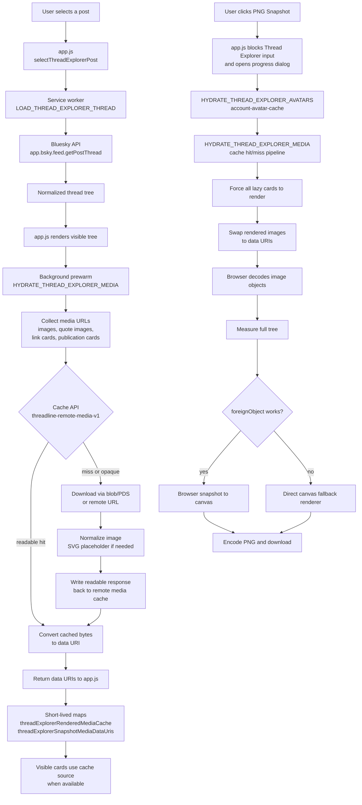

# Threadline Technical Notes

[Deutsch](TECHNICAL.de.md) | **English**

This file collects the technical background information that would otherwise overload the quick-start README.

## Modularization Complete — 2026-11-08

Application version `0.4.357`, shell cache `v376`. The entry points retain DOM/state wiring and message dispatch; domain behavior belongs to the Composer, tools, core, shared, AT Protocol and worker modules described below. Delegating entry functions preserve existing callers; extracted implementations were removed rather than duplicated.

The final boundaries are `archive-wave-controller.js` for resumable archive orchestration, `createWorkerRequestClient` in `app-storage.js` for request/progress/timeout/cancellation, `createApplicationTranslationRenderer` in `app-i18n.js` for live translated UI refresh, and `createRichTextPresentation` in `shared-post-rendering.js` for Unicode facets and search highlights. Dependencies are explicit. Archive date stopping now calls the existing media model instead of a removed global helper.

Completion validation: `npm run check` passed, including encoding/syntax, 857 unit/contract tests and all 150 Chromium browser tests with regular teardown. Both entry pages, the real Service Worker installation/cache activation and offline loading are covered. The mobile archive grid now constrains its tracks and export cards to the viewport. The Explorer screenshot has a committed Linux baseline plus geometry assertions. Use `THREADLINE_BROWSER_EXECUTABLE` to select a locally installed Chromium; the default remains Edge.

This closes the refactor. Live provider/account acceptance and the separately recorded PDF layout defects remain product QA tasks; the tests use controlled authenticated responses and do not publish live records. Optional user-triggered rollback remains a separate feature in TODO.md.

## Thread Publishing And Record Interactions

`js/worker/interaction-service.js` owns interaction gates, record deletion, likes and unlikes. `js/worker/publish-service.js` owns sequential publishing, media uploads, facets, reply chaining, gates and partial-error projection. Session, transport/PDS base, existing normalization/URI/rule/facet/upload adapters, Blob constructor and ISO clock are explicit. Existing publish/like/unlike worker entries delegate to lazy services; old bodies were removed, messages centralized and both scripts imported/precached.

Existing behavior remains: validation/auth ordering, threadgate then postgate writes, shared rkeys, rate-limit precedence, per-run mention cache, image limit, four-image/gallery boundary, card/image exclusivity, upload order, root/parent links and language normalization. A post is counted as completed only after gate setup; a failure there can leave a created post outside the completed-post list. Subsequent failures retain PARTIAL_PUBLISH counts/rate/retry/status details. No rollback was added; optional user-triggered rollback, immediate created-reference tracking and ambiguous-timeout reconciliation are now TODO items.

## Reply Eligibility And Post Edit Checks

`js/worker/reply-models.js` owns reply mode, explicit mention detection and threadgate eligibility. `js/worker/post-check-service.js` owns reply-target and repository edit-metadata checks with explicit session, URL/identity, transport, root/thread collection, PDS and error adapters. The existing two worker entries delegate to one lazy service; old bodies were removed, messages centralized and both scripts imported/precached.

Preserved policies include auth-before-URL processing, existing follower/following viewer semantics, mention matching, unknown list-rule warnings, newest-own-post selection in thread mode, selected/root fallback metadata and blocked-target errors. Thread reads retain depth 100, parentHeight 0, one retry and 20s timeout. Edit checks retain coded URL/actor/load/record failures, author-PDS selection, unauthenticated repository-record request options and original Mu-compatible edit fields. These workflows only read post data.

## Stored Settings And Draft Workflows

`js/worker/settings-models.js` owns persisted link cards/provider/proxy/usage, saved search results, segment overrides, posting history, reply targets, Explorer state and resize/expert flags. Publication metadata and ISO time are explicit adapters. `js/worker/settings-service.js` owns app-state loading and draft/settings saves with explicit storage, image persistence, field normalization, account and frontend dependencies. Existing worker names are bound to the model instance and three workflow delegates; old implementations were removed and both scripts imported/precached.

Behavior remains: legacy string drafts and locale fallback, settings-image versus draft-card precedence, raw reference retention where previously used, null-to-zero numeric coercion, per-field patch/reset rules, compact-mode persistence, unknown-field retention and existing language normalization (including legacy scalar language values). Draft saves store image bytes before metadata, then prune; settings saves write settings then locale before pruning. Failed writes propagate and skip later pruning. No schema, field defaults or storage migration was introduced.

## Rich Text And Mention Workflows

`js/worker/richtext-models.js` owns UTF-16/UTF-8 offset conversion, byte-range overlap, link/hashtag/mention-candidate parsing and mention-query variants/ranking. The encoder and configured handle suffixes are explicit. `js/worker/richtext-service.js` owns mention facets, combined rich-text facets, preview handle resolution and account typeahead. Session, resolver, request/base, profile normalization and parsing models are explicit. Existing publish/preview/search callers delegate; the shared hashtag parser remains available to archive/search models. Old implementations were removed and both scripts imported/precached.

Preserved policies include regex boundaries/punctuation, UTF-8 indices, link/mention/tag overlap priority, sorted facets, undefined facets for plain text, successful duplicate mentions, unique unresolved handles, per-run resolver caches, optional preview auth, strict-to-broad sequential query variants, tolerated per-query failures, first-DID metadata, existing score/tie rules and twelve-result cap. No posting behavior or external account data was changed.

## Media Export Scan And Download Workflows

`js/worker/media-export-service.js` owns actor selection, author-feed scanning, archive/hashtag selection, manifest assembly and item downloads. Session, request/base, archive filter/post adapters, hashtag checks, existing media models, CID/URL downloads, timeout, extension, ISO clock and heartbeat timers are explicit. The lower-bound stop rule now belongs to `media-export-models.js`. Existing scan/download worker entries delegate to one lazy service; old implementations and unused facade helpers were removed. The new script is imported/precached and existing progress/error copy is centralized.

Preserved behavior includes 100-post paging, owner filtering, per-scan hashtag caches, post-list versus media-ID deduplication rules, final date ordering, year/range stop after processing a page and unchanged manifest/schema/version fields. Downloads authenticate before item validation, prefer CID over remote URL, retain 30s timeout and 10s heartbeat with finally cleanup, preserve existing extension fallbacks and return original byte references/metadata. No transport or persistence format was changed.

## Explorer Reactions And Media Export Models

Two further units are extracted. `js/worker/explorer-reaction-service.js` owns likes/reposts/quotes loading, actor normalization/filtering and stable DID-or-handle deduplication. Session/refresh, request/base and actor normalization are explicit. URI validation still happens before authentication, unknown-type validation after auth refresh; limits, optional CID, cursor trimming, endpoints and error propagation remain unchanged. The existing worker entry delegates to one lazy service; messages are centralized.

`js/worker/media-export-models.js` owns UTC filename timestamps, post folders, indexed path stems and image/video/card manifest entries. It reuses the existing archive embed extractors and Blob CID adapter. Original invalid-date sentinels, rkey sanitation/length, source indices, image/video/card order, alt limits, dimensions, MIME hints, inclusion flags and thumbnail CID/remote-URL forms remain unchanged. The existing scan uses thin folder/entries delegates; scan/download orchestration remains separate work. Old implementations were removed and both scripts imported/precached.

## Explorer Avatar And Media Hydration

`js/worker/explorer-hydration-service.js` owns avatar hydration, readable media-cache access, cache/download deadlines, direct-versus-blob fallback, heartbeat progress and media hydration. Auth/refresh, avatar storage/models, Cache/Response access, downloads, Blob URL parsing, image normalization, conversions, concurrency, clocks and timers are explicit adapters. Author and media-entry collection now extend `explorer-models.js`; recursive collection preserves first-media-URL ownership and explicit-entry priority. Existing avatar/media worker messages and the shared timeout caller delegate to one lazy service. Old bodies were removed and the new script is imported/precached.

Existing behavior remains: avatar TTL and same-DID replacement, four-avatar/16-media concurrency, 1.5s cache-match/body deadlines, 12s direct and 30s item deadlines, 5s heartbeat, known-blob routing before direct fetch, per-image failure tolerance, SVG placeholder normalization, progress counters and heartbeat cleanup. Cache writes start during hydration and remain asynchronous; hydration does not await their completion. Cache match/body failures become misses; cache-open errors retain their original propagation behavior. Avatar results retain the existing TTL/count shape and persist assets in the shared avatar key.

## Explorer Feed Rules And Loading

`js/worker/explorer-feed-models.js` owns saved/pinned source parsing, relationship source/endpoint/profile rules, stable chronology, actor modes and saved-search parameters. `js/worker/explorer-load-service.js` owns source enrichment, timeline/generator/search/relationship feeds, actor feeds, post-URL resolution and complete selected/root thread loading. Session/refresh, transport/base, handle/URL/graph/error adapters and feed/post models are explicit. Five existing worker entry functions delegate to a lazy service; old implementations were removed and both scripts imported/precached. Existing messages are centralized in `adapter-messages.js`.

Policies remain: legacy/current pinned preferences with saved-array precedence, 25-source enrichment with per-source fallback, eight-profile relationship batches with per-profile failure tolerance, strict relationship flags, 12-post author previews, stable chronological sorting, 25-URI existence batches, actor URI deduplication and five-page cap, four-page timeline/search cap, search root deduplication, original cursor semantics and target/page limits. Thread loading retains auth refresh, depth/parent heights, deleted-anchor short circuit and selected-path merge. Required transport/auth failures propagate.

## Worker Thread Explorer Record And Tree Models

`js/worker/explorer-models.js` owns normalized actors, post edits, post/quote/media records, deleted anchors, recursive trees, parent-chain reconstruction, selected-path merging, URI lookup and post counts. Standard.site metadata normalization is an explicit adapter. The record/tree API, extended by hydration collection helpers, is bound to the existing worker names after classic imports, before archive/analysis composition. Existing archive edit-metadata callers use the same implementation; old worker bodies were removed and the module is imported/precached.

Preserved contracts include direct-image precedence over gallery/nested media, quote embed priority, array/viewer/reply reference identity, placeholder shapes, replacing an existing selected reply during parent reconstruction, preserving sibling order and target/appended node identities during path merge, and excluding deleted anchors from counts while keeping them searchable. Models perform no network or storage operations. Feed/thread loading now lives in `explorer-load-service.js`; media/avatar hydration remains worker-owned for the next extraction.

## Worker Composer Image Models

`js/worker/composer-image-models.js` owns worker image edit/record normalization, inline segment normalization and metadata projections. ID generation and the per-segment limit are explicit dependencies; the worker binds the previous function names to one model instance. The image store and settings/draft callers use this same instance. Old model bodies were removed and the script is imported/precached.

The frontend `shared-images.js` and worker contracts are currently different: frontend edits carry `fitMode`, validation includes dimensions, and frontend inline-data acceptance differs. Worker metadata allows missing inline data and retains only its previous edit/validation fields. This extraction preserves both formats; unifying them would change persistence behavior. The differences are covered by a cross-contract test and tracked separately in TODO.

Remaining worker areas include Thread Explorer record/tree/feed models and loading/hydration, rich-text mentions, media export, settings/draft orchestration and posting/reply workflows. Thread Explorer record/tree models are now extracted; next extract their loading services. Keep equivalent-normalization review separate from behavior changes.

## Composer Image Persistence

`js/worker/composer-image-store.js` owns Composer image Blob reads/writes/key listing/deletion, reference collection, persistence reuse, hydration and pruning. Database opening, existing image/segment/metadata normalizers, Blob/data-URL conversion, general value reads, Blob constructor, ISO clock, store/key names and messages are explicit dependencies. Existing saveDraft/saveSettings/getAppState callers delegate through the worker facade; old image-store bodies and unused facade helpers were removed. The script is imported/precached and existing errors are centralized in `adapter-messages.js`.

The database schema and completion boundaries remain unchanged: multi-get resolves after all request successes, key listing resolves on request success, writes/deletes wait for transaction completion. Reads deduplicate normalized IDs; writes reuse existing Blob records when size/type rules match. Hydration keeps inline-data priority, converts persisted Blobs and drops images without data. Pruning preserves the union of draft and settings references. Existing normalization and conversion policies remain unchanged.

## Network Workspace Loading

`js/worker/network-workspace-service.js` owns network slices, actor focus, common mutuals and normalized profile merging. Session, profile request/base, graph waves/pages/full collections, relationship dates, activity/like data, sample sizes and progress messages are explicit dependencies. Existing worker entry functions delegate to one lazy instance; obsolete bodies were removed. The service is imported and precached, and existing visible copy is centralized in `adapter-messages.js`.

Behavior remains: 100..500 slice limits, profile lookup concurrent with sequential follower/following waves, tolerated slice-profile failure with the original fallback metadata/flags, own versus external viewer relationship flags, sequential focus stages with twelve-profile previews, short-circuit for missing/equal mutual actors, four complete graph reads, duplicate profile merging, center-follower intersection order and progress/error propagation. Profile merging keeps nonempty metadata/counts and cumulative relationship flags.

## Shared Network Data Access

`js/worker/network-data-service.js` owns recent actor-post sampling, notification-based reciprocal likes, activity windows, normalized graph pages/waves and follow-record dates. Request/base URL, profile normalization, URI parsing, clock, sample sizes and windows are explicit dependencies. Classic worker callers delegate to one lazy instance; analysis and Thread Explorer retain their shared graph-page adapter. The original implementations were removed, the script is imported/precached and graph progress messages are centralized in `adapter-messages.js`.

Existing policies remain: author filtering, cursor termination, 100-post page size, eight notification pages, distinct liked subjects, processing an entire notification page before stopping for age, inclusive activity windows (including future timestamps), an initial graph request even for a zero target, progress after every graph page and follow-record requests without an added base override. Transport and observer failures propagate. Network slice/focus/common-mutual orchestration and profile merging now live in `network-workspace-service.js`.

## Stored Account Lifecycle

`js/worker/account-service.js` owns account switching, public metadata import, removal, logout and session verification. Storage, session renewal, account models, frontend fallback, archive cleanup and the ISO clock are explicit dependencies. Worker entry functions remain thin delegates; the old implementations were removed. Failure precedence remains offline, missing password, invalid credentials, then signed out. Logout retains the stored app password and only clears archive session/catalog when logging out the active account. Removal retains the existing first-remaining-session selection policy. The service is imported and precached; messages use `adapter-messages.js`.

## Login, Session Renewal and Identity Services

`session-service.js` owns login, session renewal, mutable auth-reference refresh and JWT decode/validity helpers. Transport, URL/frontend, identity, avatar/cache, auth storage/models, clocks, base64 decoding, warnings and classic ensure/login bridges are explicit dependencies. Existing behavior remains: Mu.social email rejection and DID/handle-to-PDS lookup, original createSession credential payload, frontend branch priority, avatar persistence, explicit/active target DID, a 30s JWT safety margin, no-exp/no-payload policy, refresh before app-password login, warning/fallback and active-account persistence. Errors during the existing refresh block retain its broad fallback policy.

`identity-service.js` owns handle resolution, DID documents, PDS endpoint selection/memoization, avatar/frontend helpers and connectivity checks. Fetch/request, URL/error/storage, AbortController and scheduler/cleanup are injected. Positive/negative handle caches, existing PLC/web URL rules, 8s defaults/1s DID minimum, first PDS match and cached fallback remain. DID timers still clear when returning the JSON promise, rather than adding a response-body deadline. Connectivity retains its 8s abort and existing error codes. The two services are lazy-wired after worker dependencies are ready; classic client/session/JWT functions remain documented thin delegates. Old bodies were removed and both scripts are imported/precached; existing strings moved to adapter messages.

## Shared Worker Transport, Auth Models and Storage

`transport-service.js` now owns XRPC request parsing, GET serialization and rate-limit headers. Browser fetch, the classic GET-to-request bridge, URLSearchParams creation, service errors, clock, default API and existing messages are explicit. The classic `atproto-client.js` names remain thin mutable delegates to a lazily constructed service, preserving existing interceptors. Request option/header precedence, JSON/plain/empty bodies, metadata envelopes, 401 codes, seconds/date Retry-After and scalar/array query omission rules remain unchanged.

`auth-models.js` owns service URL/security rules, account/state normalization, public account/response projection and upsert. Default service/frontend, frontend inference, error creation and ISO clock are injected. Legacy single-account data, active DID selection, session identities, duplicate matching and public credential omission retain their contracts. `storage-service.js` owns existing store creation and shared general/auth read/write/delete operations. Database/store configuration, IndexedDB access and auth normalization are explicit. Schema version two, image keyPath id, nullish general values, falsey-auth fallback, opening before auth-write normalization and resolving writes on request success remain. Injected normalization errors reject the operation; transaction-completion semantics were not introduced. `adapter-messages.js` centralizes existing strings. Old implementations were removed; four classic scripts are imported and precached.

## Complete Worker Analysis Module

Worker analysis is now extracted as one cohesive block. `analysis-models.js` contains account matching, facet/quote/media/reply rules, frequency ranking, persisted analysis-state normalization and a mutable feed-page accumulator. The shared AT-URI parser is explicit. The accumulator preserves date boundaries before post exclusions, accepted-text-only frequencies, duplicate facets/languages, reply/quote filtering, post order and limits. The persisted snapshot retains its intentionally reduced schema.

`analysis-service.js` owns account validation/loading, saved-account session selection, complete graph collection, authenticated mute/block lists, profile enrichment and a private DID-profile cache. Session/storage, request/base, handle resolution, existing network-profile normalization, graph-page transport, service-error factory, clock and positive limits are explicit. Existing policies remain: 100..2000 accepted posts, 100-post pages, at most 200 feed pages, 100-profile graph pages with a 5000-profile cap that may overshoot by the final page, 25-DID enrichment batches, tolerated failed enrichment batches, unresolved-marker deleted flags, parallel graph warnings and source-account-only private lists. `analysis-messages.js` centralizes existing wording.

Fifteen old function bodies and the global cache were removed. Search still receives the same facet contract, settings still use the same snapshot normalizer, and network comparison still calls the shared complete-graph operation. The dispatcher binds the new check/load methods; all three classic scripts are imported and precached. Global network page normalization, generic transport/auth/storage and UI error classification remain explicit entry adapters rather than duplicated analysis code.

## Worker Thread-URL Import

`archive-import-service.js` exposes frozen `load`, `collect`, `enrich` and `result` operations. Source parsing/handle resolution, session/transport/base URL, existing archive models, asset service, run control, messages and export clock/version are explicit. Collection retains DID bypass, default path mode, root/reply classification, swallowed entry-request failures, missing-post results and the early cancellation boundary. Tree requests retain depth 100 and parent height zero without adding refresh/retry behavior. Selection delegates to the existing all/path/author models.

Metadata enrichment uses the existing archive post builder and retains raw references, last duplicate URI precedence, author/count fallbacks and descending date order. `archive-asset-service.attachThreadAssets` preserves the import-specific sequential policy: shared avatars, one card attempt with a 5s timeout, two image attempts with 350ms delay, normalized output bytes, fifth-image previews and cancellation between posts. It intentionally does not substitute the wave's concurrent asset policy. Result building retains the different missing/early-cancel/final schemas, original array identities and account/source-author metadata. Unexpected tree/observer failures still propagate with the prior lifecycle behavior; this extraction adds no recovery policy. The old entry implementation was removed; the new classic script is imported and precached, and existing messages are centralized.

## Worker Archive Asset Pipeline and Finalization

The existing `archive-asset-service.js` now exposes `attachLinkCards` and `attachImages` in addition to shared avatars. Blob/CID, embed-image extraction, cooperative wait, public URL, data URL and delay adapters are explicit and validated for each operation. Link cards retain two attempts, 350ms retry delay, a 5s download deadline, path deduplication, caches and progress/flags. The old success branch referenced an undeclared `normalizedBlob`; output assets now correctly use the normalized `blob`. A contract deliberately supplies different normalized bytes to protect this correction.

Images retain task order, bounded mapping, pause/cancel checks, retry/skip policy, descriptor/path rules, previews and progress. A live saved/skipped-count adapter retains partial mutations after failures. The prior distinction between normalized descriptor/preview data and original downloaded output-asset bytes is intentionally unchanged and tested. `archive-wave-service.finalize` centralizes every wave completion path and caught failure, releasing run state before result building and sorting partial posts only on failure. Cancellation/error messages and fallback classification remain unchanged; entry wiring retains explicit live state.

## Worker Archive Collection, Metrics and Avatars

`archive-wave-service.js` exposes frozen `readPage` and `enrichMetrics` operations. Requests, refreshed authentication, XRPC base, retries, cooperative wait, chunking, selection, hashtag lookups and messages are explicit dependencies. Page collection retains repo/feed distinctions, foreign-author filtering, raw references, oldest timestamps before filtering and caller caches. A live cursor/skipped-counter adapter preserves updates when hashtag selection fails midway; selected page records commit only after the whole page succeeds.

Metrics retain 25-URI batches, known-post updates, author fallbacks, second-batch previews and progress wording. Cancellation returns to the entry point for sorting, lifecycle cleanup and result building. Partial updates and transport/observer failures propagate. `archive-asset-service.js` provides shared `attachAvatars` for archive waves and thread import, with explicit download, image normalization, extension, bounded mapping and cache dependencies. URL grouping, slug limits, path deduplication and per-download failure clearing remain unchanged. The old implementations were removed; both classic scripts are imported and precached. Existing strings moved into the archive message file.

## Worker Archive Wave Preparation

`archive-source-service.js` owns profile resolution through `createThreadlineArchiveSourceService({request, base})`. The active-account fallback makes no profile request; explicit source DID takes precedence over handle. The supplied authentication reference, profile trimming/fallbacks and own-account flag keep their previous behavior. `sw.js` binds the old source helper to the service after imports; the old body was removed and the new classic script is precached.

The existing `archive-models.js` now exposes a fourth frozen API, `wave`. `wave.restore` builds the initial record list, raw/post maps and bounded cursor/page inputs. It preserves shallow post copies, fresh count/image containers, raw/nested identities, duplicate record order and last-entry map precedence. `wave.result` builds the existing manifest and continuation session from a current state snapshot with explicit export time/version. Returned post/asset arrays and filters retain their identities; status/error fields and the existing fixed session wave index one remain. The old local restoration/result implementations were removed; the wave entry retains live state assignments and a thin result delegate.

Ten new contracts and 79 old/new comparisons cover source transport, restoration, schemas and nine complete-wave fixtures. Browser coverage exercises the real wave caller for completed/cancelled/paused results while authentication, storage, network and avatar assets are controlled. These fixtures do not prove live collection or persistent/offline recovery.

## Worker Archive Thread Service

`js/worker/archive-thread-service.js` owns root/thread hashtag lookups, media hashtag selection, thread error classification, bounded thread requests and conversation-context expansion. `sw.js` constructs `createThreadlineArchiveThreadService` after archive models/run control and binds the seven previous helper names. Models, refreshed auth, transport/base URL, cooperative wait, AbortController/timer creation and cleanup, deadline/retry defaults and existing messages are explicit adapters. The seven old bodies were removed and the classic script is imported/precached. Progress/error wording now lives in the existing archive message file.

The service retains URI-keyed caller caches, direct-tag priority, root-only versus whole-thread scopes and missing-post caching. Hashtag requests share one auth/transport helper. Bounded requests still use a fresh controller/deadline before refreshing auth on each attempt, default to 15 seconds and one retry, and clear every timer in finally. The last transport failure and timeout/progress wording remain. Context expansion keeps a unique root snapshot, checks cooperative cancellation between roots, skips missing/timed-out conversations and passes real archive entities/raw records to the existing upsert callback. The legacy raw-record map argument remains accepted without additional mutation.

Twelve new contracts and 59 old/new comparisons passed for response envelopes, caches, auth/transport, timer order/cleanup, timeout retries, observer failures, cancellation, skip behavior and upserts. Two new browser cases load actual `sw.js` from both entry pages, verify all bindings/cache inclusion and exercise real AbortController deadlines with controlled auth/network responses. Full live archive-wave/thread-import and offline acceptance remain separate.

## Worker Archive Models

`js/worker/archive-models.js` owns frozen APIs for archive filters, thread selection/collection, post/embed models and the wave preparation described above. `createThreadlineArchiveModels` receives the existing hashtag normalizer/parser/text-facet parser, AT-URI parser, permalink builder, site/edit metadata helpers and image limit. The model has no network or storage access. `sw.js` constructs it after classic-worker imports and binds the existing 17 helper names; the wave caller uses the two additional wave methods directly. The old bodies were removed and the module is precached.

Existing contracts remain: source/enumeration defaults, normalized OR hashtags, year/inclusive UTC dates, missing-root/parent behavior, own-thread/main-path selection, depth-first order and duplicates, explicit node-reply priority, image limits, video/card priorities, raw-array/reference retention, permalink fallback and truthy merge precedence. Shared tree-node/reply helpers replace three repeated implementations. The extraction adds no graph-cycle handling or schema migration. New functions are documented and contain no ternaries.

Fourteen new contract tests load the actual worker import chain and shared adapters. A further 841 old/new model comparisons matched values, mutations and error categories. Two new browser cases load real `sw.js` from both entry pages, verify all helper bindings and cache inclusion, then exercise Unicode/date/ownership/tree/embed/schema/reference behavior without live network access.

## Worker Archive Run Control

`js/worker/archive-run-control.js` owns private per-run state, start/finish, pause/resume/cancel commands, cooperative waits, request retries and voluntary feed pauses. Scheduler, service-error creation and the existing text templates in `archive-run-messages.js` are explicit dependencies. `sw.js` binds the six existing helper names to the controller and delegates run lifecycle operations in archive waves/thread imports; the six old bodies and public state map were removed. Both scripts are imported by the classic worker and precached.

Behavior remains unchanged: pause polling at 350 ms, sleeps in at most one-second chunks, retryable HTTP/message classification, Retry-After priority over capped 30/45/60-second backoff, four default retries, progress/checkpoints, and 3/10-second voluntary pauses after 25/100 pages with expert-mode bypass. Cancellation during the last sleep chunk is still observed at the next caller checkpoint. Run identity, unknown commands, reset/cleanup and existing service error codes retain their previous rules.

Twelve new contract tests and 100 old/new workflow comparisons passed, covering state isolation, lifecycle, pause/resume/cancel, empty/invalid duration inputs, chunk boundaries, retry classification/limits, backoff, progress and feed thresholds. Two new browser cases load the real `sw.js` from both entry pages, exercise actual controller bindings and timers for pause/resume/cancel plus a controlled request retry; virtual delays cover longer retry/feed pacing.

## Worker DM Service

`js/worker/dm-service.js` owns chat access checks, paged partner collection, missing-profile and avatar hydration, and selected-partner archive collection. `sw.js` constructs `createThreadlineDmService` after the shared DM models and binds its four operations to the existing message handlers. Authentication, chat/profile transport, XRPC base, account-avatar lookup, remote/blob downloads, CID/extension resolution, ISO clock, random IDs, cache version and text formatting are explicit adapters. The five old function bodies were removed. Both new classic-worker scripts are imported and included in the shell cache; app/cache versions are `0.4.357`/`v376`.

The service retains partner pagination and latest-contact selection, optional asset skipping, 25-profile batches, copied hydration inputs, deduplicated avatar paths, best-effort assets, cached-partner fallback, message pagination, inclusive UTC dates, sender enrichment and URL/CID card thumbnails. Existing cache mutation and participant-count rules remain unchanged. Both partner paths now share one avatar attachment helper. `dm-messages.js` centralizes the existing German progress/error wording and formats literal placeholders; this extraction adds no locale switching. New service code uses documented functions and if/else branches without ternaries.

Eleven new contract tests exercise required adapters, text, auth/transport failures, pagination, latest-contact selection, empty/malformed collections, profile batching, input copies, asset failures/deduplication, cached/fallback collection, UTC boundaries and card downloads. Eighty direct comparisons with the previous worker code matched data, cache effects, transport calls and progress across success, empty, malformed and failure cases. Two new browser cases load the actual `sw.js` import chain in classic workers, assert existing caller bindings/cache assets, and exercise collection/hydration/export from both page entry routes with controlled adapters.

## HTML Archive Cleanup

The first cleanup removed the unused inline `buildArchiveHtmlDocument` implementation and its private toolbar-text helper: 1,188 lines of obsolete code. The subsequent extraction below now owns the active template export as well. `app.js` supplies the active catalog, shared adapters and composition.

`tests/browser-archive-export.test.cjs` exercises full and compact downloads through the real export buttons, starting from both application pages. Controlled worker responses supply a two-post thread and a local image. The downloaded HTML is loaded in the browser to check thread grouping, literal text, embedded versus deferred images, working search and absence of page errors. This does not verify live archive collection or offline cache activation.

## Active HTML Archive Export

Three domain modules now own the active export:

- `archive-html-models.js` owns parent-first grouping, capped depth maps, hashtag/link collections, date/URL display data, translation subsets, document metadata and the 48 MiB embedding recommendation. Grouping and URL display helpers are also imported by existing PDF/DM callers; no second local implementation remains. Scope labels now use the existing translation keys instead of embedded German copy. Cyclic parent records no longer recurse indefinitely during depth calculation.
- `archive-html-rendering.js` clones reusable structures from `templates/archive-html-fragments.html` and fills them with DOM methods and `textContent`. Post cards, groups, image modes, edit markers, external cards, link rows, metadata and tags retain their CSS selectors and client interaction data. The existing shell and client script remain the standalone-document envelope. Shell slots are replaced in one pass, so literal placeholder text from archived content is not interpreted as another replacement. Bootstrap JSON retains script-boundary escaping.
- `archive-html-export.js` owns the cached three-file template loader and export orchestration. Avatar completion, data-URL encoding, rendering, progress, UI yielding, file construction and delivery are explicit adapters. Buffered/full, requested compact, size-triggered compact and one rendering-size retry preserve the previous progress, filename and error rules. The entry point retains only the active-catalog delegate and factory wiring.

The fragment asset and all modules are precached. Nine new unit/contract tests cover ordering, cycles, empty/invalid models, date/URL boundaries, the exact size threshold, template caching/failure and export/fallback/delivery branches. Thirty-six extraction-time comparisons matched the previous models, size policy and export workflows.

Four targeted browser cases cover both application entry pages, full/compact HTML, ZIP download/reimport, actual archive/analysis PDFs and direct template edge cases. They collect page errors and check literal HTML/script/placeholder text, metadata escaping, edit dialogs, card thumbnails/fallbacks, link indexes, repeated rendering and empty output. The long-name fixture exposed a narrow-screen intrinsic-width overflow; zero-minimum grid tracks, shrinkable author areas and wrapping contain it. Geometry is checked at 390 and 1100 pixels, with a mobile screenshot inspected. These tests use controlled worker responses, not live archive collection or offline-cache activation. The known unrelated Thread Explorer screenshot failure remains outside this focused run.

## Shared ZIP Codec

`js/shared/shared-zip.js` owns buffered stored-ZIP generation, incremental writing, CRC-32, UTC DOS timestamps, directory assembly and the existing local-record reader. Its only export, `createStoredZipCodec`, receives UTF-8 encoding, a clock and localized error-text callbacks and returns `build`, `parse` and `createWriter`. The reader still supports uncompressed local records only; this extraction does not add compressed ZIP, ZIP64, data-descriptor or archive-integrity validation support.

Archive import/export and media streaming now use the same codec instance. Catalog serialization and media progress/cancellation now belong to the archive domain modules described below; `app.js` supplies file-picker and state adapters. The old ZIP implementations were removed, the closed-writer text was centralized in all three locales, and the module is included in the service-worker shell cache. The shared PDF and Canvas boundaries are described below.

Eight contract tests cover required adapters, UTF-8 names, binary/empty payloads, standard CRC-32, UTC timestamps, directory offsets, byte subviews, duplicate names, unsupported headers/compression, streamed/buffered parity, repeated closure and sink failures. An extraction-time comparison against the pre-extraction implementation passed 45 checks for buffered bytes, parsed content and streamed bytes across five archive fixtures and three dates. The browser export tests now download a real ZIP, import it through the file input and export HTML again from both page entry paths. These controlled tests do not exercise a real media scan, native file-picker streaming, live accounts or offline cache activation.

## Explorer View Preferences And Saved Searches

The existing explorer controller now provides one optional-storage preference factory, instantiated for orientation and view mode. Storage/key, normalizer and fallback are explicit. Page restore assignments and the restore timing when opening the explorer remain unchanged.

`search-models.js` owns saved-search URL parsing, labels/metadata, normalization, lookup and URL/full-preference construction through `createSavedSearchModels`. Translation, shared preference/URL/label helpers and ISO/timestamp/random adapters are injected. Existing host/path/query checks, case-sensitive sort normalization, legacy versus full-preference fields, preference-sensitive deduplication, ID format and 100-entry limit remain. The page constructs it after the shared search models; the old bodies and unused parser helper delegates were removed.

The existing rendering module owns saved-search list rendering and context-field configuration. Entry actions remain page adapters. Search context hides URL/add controls; archive/explorer contexts retain them. Existing templates and literal text are reused. The remove SVG now lives in both HTML templates instead of being constructed with innerHTML, and the unused string icon builder was removed.

`createSavedSearchController` in the existing `search-controller.js` now owns saving full filters, adding URLs, removal and application in search/explorer/archive. Collection access, models, preference normalization/equality, persistence, clock, status/dialog and workspace effects are explicit adapters. State assignments and DOM access remain in the page. Preference-based versus case-insensitive URL duplicate rules, empty-form checks, active-reference cleanup before persistence, usage timestamps and legacy/full preference selection retain their previous behavior. Search invalidation runs synchronously before the first persistence await; applying the form still resets results and persists a second time. The page constructs the controller after the models and search-run controller. The six old workflow bodies and two unused constructor delegates were removed.

Nine additional contract tests cover required adapters, each meaningful-filter branch, duplicates, invalid URLs/IDs, reference cleanup, application/persistence order, invalidation before deferred persistence and storage failures. Sixty old/new workflow comparisons passed. Four additional browser cases on both entry routes exercise real URL-add/duplicate/invalid actions, archive/explorer selection, active-reference removal/reload and late search replies with controlled worker/settings responses.

Eleven new contract tests cover storage/fallback, URL/parser boundaries, deterministic IDs/clocks, normalized formats/deduplication/limits, legacy labels/metadata, lookup and dialog contexts. Seventy-four old/new comparisons passed. Four new browser cases on both entry routes exercise real local view storage/reload/explorer-open restore and real saved-search save/load/reload/remove, literal labels, SVG templates, contexts and mobile button bounds.

## Explorer Selection Storage, Favorite Models And Replies

`thread-explorer-controller.js` owns optional selection storage with injected storage/key, active account/source, source normalization and ISO clock. The stored schema, source restoration and existing account rule remain: an explicit saved account is rejected only when the active account is also explicit and differs. Restricted storage, malformed JSON and missing selection are tolerated. Page adapters retain assignments made during restore.

`thread-explorer.js` builds search/root favorite models through explicit author-label, preview, web-app and clock adapters. Existing field/schema behavior is retained, including search-field trimming versus untrimmed thread fields and the selected reply URI for root favorites. Both page callers delegate to one builder. The same module now owns recursive tree and direct-parent lookup without changing identity or traversal order.

`thread-explorer-rendering.js` renders loaded replies through the existing actor template. Labels remain literal; role, tab stop and Enter/Space activation remain. Selection/persistence/render/focus/dialog-close effects are explicit page callbacks; the renderer does not fetch or replace the loaded thread.

Ten new contract tests cover storage schema, accounts/source recovery, malformed/blocked storage, deterministic favorite fields, missing identities and tree traversal. Ninety-six extraction-time old/new comparisons passed. Four new browser cases on both entry pages use real LocalStorage and reloads, reject a different account, exercise template reply labels and mouse/Enter/Space selection after repeated rendering, and check empty output and mobile containment. Existing search/favorite flows exercise the shared builder as well.

## Explorer Feed Models, Selection And Favorites

The existing `thread-explorer.js` owns feed merging, optional root grouping, date timestamps and stable newest-first sorting. It preserves the first item identity, created/indexed/zero timestamp fallback and source order for equal dates. Selection resolution keeps current, lazily read stored, then first-feed-item priority with exact URI membership and the outside-feed option. Selection persistence adapters remain in the page.

Favorite normalization also belongs to that module, retaining first-root deduplication, archive fields, 260-character previews and the 100-entry cap. The controller module shares insert/remove/persist operations between search and thread callers; page callbacks retain status and workspace updates. The rendering module fills the existing favorite template with literal text and injected load/remove handlers. Previous implementations and duplicate save logic were removed. Search cards now read the current favorites getter during rendering instead of capturing the initial list; saving/removing updates their saved indicator.

Ten new contract tests cover feed order/identity/invalid inputs, selection and lazy storage reads, favorite format/limits, updated-state persistence and failures. There are 187 extraction-time old/new model comparisons. Four new browser cases on both entry pages check feed template order, selection, repeated favorite rendering without duplicate events, literal content and real search favorite save/reload/dialog/remove flows including saved indicators and mobile button bounds. Worker/settings storage are controlled fixtures.

## Explorer Feed Sources, Gallery Fullscreen And Focus

The final focused browser run uses a 60s per-test limit. A prior 30s run timed out during page navigation; the project default timeout remains unchanged.

`thread-explorer-controller.js` owns account-scoped pinned-feed loading. Shared feed state remains explicit; duplicate starts for the same account are skipped. A new account may replace an outstanding request, and old-account or logged-out replies cannot update feed state or clear the replacement run loading flag. The existing 60s request, empty/error behavior and once-per-account cache remain. `thread-explorer-rendering.js` renders the select through the existing option template with literal labels and explicit source/disabled state.

The gallery fullscreen controller owns native fullscreen attempts, iOS/API fallback, Escape/arrows and close priority. The fallback flag is private; browser/device, native fullscreen and visual/dialog adapters are injected. The page retains body/element class wiring. Native success/rejection/exit paths are tested with adapters; actual OS fullscreen is not claimed.

The focus controller owns exact URI lookup, selected/root/cluster target resolution and measured card reveal. The layout module calculates pan from DOM rectangles and alignment. Reveal now updates both page and viewport-controller coordinates before rendering; center alignment and the default 24px inset are retained.

Ten new contract tests and 96 old/new pan comparisons passed. Four new browser cases check stale account replies, real select templates/literal labels, and rendered card centering at 390/1100 pixels on both entry pages. The existing real gallery tests additionally check rejected native fullscreen and Escape leaving fallback before closing the dialog. The focused batch passed 540 unit/contract tests and 28 browser cases; syntax, encoding, asset contracts and diff whitespace passed.

## Explorer Toolbar, Gallery Selection And Render Scheduling

`thread-explorer-rendering.js` owns toolbar availability, account input/field visibility, mode labels, saved state and ARIA presentation. Controls, normalized workspace state, translation and note/feed rendering are explicit inputs. Focused account input remains untouched. Three contract tests and 256 extraction-time old/new comparisons cover authentication, tree/loading state, account/focus modes, orientation, saved status and fullscreen combinations.

The existing `thread-explorer.js` owns gallery image/index state and selection orchestration through `createThreadExplorerGalleryController`. It reuses the existing thumbnail template, normalizers and gallery renderer. Open/render/step/current operations preserve clamping, wrap-around and invalid/empty handling; image-error fallback reads the controller current image. Three new contract tests cover selection and replacement. Fullscreen behavior is now owned by the controller described above; native/DOM integration remains injected.

`thread-explorer-controller.js` owns edge frames and focus frames/timers. Edge requests coalesce and recheck cluster/drag/inertia guards at execution. A new focus request cancels old frames and the delayed pass, preserving the two-frame layout wait and 80ms settling pass. Three tests cover guards, replacement and cancellation. Previous page implementations and selection/frame globals were removed.

## Explorer Lazy And Snapshot Hydration

The existing `thread-explorer-hydration.js` owns the lazy-card observer lifecycle: prepare, reset and forced snapshot hydration. Root/stage access, selected URI, forced mode, observer construction and card hydration are injected. The observer retains its existing 900px margin and zero threshold. Selected/forced cards and unsupported browsers hydrate immediately; deleted anchors are skipped. Reset now invalidates queued callbacks from the old observer, so they cannot hydrate stale cards or unobserve through a replacement observer.

The same module owns snapshot avatar requests, the 120s timeout, phase filtering, translated counters, progress mapping from 5 to 17 percent and optional-error versus cancellation behavior. `thread-explorer-media-hydration.js` owns snapshot-media progress mapping from 18 to 27 percent over its existing transport workflow, preserving the 420s timeout and result/error/abort rules. Translation, request, progress, abort and asset-result adapters remain explicit. The page keeps cache initialization and DOM/asset wiring. The unused media-prewarm function and its exclusive controller/generation state were removed after verifying that it had no callers.

Ten new contract tests cover observer reuse/reset, stale callbacks, selected/forced/fallback/deleted cards, payloads, zero/invalid counters, response identity, optional failures and aborts. Thirty-six extraction-time comparisons match old/new snapshot requests, progress and results. Four new browser cases on both entry pages use real IntersectionObserver events and rendered templates, force snapshot content, decode real local PNG images, apply avatars to replies/quotes and exercise aborts before/during transport. Transport replies remain controlled.

## Explorer Anchored Zoom, Reset And Card Neighborhoods

`thread-explorer-controller.js` now owns absolute, point-anchored and viewport-center zoom, as well as a separate reset controller with private timer and remembered zoom. Viewport measurements, state updates, rendering, edge scheduling and timers are explicit adapters. `thread-explorer-layout.js` calculates the anchored transform, preserving the same stage point under the cursor after clamping to 0.01–2. Invalid measurements/anchors are ignored. Page and existing viewport-controller coordinates are synchronized through one page adapter.

A single reset click defers fitting by 220ms; a double click cancels it and toggles between 100 percent and remembered zoom around the viewport center, retaining the 8 percent restore minimum. The layout module also owns reply-cluster node lookup and neighborhood bounds for the selected card and its direct children. Grandchildren remain excluded in both tree and cluster mode. The previous page implementations and reset globals were removed.

Ten new contract tests cover point invariance, clamping, invalid values, controller synchronization, reset replacement/cancellation/restoration, lookup and neighborhood boundaries. There are 138 extraction-time old/new comparisons. Two new browser cases exercise the actual page zoom buttons and rendered template fixtures on both entry pages at 390/1100 pixels. Measurements check the fixed anchor, scale, restore and direct-child bounds; reset events check fit cancellation and delayed single-click fitting. These remain controlled fixtures, not full-tree or live account acceptance.

## Explorer Pan, Card Focus And Worker DM Models

The existing `thread-explorer.js` owns a pan controller with private frame/velocity state and explicit frame, clock, movement, drag and visual adapters. Restarting preserves the release velocity: the previous start path cleared it before checking the threshold. Cancellation clears pending frames; edge rendering resumes after the final frame. Four contract tests cover movement/decay, thresholds, invalid samples, cancellation, replacement and delayed frames.

The existing `thread-explorer-controller.js` coordinates delayed card selection, mouse double-click, touch double-tap and focus restoration. Timers and the last tap are private; focus/viewport state, neighborhood bounds, fit, selection and target predicates are explicit adapters. Restoring a focus also synchronizes the page viewport controller. Five new contract tests cover selection replacement/cancellation, ignored targets, absent bounds, the inclusive 320ms touch boundary, zoom limits and restore. DOM measurements remain page adapters; neighborhood collection is now owned by the layout module as described above.

`js/worker/dm-models.js` exposes a frozen classic-worker API for UTC date boundaries, filters, conversations, messages, embed/facet priority and external link cards. Missing IDs use an injected UUID adapter. Raw data identity, field fallback order and archive format remain unchanged; the previous implementations were removed from `sw.js`. Seven new contract tests and 100 extraction-time old/new comparisons passed. The asset is precached and imported before caller composition.

Four new browser cases on both entry pages use rendered card templates to check pan movement/cancellation, focus geometry, selection timing, restore, native controls and touch events. The classic-worker cases additionally exercise real DM aliases and UUID/date/card operations loaded through `sw.js`. These are controlled fixtures, not real account, full-tree or offline acceptance.

## Worker Search Filters And Runs

`js/worker/search-filters.js` owns local text/phrase/exclusion, tag, UTC date, mention, language, domain, URL, media and post-type predicates, plus normalized result/repost metadata and sorting timestamps. Its factory receives query operations, the existing facet extractor and the shared post normalizer explicitly. The frozen API exposes only `matches`, `item` and `timestamp`. Existing tag-prefix matching and unknown-date behavior are retained; the old implementations were removed from `sw.js`.

`js/worker/search-service.js` owns authenticated network/author-feed paging, variant merging, URI exclusion, progress, mode routing and a private run-control map. Queries, filters, XRPC, base URL and authentication are injected. Existing endpoints, payloads, cursor formats, ordering and paging policies remain. Runs register before awaiting authentication, so a cancel signal during authentication is retained. Awaited routing releases run entries in `finally`, including multi-variant, validation, authentication and transport failures. Late or unknown controls return `ok: false` and do not recreate completed runs. The worker entry point binds the service's `load` and `control` operations to the existing message dispatcher.

Eight new filter tests and eight service tests cover normal, boundary and invalid cases, real query/filter composition, transport arguments, deduplication, variants, author/repost modes, paging limits, partial cancellation and cleanup. There are 107 one-time old/new filter comparisons. Classic browser workers load the actual `sw.js` on both pages and exercise real filter/facet/post adapters and service wiring with controlled transport/authentication, including a partial-result cancellation. Live account access, Service Worker activation and offline behavior remain separate acceptance work.

## Thread Explorer Viewport Geometry

The existing `thread-explorer-layout.js` now owns rendered-to-stage rectangle conversion, content bounds, rectangle merging and padded/clamped viewport-fit calculation. `app.js` measures the DOM and applies the returned zoom/pan through the existing controller; its previous math and merge implementation were removed. Valid-input behavior, padding and default zoom limits of 0.08/1.85 remain unchanged. Invalid or absent measurements do not produce a new transform.

Six new contract tests and 64 extraction-time old/new comparisons cover negative coordinates, hidden cards, limits, defaults, centering and invalid bounds. Two browser cases use rendered template-based card fixtures on both entry pages at 390/1100 pixels; all measured cards remain inside the viewport and reverse conversion recovers the original coordinates. Representative fixture screenshots were inspected. This verifies viewport geometry, not the full Thread Explorer layout or the known full-tree snapshot timeout.

## Worker Search Query Planning

`js/worker/search-queries.js` owns the classic worker's pure search mode/sort/tag/language normalization, exclusion-query formatting, searchPosts parameters, author-feed fallback decision, language/tag request cross-product, per-variant cursor codec and continuation URI set. It exposes one frozen `ThreadlineSearchQueries` namespace; `sw.js` imports and explicitly binds its 14 operations. The old declarations were removed. Filtering and paging are now owned by the modules above; authentication and persistence remain explicit entry-point adapters. The existing eight-tag/three-language limits and cursor format are retained. Page and worker exclusion-query contracts are compared without changing their module formats.

Seven new contract tests cover normal/boundary/invalid inputs, server parameters, variants, cursor exhaustion and malformed data, URI deduplication and page/worker query agreement. A one-time 33-case old/new comparison passed. A browser worker imports the real `sw.js` and checks the imported operations through their actual worker callers, including local post matching. It does not simulate Service Worker installation, cache activation or live network/auth flows.

## Snapshot Export Lifecycle

The existing `thread-explorer-snapshot.js` module now owns the progress dialog, a private active AbortController, duplicate-start protection, PNG delivery and final button/dialog cleanup through `createThreadExplorerSnapshotExportController`. Rendering, filename, download, paint/wait, translation and control refresh are explicit adapters. Preparation/rendering helpers and the large-media confirmation stay in their existing domains; the entry point delegates download/cancel and supplies the real elements. Old progress/export implementations and the global abort controller were removed.

Five new contract tests cover success, progress limits, missing optional nodes, render/delivery failures and retry, duplicate starts, and cancellation during a paint or render. Two focused browser cases load both pages, operate the real progress dialog with controlled PNG rendering, download a valid PNG, cancel a second run, collect page errors and check dialog containment at 390 pixels. The progress screenshot was inspected. This validates the lifecycle with controlled rendering; it does not resolve the known full-tree snapshot screenshot timeout or verify all media/layout cases.

## Search Form And Run Orchestration

The entry point now composes three explicit boundaries: `search-models.js` for localized summaries/progress/share URLs/saved labels, `search-form.js` for controls, URL imports, language/sort constraints and private 30/280 ms timers, and `search-controller.js` for worker pages, cancellation, persistence and restored results. The existing preference normalizer in `search.js` now also owns post-type aliases/defaults; its duplicate in the entry point is removed. Shared result-state helpers remain authoritative.

Continuation compares effective request filters, ignoring the source URL field and resolving the implicit own-account actor. Startup passes account identity from the same saved bundle before global authentication state is applied. Reset and saved-query selection invalidate pending replies; late progress, result, error and cancel-finalization callbacks cannot overwrite a later run. Form changes refresh continuation controls, and search language changes refresh disabled sorting options. Loaded status is restored after generic translation updates. Storage schema and worker message contracts are unchanged.

## DM HTML And PDF Export

`dm-export-models.js` owns partner/contact merging, conversation titles, filenames, chronological message enrichment, valid date ranges, external preview precedence and the standalone translation subset. `dm-pdf-rendering.js` owns A4 bubble measurement, pagination, Canvas pages and shared PDF link annotations. Drawing, timestamps, asset decoding, catalog models and Canvas creation are explicit adapters. The existing `dm-archive.js` export controller retains progress, files and delivery and now awaits the HTML builder. The entry point retains current-catalog delegates and factory composition; previous implementations and the obsolete inline rich-text HTML helper were removed.

`dm-html-rendering.js` caches the shell, inert fragment templates, CSS and search client from `templates/dm-html*`. It clones templates, assigns literal text and attributes, and serializes them into a standalone document with embedded assets, styles and script. One-pass shell substitution preserves literal placeholder text; bootstrap JSON escapes script boundaries. Failed loads can retry. The document declares the active locale; regional browser languages resolve to supported language codes for search status. Search escapes regular-expression characters literally and creates highlights from a template. Long names wrap within the viewport, with separate sender/handle lines. Link cards without a thumbnail use the full text width. All seven new assets/modules are precached in cache `v357`, application `0.4.338`; storage and archive formats are unchanged.

Seven new unit/contract tests cover models, fallbacks, invalid adapters/data, oversized and empty PDF pages, sender alignment, avatar cleanup, link coordinates and template-load retries. Nine targeted browser cases pass, including actual HTML/PDF downloads from both entry pages. The three DM cases were rerun successfully after final search/template/CSS changes. Direct rendering checks literal markup/script/slot text, cards, empty output, missing fragments, cached source loads, regional language status, literal special-character search, highlights/reset and document containment at 390/1100 pixels, collecting page errors. Representative HTML screenshots and one Poppler-rendered DM PDF page were inspected. Worker/account data are controlled; live accounts, long-message PDF layout, offline activation and the full browser suite remain separate acceptance work.

## Archive Source Validation And Template Layout

`archive-source.js` owns source normalization, the private request version and debounce timer, worker validation, profile/status persistence and shared-picker selection. It retains the 1800 ms delay and worker contract. Input changes invalidate pending replies immediately, including the window before deferred validation starts; replies also compare their captured input. Immediate validation, blur and picker selection cancel the pending timer. Shared input/change events and catalog invalidation are retained. Form/profile/storage/timer/worker operations are explicit adapters.

The existing workspace-rendering module now also exports `createArchiveWorkspaceLayout`. Export cards, tools headings, content columns and action rows use four additional templates on both pages. The module moves the existing controls instead of recreating them, preserving values and listeners. The old heading builder, layout implementation and validation token/timer were removed from the entry point. Page event/busy wiring and global profile state remain there intentionally.

## Archive Workspace Presentation And Run Controller

`archive-workspace-models.js` owns localized run status, start hints, heartbeat formatting, background activity, catalog notices, control availability and summary counts. `archive-workspace-rendering.js` owns source identity, preview, description, results, progress and workspace rendering. Six templates on both entry pages replace the previous repeated DOM construction. Content is assigned through textContent; export callbacks are explicit adapters. The full-HTML size threshold and result export behavior are retained.

`archive-run-controller.js` owns wave loading and saved-session reuse, thread-URL import, session/catalog writes, pause/resume/cancel, clear and invalidation. Wave/thread progress now shares one handler while preserving their control-refresh policies. Worker message names, timeouts, payload formats and storage behavior are retained, including optional catalog-storage warnings. State reads/patches, normalized filters/catalogs, UI refreshes, clock and run IDs are explicit dependencies. Global state, form adapters and button/busy event wiring remain in the entry point. Source validation and dynamic card arrangement are now module-owned as described above.

## Shared Binary Assets And Catalog Avatars

`shared-assets.js` owns chunked base64, synchronous/reader-based Data URLs, remote binary downloads, MIME suffix selection and image bitmap decoding. Base64, Blob, FileReader, fetch, bitmap and localized error adapters are supplied explicitly. Existing empty/MIME/view behavior is retained; the Data-URL fallback error now comes from all three translations. Bitmap lifetime remains with the drawing caller. Backup, Thread Explorer, accounts and archive/DM exports share these implementations.

`archive-assets.js` owns post-avatar hydration and DM avatar-path propagation. It receives active account state, the existing primary-partner resolver and binary download/suffix adapters. Archive hydration retains self-account fallback, per-pass URL reuse, existing paths and optional download failures. DM hydration only propagates cached self/partner/contact/member paths and does not download more assets. Existing filename collisions retain the first asset, as before. `resolveStoredAccountAvatar` extends the existing shared account module with path, DID/URL and remote fallback precedence, including the prior avatarPath update. Cache state and restoration messages remain in the entry point.

## Catalog Files And Resumable Media Export

`archive-catalog.js` owns catalog normalization, ZIP/JSON/gzip-JSON loading and manifest/posts/assets ZIP delivery. Shared thread-depth calculation replaces the former duplicate recursion, including cycle protection. Malformed ZIP post data receives the localized import error. The stored format, record order, raw-record exclusion and existing image-reference rules remain unchanged; ZIP import still reconstructs only assets referenced by post images. Applying a catalog to application state and persistence remains in the entry point.

`archive-media-models.js` owns stable actor/filter/kind keys, the shared 250-entry part size, resume checks, sessions, post folders and batch post selection. `archive-media-export.js` owns session IO, scan/download worker messages, sequential streaming parts, skipped-media reports, picker pause, cancellation, progress and checkpoint updates. Worker requests, save-file picker, streaming ZIP writer, account/options/signal reads, notices and clock are explicit adapters. App event handlers retain busy state and control wiring.

Sixteen new contract tests cover formats, empty/invalid inputs, byte views, thread cycles, part boundaries, resuming, skipped downloads, cancellation, close failures and delivery errors. Six focused browser tests cover both app entry pages, actual ZIP/JSON/gzip imports, HTML/PDF downloads and a 251-entry media export with one failed download and picker cancellation before part two. Resume does not scan or repeat the completed part. Media output uses the real ZIP writer and a controlled writable/picker adapter; this does not verify native dialogs, filesystem permissions, real worker persistence or live downloads. Forty-four extraction-time comparisons match previous models, normal catalogs, streamed ZIP bytes, progress and checkpoints across completion, skip, picker pause and abort scenarios.

## Archive PDF Layout, Rendering And Volumes

`archive-pdf-layout.js` owns image grids/captions, preview measurement, post heights, capped thread indentation, A4 pagination and volume splitting. It retains the application's injected image limit and the existing rule allowing complete threads to exceed a volume limit. `archive-pdf-rendering.js` owns Canvas cards/pages, avatars, previews, images, JPEG encoding and PDF link annotations. `archive-pdf-export.js` owns avatar preparation, sequential page/volume assembly, progress and delivery. All environment and state access is injected; `app.js` retains composition and a small export delegate. Shared PDF/text/Canvas primitives are reused.

The old implementations were removed and all three modules are cached by the service worker. German, English and French volume/page/open-post/fallback-title labels now come from translations. Ten new contract tests cover boundaries, invalid dependencies, image limits, empty/oversized pagination, thread volumes, progress, sequential delivery and propagated failures. Three targeted browser tests cover real downloads through both entry pages and direct media/link rendering in three languages, collecting page errors. A one-time browser comparison against the previous implementation matched JPEG bytes and annotations on three localized pages after supplying identical labels, plus image geometry, measured heights, pagination and volumes. The English page screenshot was inspected.

This extraction preserves existing layout limits: the thread backdrop can cover volume/warning text in the header, and failed preview thumbnails can extend below their measured card area. These are recorded separately in TODO. Complete browser regression, offline activation, live catalogs and live-account DM PDF exports remain separate acceptance tasks.

## Shared PDF, Text And Canvas Primitives

Three shared modules replace the common implementations in `app.js`:

- `shared-pdf.js`: `createPdfFileBuilder` receives the live application/version label and clock and returns the A4 PDF writer used by archive, DM and analysis exports. Object order, JPEG streams, UTF-16BE metadata, escaped link annotations and UTF-8 byte offsets remain unchanged. The unused separate text-only PDF writer was removed.
- `shared-pdf-text.js`: `createPdfTextLayout` receives the existing facet resolver and exposes link runs, Canvas-font wrapping, text drawing and A4 link-coordinate conversion. HTML rich-text export uses the same link resolver. Facet authority, URL punctuation, blank-line handling and code-point splitting remain unchanged.
- `shared-canvas.js`: explicit Canvas-context functions own rounded fills/strokes, contained images and circular cover images. Archive/DM page layout and pagination remain in their existing callers; analysis keeps its renderer and layout modules. Snapshot-specific drawing is unchanged.

All three modules are precached and have contract-test assignments. Nine new tests cover adapters, normal/empty/invalid inputs, text/link geometry, image fitting, Unicode metadata, timezone offsets, PDF references and byte-correct cross-reference tables. Forty-seven direct comparisons against the previous implementation matched PDF bytes, text/link runs, wrapping, drawing calls and annotation bounds.

## Analysis Calculations

Five analysis units now have explicit domain boundaries: `analysis-config.js` contains multilingual lexicons and temporal buckets; `analysis-corpus.js` owns tokenization, frequencies and text metrics; `analysis-similarity.js` owns vector/set overlaps; `analysis-temporal.js` owns UTC profiles, histograms and timestamp comparisons; `analysis-stylometry.js` owns word chunks and Burrows Delta. Locale and clock providers are injected. `app.js` composes the analyzers and retains account/UI orchestration, not duplicate calculation implementations. All five modules are registered in the service-worker asset list.

Existing calculation semantics remain intact, including upper-middle median gaps, inclusive time windows, many-to-one timestamp matches and insufficient-sample Delta results. Invalid chunk limits now throw instead of allowing an unbounded merge loop. Contracts cover normal, empty, multilingual and invalid-input cases. Controlled-worker browser integration loads both pages, loads two analysis accounts, calculates a comparison, checks finite displayed scores and resets the result while collecting page errors. It does not verify live account requests, PDF export or offline cache activation.

### Analysis Accounts And Comparison

`analysis-accounts.js` owns worker/storage account normalization, JSON-safe storage projection and legacy network refresh detection. Corpus and temporal calculators are explicit adapters. Raw posts remain separate from normalized text samples; DID sets are rebuilt after storage restoration. Missing moderation lists remain distinct from available empty lists, and network load-state/fallback rules are preserved.

`analysis-comparison.js` owns the complete comparison model: metric distances, text/style/time similarities, network and interaction overlaps, moderation availability, direct relationships, weighted scores, confidence and label thresholds. Metric definitions now live in `analysis-config.js`. Calculation adapters and definitions are supplied at composition time; the entry point only delegates and applies results. Obsolete corpus/style/time wrapper functions were removed.

Tests cover normalization, JSON round trips, legacy field precedence, comparison branches, missing accounts and score/confidence thresholds. Browser integration now also saves and reloads the comparison and confirms restoration without additional account requests. Storage and worker responses are controlled; real IndexedDB persistence and live requests are not exercised.

### Analysis Summary And List Rendering

`analysis-rendering.js` separates summary/result display models from DOM rendering. Account summaries, comparison results, token chips, formatted statistic rows, percentage bars and titled pattern cards use reusable templates on both pages. Translation, numeric/date formatting, avatars, template cloning and output hosts are explicit adapters. Only runtime bar widths remain inline. Existing classes, order and translated copy are retained; duplicate token-list builders now delegate to one renderer.

Model contracts cover missing accounts/results, display-name/handle fallbacks, date/range copy and finite versus unavailable Delta. Browser contracts render the real templates on both pages in normal and compact modes, verify literal hostile text, rerender replacement, empty/invalid lists, bar clamping and card/track bounds at mobile width. The production load/compare/reload/reset test exercises the composed renderer too. Remaining network/pattern workspace and export orchestration are separate follow-up areas, not claimed complete here.

### Five Further Analysis Rendering Units

The same renderer now owns temporal summary rows and account/comparison cards, profile and overlap heatmaps, daily UTC timelines, resolved network profile chips and metric comparison tables. Summary/profile/metric formatting has exported DOM-free models. A shared four-column table renderer handles metric and temporal comparison rows; existing headers/row templates are reused. Translated table models are explicit renderer inputs.

Heatmap grids share axes/cell templates, retain the 0.08 intensity floor and consume the existing overlap calculator with the original ten-minute window. Timelines retain UTC ticks, clamped point positions and hour tooltips. Profile chips retain lazy avatars, handle/DID fallback, share and optional deleted status. Metric rows retain percent/number formatting and upper-only difference clamping. Dynamic heat/position properties remain inline; markup lives in templates on both pages. Obsolete chart/account builders were removed from the entry point.

Unit contracts cover empty/invalid model inputs and format boundaries. Browser contracts assert 84 heatmap cells, overlap/empty charts, five ticks, point clamping, deleted-profile visibility, four-column metric formatting, temporal partial/comparison states and replacement without duplicates, in both densities on both pages. Heatmap cell bounds are checked at mobile width. Live queries, PDF rendering and real-device touch interaction are not covered by these controlled tests.

### Pattern Definitions, Table Models And Complete Pattern Views

Five further units are module-owned: ordered corpus/network pattern metadata in `analysis-config.js`, network and temporal table models in `analysis-table-models.js`, and complete network/pattern workspace rendering in `analysis-rendering.js`. Both UI and existing PDF row adapters use the same translated table models. Network report definitions use explicit media metadata instead of a DOM-builder callback. PDF page generation itself is not extracted in this step.

Network rows retain complete/partial load distinctions, moderation source availability, overlap counts, direct relationships, top-marker shares and assessment text. Temporal rows retain missing medians, vector similarity, five-minute proximity copy and active-hour formatting. Network views retain first-warning precedence, reload-needed notes, three summary details, thirteen table rows and fourteen ordered pattern cards. Corpus views retain twenty-four account-paired cards, missing-account states, special empty emoji text, starts/ends dual lists and mixed stat formatting. All markup uses existing templates plus one network-summary template on both pages; unused entry-point list/card wrappers were removed.

Contracts cover metadata order, model boundaries and availability branches. Seventy-two differential checks in three locales matched the original table builders before removal. Browser tests cover network/pattern empty/partial/full states, moderation and warning text, literal labels, repeated rendering without duplicates, card counts and production comparison/reload behavior. PDF callers were updated and syntax-checked, but PDF export and live requests were not executed.

### Ten Analysis Controller Units

`analysis-controller.js` owns ten connected workflow areas: locale-aware formatting; active actor/options; status and inline notes; control states; snapshot capture; restoration; actor validation; individual loading; comparison; reset. Its explicit live-state adapter shares existing application state without changing storage schemas. Native controls, worker transport, normalization/comparison, storage, rendering, error reporting and locale are injected. Composition follows initialization of calculation factories; thin entry-point delegates preserve callers, including PDF formatters.

Validation retains per-slot tokens, inline errors and the 30-second timeout. Loading retains the 180-second timeout, progress ownership, sequential A/B comparison loads, expected-error logging suppression and current-request busy-state release. Reset invalidates load responses and restores the original defaults. Stored comparison summaries are recomputed from normalized accounts; legacy network records still suppress comparison and show the reload note. No PDF page rendering was moved here.

Contract tests cover locale changes, saved actor precedence, option limits, auth/loading/result control matrices, snapshot/restoration, empty/failed actor validation, superseded validation responses, progress, reset during loading, comparison order and expected/unexpected errors. Browser integration loads both pages and exercises account load, comparison, persistence/reload and reset. Real worker/PDS and IndexedDB behavior, PDF export and all possible request races remain outside these controlled tests.

### Ten Analysis Report Data And Layout Units

`analysis-report-models.js` owns filenames, metric/Delta rows, score summaries, token/stat text, paired corpus cards and paired network cards. It shares ordered metadata and the metric table model with the UI. Clock, copy, formatting and metadata are explicit inputs. Eight-token/eight-bar/six-profile limits and historical missing-account card behavior are preserved.

`analysis-report-layout.js` owns pattern-card, score/info and heatmap measurements, paired-pattern pagination, table-row measurements and table pagination. Canvas creation and text wrapping are injected. Both former pattern pagination paths now use one implementation. Font sizes, line heights, spacing, minimum body height, column ratios and oversized-row handling are unchanged. The subsequent renderer extraction below completes the active Canvas export path.

Thirty direct comparisons matched the original report models and page layouts before replacement. Unit tests cover metadata limits, absent/zero Delta, card contents, measured heights, empty/oversized pages and exact capacity boundaries. The Edge integration now clicks the real export button after restoring a comparison, receives the PDF download and checks filename, PDF header, EOF and nontrivial size. This exercises real Canvas/font measurements and report assembly but does not visually inspect PDF pages or test live account data.

### Complete Active Analysis PDF Renderer

`analysis-pdf-rendering.js` now owns the A4 Canvas shell, cached anonymous avatar loading, text/profile/bar card drawing, score rows, UTC heatmaps, overview/table/temporal/pattern pages, JPEG page assembly and PDF delivery workflow. The application supplies live read-only account/comparison adapters, report models/layout/tables, shared Canvas primitives, fonts/text wrapping, clock/formatters, fetch/bitmap decoding and PDF/file/delivery functions. `app.js` retains only factory composition and the export delegate; shared archive/PDF primitives stay shared.

Page order, numbering, image names/dimensions, JPEG quality, default headings, download preference and success/error flow remain intact. Avatar promises are cached per renderer, including failed loads. Three uncalled legacy text-PDF builders and unused export wrappers/cache were removed rather than copied into another module.

Contract tests cover drawing branches, A4 geometry, heat colors, credential omission, avatar deduplication/fallback, output order, missing comparison and delivery failures. Edge integration exports the real ten-page fixture and retains it under ignored `test-results/`. Poppler renders the report for representative visual review. That review exposed existing temporal-note font-measurement drift and bar labels obscured by tracks: the renderer now measures the notes with their drawing fonts and sizes the bar-label column from actual text width. Both fixes have regression assertions. Long-name/image-heavy reports, other real account data and every possible locale/page combination are not visually verified by this fixture.

### Analysis Events And Workspace Lifecycle

Analysis event bodies now belong to `analysis-controller.js`: own-account selection, field invalidation/token updates, blur validation, Enter comparison, filter changes and export busy/error feedback. The existing event binder receives the controller's handler object after factory initialization instead of entry-point closures. Fifteen unused actor/options/render/action delegates were removed.

`createAnalysisWorkspaceController` in `analysis.js` owns cross-page/auth navigation gates, shell transitions, ordered section rendering and analysis-specific label/placeholder refresh. It receives live state, renderer, table models, controller and shell actions explicitly. Existing state schemas, rendering order and text remain intact; `app.js` retains composition and necessary global integration delegates.

Contracts cover own-account/input events, slot-specific validation invalidation, Enter routing, export success/failure cleanup, navigation/auth guards, rendering order and current-locale labels. Browser integration operates own-account buttons, Enter comparison, input invalidation, persistence/reload and PDF export on the production composition; initialization errors are collected on both pages. Real authentication and native device interaction are not covered.

## Archive Dates And Preferences

`archive-preferences.js` separates local calendar parsing/formatting, month-end-safe month shifting, clock-based defaults, preferred-edge range clamping, browser date bounds, filters/source metadata, PDF/wave options and preference restoration. Clock, maximum months, live state, tag normalization and dependent UI refresh callbacks are explicit adapters. Existing three-calendar-month rules, scope/content/import modes, supported-select preservation, checkbox defaults and storage shape remain unchanged. The module is precached; entry-point implementations and unused imports/source wrapper were removed.

Contracts cover invalid dates, leap years, month ends, from/to/auto limits, defaults, supported versus invalid choices, metadata and callback order. Forty-eight direct comparisons matched the original range/bounds implementation before final verification. The Edge integration opens the real archive controls, checks January-to-April month bounds, changes content/image options, saves and reloads them, while retaining analysis/PDF/network regression coverage. Worker storage is controlled; real archive fetching and live account data are not exercised.

## Network Calculations

`tools/network.js` owns profile merging, score ranking/cutoffs, relation/text filters, limits and locale-aware alphabetical sorting. Existing rules are retained: empty profile fields and zero counts do not replace known values, relationships are combined, search results remain score-ranked and lists alphabetically sorted.

Viewport and content bounds are pure calculations in the same module. Zoom limits and the shared clamp function are injected; `app.js` only applies returned pan coordinates. Focus previews are explicit inputs. Fit padding, node sizes and focus-island spacing are unchanged. The existing service-worker asset entry remains valid.

Contract tests cover merging, filters, limits, sort ties, zoom/pan limits and focus geometry. Browser integration operates real network controls with controlled worker data and checks circle bounds within the fitted SVG after focus selection. Both pages load with page-error collection; live network queries are not exercised.

### Network Focus Controller

The network's `createNetworkFocusController` owns profile lookup/ingestion, bounded preview lists, selection and common-filter lifecycle, focus requests and common-mutual requests. State/maps, transport, progress/status rendering and input updates are explicit adapters. Viewer/node/focus/preview lookup priority, request timeouts, same-target suppression and loading-marker ownership are preserved. Selection-specific progress/errors stay scoped to the request target; no duplicate request workflow remains in `app.js`.

Unit contracts cover empty/missing profiles, deduplication, selection/filter transitions, response normalization, request failures and overlapping request completion. The browser test additionally loads common mutuals, uses their filter and changes selection to clear it. Worker responses are controlled; real PDS data and network races are not verified by this integration test.

### Network Loading, Geometry And Controls

`createNetworkDataController` in `network.js` owns the complete slice-loading sequence: actor selection/reset, cursors, progress, profile ingestion, counts, busy state and error feedback. State and existing reset/transport/UI functions are explicit adapters. Append behavior, request limits/timeouts and silent-error handling are unchanged.

`network-layout.js` owns stable relation slots, lane/ring spacing, density, round/squircle orbit points and paths, label candidates and focus-island dimensions. The controller reads current shape/maps through an adapter, including maps replaced during reset. The original numeric rules and 72-segment path remain intact; the module is included in the service-worker asset list. `renderNetworkLoadControls` in `network-ui.js` owns translated load/reset/own-account button states.

Contract tests cover cursor reuse, actor switches, append/no-op/error paths, stable slots, relationship changes, reset maps, dense layouts and control states. The browser test loads a second wave with the returned cursor, restores a saved squircle preference and checks focused SVG bounds. The existing shape button stays intentionally hidden by CSS; the test does not simulate a user click on it. Live worker/PDS interaction and offline cache activation remain outside this test.

### Network Stage Interaction

`createNetworkStageController` in `network-ui.js` owns anchored zoom, pointer pan, shape/reset actions, native fullscreen and app-internal fallback, focus/list/group switches, Escape/fullscreen lifecycle and two-frame scroll restoration. The existing event binders receive its handler groups; inline copies were removed from `app.js`. State, geometry/viewport, render operations, persistence and animation frames are explicit adapters, initialized after the layout/data/focus controllers.

Contract tests exercise pointer identity/workspace gates, zoom limits and anchors, fullscreen success/rejection/fallback, panel toggles and generated versus manual scroll events. Browser integration operates wheel zoom and pointer drag, enters/exits the app-internal fullscreen fallback, toggles panels and uses Escape. Real native OS fullscreen behavior is not claimed by that controlled fallback test.

### Network Workspace Rendering

`createNetworkWorkspaceRenderer` in `network-rendering.js` owns filters/counts, grouped result lists and workspace presentation (panel visibility, icons, active/ARIA states and sort controls). It receives existing DOM controls, explicit state/action/translation adapters and the shared template-cloning function. Intro/group/item/pagination/empty structures and the focus-toggle icon use matching templates on both pages. Profile names and account notes are plain text, not HTML.

Group order, alphabetical sorting, own/foreign account notes, selection and pagination callbacks, stage group restrictions and scroll restoration are unchanged. `app.js` retains orchestration of the separate stage/focus renderers, not duplicate list/control generation. The new module is registered in the service-worker asset list.

Unit tests cover filter fallback, counts, optional controls, panel/ARIA states, empty results and missing templates. Browser tests render real templates on both pages, check hostile labels, single actions after rerendering, pagination disablement, stage grouping and button bounds. Existing end-to-end network interaction tests exercise the production composition with controlled worker responses.

### Complete Network Focus Card

`network-focus-rendering.js` separates the complete focus display model from template rendering. Profile/viewer fallback, avatar lookup, action disablement, score breakdown, common-mutual metadata, relationship dates, activity windows, own-account like samples, descriptions and preview/loading notes are explicit model fields/sections. The two identical entry-point date formatters were replaced by one shared focus-date helper. Own/foreign metadata visibility and section order remain unchanged.

Shell/statistic/metadata/description templates exist on both pages. Text is assigned through `textContent`; actions receive explicit loading, common-mutual and workspace adapters. `app.js` retains only the focus renderer delegate and composition. The new module is precached. Focus grid minimum widths and inherited word wrapping prevent long unbroken names/text from enlarging the card.

Tests cover valid/invalid dates and activity samples, account fallbacks, metadata ordering and own/foreign visibility, missing templates, safe profile/description text, exact action payloads and rerendered handlers. Browser geometry checks keep statistic cards within a narrow focus card; production network selection/common filters remain covered with controlled worker responses.

### Complete Network SVG Stage

`network-stage-rendering.js` owns the complete SVG scene: glow/orbits, edges, viewer, profile nodes, common-mutual rings/links, focus island and previews. Namespace-correct SVG templates on both pages define repeated structures; attributes and labels are applied through DOM APIs. The original paint order, radii, colors and geometry remain unchanged. Selection, hover, current state, layout and translation are explicit adapters. The viewer initials now come from the translation layer (DU/YOU/VOUS), rather than a hardcoded German string.

Shared SVG-node binding preserves pointer propagation shielding, hover ownership and Enter/Space activation, including the preview relation/load context. No SVG layer or node generation remains in `app.js`; its generic SVG adapter remains because other workspaces use it. The new module is precached.

Contract tests cover relation styles, selected radii, unknown/invalid inputs, hover ownership, keyboard activation, preview selection payloads and missing templates. Browser DOM tests on both pages verify SVG namespaces, paint order, safe titles, common links/rings, single actions after rerender and empty scenes. Production integration continues to check focus geometry, zoom/pan and stage-mode controls with a controlled worker.

### Network Workspace Controller

`network-controller.js` completes five workspace units: loaded-state reset/account establishment; own/foreign labels, actor selection and group pagination; filter/search/account/sort/reset handlers; cross-page navigation and ordered rendering; status/hover and optional shape persistence. Existing global state is still composed explicitly in `app.js`; domain operations and handler bodies live in the controller. Storage helpers are standalone so the early shape preference can be read before controller composition.

Data reset creates fresh maps, clears cursors/focus/pan and delegates common-mutual cleanup. View reset keeps loaded profiles and zoom. Actor fallback, own/foreign relationship translation, pagination trigger payloads, initial-load/auth/navigation gates, rendering order and pending-focus suppression are unchanged. The controller is created after its renderer/data/focus dependencies and receives all native/navigation/UI adapters explicitly. The new module is precached; storage keys and version files are unchanged.

Contract tests cover all five units, including distinct resets, unavailable storage, exact event payloads, sort fallbacks, render ordering and no-op gates. Browser integration additionally resets without losing loaded profiles, opens a foreign account via Enter, checks its relationship label and returns to the authenticated account. Live PDS calls, native storage persistence and worker cache activation are not claimed by the controlled-worker test.

## Application Startup Boundaries

`app-storage.js` owns the required app-state request, four optional startup-cache requests and queued settings writes. Failed optional reads remain non-fatal; required state errors propagate to hydration. Settings snapshots are captured before entering the serialized write queue.

`app-state.js` normalizes preferences and coordinates domain restoration in the existing order. Local theme/density values take precedence over stored state. URL reply handoff precedes pending browser storage, layout migration is saved before workspace activation, and hydration failures still release workspace restoration without scheduling a success reminder.

`app-bootstrap.js` registers the worker, waits for readiness and then runs hydration, session verification, session checks and the update check. Its controller-change handler preserves pending page navigation, ignores privacy navigation and guards against duplicate reloads. `app.js` composes adapters and applies explicit shared-state patches; it does not retain duplicate startup orchestration.

Contract tests cover errors, fallback rules and ordering. The browser regression traverses the real entry-point startup on both pages using a controlled worker transport; this is not an actual IndexedDB or offline-recovery test.

## Shared Appearance And Navigation

`app-shell.js` owns shared appearance cache normalization, restoration, synchronization, URL handoff, body classes and translated settings controls. Both cache values are applied before rendering either change, preventing stale density/theme writes. Missing or invalid cache entries do not overwrite live preferences during synchronization. Native storage and URL operations are injected.

`app-navigation.js` owns pending destinations across worker reloads: store, read, consume and clear on reaching the intended path. The entry point keeps state and adapters only.

`app-layout-state.js` owns width normalization/migration, CSS geometry, responsive sidebar labels/classes, reset and pointer drag lifecycle. State, native events and persistence are injected. Repeated drags replace previous listeners; cancellation, reset and switching to mobile remove active drag listeners. The entry point retains only state adapters and thin rendering delegates. No new cache asset or storage schema is introduced.

Layout contract tests cover bounds, invalid values, cancellation, collapsed offsets and media transitions. The browser test exercises real pointer drags, reset, equal collapsed geometry in both densities and mobile stacking on both pages. It collects runtime errors and uses a controlled worker transport, not real devices or offline persistence.

Contract tests cover invalid values and restricted storage. The Edge regression exercises both pages, real settings clicks, round-trip navigation, reload and appearance query consumption against contradictory worker state. This controlled transport does not verify live service-worker update races or offline recovery.

## Application Lifecycle Controllers

Update presentation, metadata checks, automatic-check throttling and worker-assisted reloads are owned by `createApplicationUpdateController` in `app-bootstrap.js`. Its concurrent-check and reload guards are private; browser navigation, timers and registration access are explicit adapters.

`app-session.js` owns verification, account/identity updates, avatar restoration, offline behavior, password-repair routing and the five-minute check timer. It also owns endpoint normalization, login error localization, the login dialog/submission controller and saved-account switching, sign-in/out and confirmed removal. `shared-accounts.js` renders the sidebar through `account-switcher-item-template` with explicit state, avatar, translation and action adapters. No account actions remain embedded in the entry-point renderer. The worker protocol and persisted account schema are unchanged; workspace updates and native APIs remain injected dependencies.

Contract tests cover endpoint/error fallbacks, private-input cleanup, request/busy lifecycle, offline and repair routing, canceled removal and action failures. Browser integration exercises login, logout, switching, verification and removal on both pages with controlled worker responses and page-error collection. Renderer tests check untrusted labels and rebinding without duplicate actions; live authentication and IndexedDB persistence are not exercised.

`createApplicationInstallController` in `app-shell.js` owns the deferred install prompt and install-button availability, including iOS instructions and standalone mode. `createApplicationLifecycleHandlers` in `app-initialization.js` coordinates visibility/focus, appearance synchronization, viewport resizing and installation lifecycle events. `app.js` only assembles these controllers and native adapters.

Contract tests cover normal, boundary, concurrent and failure cases. The browser regression loads both authenticated pages using a controlled worker, opens the password-repair dialog, consumes a synthetic install prompt, shows remote update metadata and performs a real URL reload. This does not validate live authentication, actual OS installation or live worker activation/offline races.

## Help Boundaries

`app-help-topics.js` holds the contextual help translation-key catalog, replacing the large entry-point switch. `app-help.js` owns the dialog, localized README selection/loading/cache, failure state and delegated topic clicks. Topic bodies and lists use the shared `help-topic-template` with plain text. Request generations prevent late README responses from replacing a newer topic or closed dialog.

`app-help-markdown.js` owns the intentional controlled Markdown-to-HTML boundary. URL context and text escaping are explicit dependencies. Raw HTML remains escaped; allowed centered README blocks use generated markers rather than accepting arbitrary source HTML as trusted. Link/image protocols are filtered, and generated attributes are escaped. The general application HTML escaper remains a single injected implementation.

Contract tests cover the catalog, locale fallback, markup, unsafe URLs/HTML, caching, failures and cancellation. Browser coverage loads both pages, checks all help topics in German/English/French, localized README paths, template text safety and stale-request protection. New modules are included in the service-worker shell; there is no storage migration.

## Composer Document Boundaries

The Composer domain extraction is complete under the project boundary rule: application state, native API adapters and page-level composition remain in `app.js`, not a second Composer implementation. Startup hydration and shared navigation/preferences are application concerns and are not part of this completion claim.

| Domain | Owning modules |
| --- | --- |
| Document, draft and file lifecycle | `composer-document.js`, `composer-page.js` |
| Text limits, splitting and section rendering | `composer-main.js`, `composer-splitter.js`, `composer-segments.js`, `composer-segment-rendering.js`, `composer-validation.js` |
| Images, Canvas and editor lifecycle | `composer-images.js`, `composer-image-processing.js`, `composer-image-geometry.js`, `composer-image-renderer.js`, `composer-image-editor.js` |
| Link cards, provider validation and transport | `composer-link-cards.js`, `composer-link-card-providers.js`, `shared-link-cards.js` |
| Mentions, reply dialogs and posting settings | `composer-mentions.js`, `composer-dialogs.js`, `composer-post-settings.js` |
| Publish validation/confirmation orchestration, progress, server limits and history | `composer-publishing.js`, `composer-history.js` |

Structural regression tests prevent selected domain operations, request timers and the publish-click orchestration from returning to the entry point. These tests are an architectural guard, not proof of authenticated network behavior. Live publishing, real-device interaction and offline/IndexedDB recovery still require separate acceptance checks.

Segment link-card previews and their removal lifecycle belong to `composer-link-cards.js` and use `composer-link-card-preview-template` on both pages. Mention source correction, resolver invalidation and document refresh belong to `composer-mentions.js`. Ordered text/media payload collection belongs to `composer-publishing.js`. `app.js` only supplies document state, storage and UI adapters for these operations.

Contract tests cover media identity, empty text slots, safe preview labels and the correction/removal update order. Targeted Edge tests render the actual preview template on both pages and collect initialization errors; they do not exercise authenticated publishing or real IndexedDB writes.

## OpenGraph Asset Pipeline

The OpenGraph source of truth is `icons/threadline-og-workspaces.svg`. Derived raster files are generated with `npm run build:og-image` using the settings in `config/og-image.config.json`.

Current outputs:

- `icons/threadline-og-workspaces.png`
- `og-image.jpg`

## Interface Overview

Threadline is a static PWA without a custom backend. Most data flows go straight from the browser to the relevant Bluesky or AT Protocol endpoint. The service worker in [sw.js](sw.js) coordinates login, API access, caching, and archive logic.

```mermaid
flowchart TD
    A["User in the browser"] --> B["app.js"]
    B --> C["Service worker sw.js"]

    C --> D["Login<br/>com.atproto.server.createSession"]
    D --> E["Session with DID, handle,<br/>accessJwt, refreshJwt"]
    E --> F["Derive PDS base<br/>auth.pdsUrl or auth.service"]
    F --> G["Refresh<br/>com.atproto.server.refreshSession"]

    C --> H["Composer"]
    H --> H1["Resolve handles<br/>com.atproto.identity.resolveHandle"]
    H --> H2["Upload images<br/>com.atproto.repo.uploadBlob"]
    H --> H3["Create posts<br/>com.atproto.repo.createRecord"]
    H3 --> H4["optional threadgate / postgate"]

    C --> I["Archive"]
    I --> I1["Read own posts<br/>com.atproto.repo.listRecords"]
    I --> I2["Expand threads<br/>app.bsky.feed.getPostThread"]
    I --> I3["Hydrate metrics<br/>app.bsky.feed.getPosts"]
    I --> I4["Download images<br/>com.atproto.sync.getBlob"]

    C --> S["Search"]
    S --> S1["Global search<br/>app.bsky.feed.searchPosts"]
    S --> S2["Account posts / reposts<br/>app.bsky.feed.getAuthorFeed"]
    S --> S3["URL resolve / favorites<br/>local Thread Explorer integration"]

    C --> J["Analysis"]
    J --> J1["Profiles<br/>app.bsky.actor.getProfile"]
    J --> J2["Author feed<br/>app.bsky.feed.getAuthorFeed"]

    C --> L["Network"]
    L --> L1["Profile<br/>app.bsky.actor.getProfile"]
    L --> L2["Followers / following<br/>app.bsky.graph.getFollowers / getFollows"]
    L --> L3["Recent posts<br/>app.bsky.feed.getAuthorFeed"]
    L --> L4["Likes on recent posts<br/>app.bsky.notification.listNotifications"]

    C --> K["DM archive"]
    K --> K1["Conversations<br/>chat.bsky.convo.listConvos"]
    K --> K2["Messages<br/>chat.bsky.convo.getMessages"]
    K --> K3["Attachments / images"]
```



## Thread Explorer Cache And Snapshot Pipeline

The Thread Explorer is split between the visible browser app in [app.js](app.js) and the service worker in [sw.js](sw.js). The app owns selection state, tree rendering, lazy card hydration, zoom/pan state, and the PNG export dialog. The service worker owns authenticated Bluesky requests, thread loading, avatar hydration, media hydration, and cache access.

### Live thread loading

When a post is selected, `app.js` sends `LOAD_THREAD_EXPLORER_THREAD` to the service worker. The service worker loads the selected post through `app.bsky.feed.getPostThread`, normalizes the thread tree, and returns a root node plus post count. If the selected post is a reply inside another thread, Threadline tries to reload from the detected root and merge the selected path back into the full tree.

After the tree is rendered, the app starts a non-blocking media prewarm. This prewarm calls `HYDRATE_THREAD_EXPLORER_MEDIA` in the background. It must not delay normal thread selection: stale prewarm runs are aborted or ignored when the user selects another post.

### Media and avatar caches

Threadline uses multiple caches for different jobs:

- `account-avatar-cache` is an IndexedDB-backed app cache for account avatar assets. It stores bytes, MIME type, DID, source URL, and timestamp.
- `threadline-remote-media-v1` is the Cache API store for remote media responses used by the service worker.
- `threadExplorerRenderedMediaCache` in `app.js` is a short-lived in-memory map for the currently displayed thread. It maps media URLs to canvas-safe data URIs.
- `threadExplorerSnapshotMediaDataUris` in `app.js` is the snapshot-specific data URI map filled during PNG export.

The remote media cache can contain two kinds of entries:

- readable responses written by Threadline's own hydration path
- opaque browser image responses created by normal cross-origin image loading

Opaque responses can be replayed by the browser, but their bytes cannot be read back by JavaScript. For PNG export, only readable responses can be converted into data URIs and drawn safely into canvas.

### PNG snapshot stages

The PNG export intentionally blocks Thread Explorer input while it runs. The export changes rendered DOM state, forces all cards to hydrate, swaps images to data URIs, measures the full tree, and then draws the output. Letting the user switch threads, collapse nodes, or zoom while this is happening would invalidate the snapshot geometry.

The main stages are:

1. `app.js` opens the progress dialog and creates an abort controller.
2. `HYDRATE_THREAD_EXPLORER_AVATARS` collects all authors in the tree and ensures their avatars are in `account-avatar-cache`.
3. `HYDRATE_THREAD_EXPLORER_MEDIA` collects post images, quoted-post images, link-card thumbnails, and publication-card thumbnails.
4. For each media URL, the service worker checks `threadline-remote-media-v1`.
5. On cache hit, readable bytes are converted directly to a data URI.
6. On cache miss, the service worker downloads the asset through blob resolution when possible, normalizes SVGs to a PNG placeholder, writes the readable response back to `threadline-remote-media-v1`, and returns a data URI.
7. `app.js` stores returned data URIs in the short-lived media maps.
8. The app forces all lazy Thread Explorer cards to render once.
9. Rendered images are swapped to data URIs and checked by the browser image decoder.
10. The complete tree is measured and exported through the browser `foreignObject` path when possible.
11. If `foreignObject` is not supported for the current tree, Threadline falls back to the direct canvas renderer.

### Cache hit and miss progress

During media hydration, the service worker reports:

- `current` / `total`
- `remaining`
- `hydrated`
- `skipped`
- `cacheHits`
- `downloaded`

This lets the UI distinguish between a slow network run and a mostly cached export. A healthy repeated export of the same thread should show many cache hits and fewer newly downloaded assets. If `downloaded` remains high after a previous full export, the likely causes are expired browser storage, cache eviction, opaque-only image entries, changed CDN URLs, or media URLs that failed normalization.

### Flow



## PowerShell Archiver

For large account archives, Threadline now has a two-part direction:

- the browser PWA remains the interactive UI
- a standalone PowerShell archiver handles long-running bulk fetches

The key design constraint is compatibility:

**The PowerShell archiver must emit the same archive JSON contract that the browser app already exports today.**

That means:

- the same `manifest.json` / `posts.json` structure
- the same asset folder conventions
- ZIP output that can still be imported back into Threadline
- compatibility with `scripts/convert-threadline-archive-to-html.ps1`

A dedicated script and note for that tool live in:

- `scripts/archive-threadline.ps1`
- `scripts/README.threadline-archiver.md`

## Search Workspace Internals

The search workspace deliberately combines two strategies:

- direct server-side search through `app.bsky.feed.searchPosts`
- local feed scanning through `app.bsky.feed.getAuthorFeed`

This split exists because the built-in Bluesky search API is strong for global discovery, but not enough for all of Threadline's search modes and filters.

### Search modes

- `Network search`
  - uses `app.bsky.feed.searchPosts`
  - best for global topic search, account-scoped global search, hashtag search, and URL/domain filters
- `Posts of one account`
  - walks `app.bsky.feed.getAuthorFeed`
  - lets Threadline inspect one account's posts even when the global search index is incomplete
- `Reposts of one account`
  - also walks `app.bsky.feed.getAuthorFeed`
  - keeps only entries whose feed reason is `reasonRepost`
- `Hashtag search`
  - starts from `app.bsky.feed.searchPosts`
  - can switch between documented AND-style tag matching and Threadline's own `at least one hashtag` mode

### Why local filtering exists

The Bluesky API does not expose every UI filter as one server-side parameter. Threadline therefore applies a second filtering pass in `sw.js` after loading results.

Typical local filters are:

- exclude text
- post type such as originals, replies, quotes, reposts, or non-reposts
- posts without media
- mention checks
- multi-language merging
- account-feed-only scans
- `any hashtag` matching across several API variants

### Multi-language and hashtag variants

When the user selects more than one language, Threadline runs multiple `searchPosts` requests and merges the pages locally. The same happens for `at least one hashtag`:

- Bluesky documents multiple `tag` parameters as AND matching
- Threadline emulates OR matching by running one search variant per tag and deduplicating the returned post URIs

This is why the search workspace keeps its own cursor state in addition to the plain API cursor.

## Login And Auth

### What happens during login

1. The app checks the selected service through `com.atproto.server.describeServer`.
2. It then creates a session through `com.atproto.server.createSession`.
3. Threadline stores the resulting DID, handle, and JWTs locally so reloads and long-running jobs can continue.
4. Authenticated requests try to use the logged-in account's PDS base, not blindly `bsky.social`.

The most helpful original references here are:

- [Protocol Overview](https://atproto.com/guides/overview)
- [AT Protocol Specification](https://atproto.com/specs/atp)

### Why `refreshSession` matters

- `com.atproto.server.refreshSession` is used when long archive or network runs outlive the current access token.
- This keeps archive, network, and DM jobs from failing unnecessarily during longer runs.

### Security notes

- Threadline intentionally blocks insecure `http://` PDS servers.
- App passwords and session data are stored locally because the app has no backend.
- That is convenient for a PWA, but still security-sensitive and explicitly tracked in [TODO.md](TODO.md).

## Repo Commands

These commands work directly on AT Protocol records in an account repo.

Here, `repo` does not mean a Git repository. It means the account's personal data repository in AT Protocol, which stores records such as posts, follows, likes, and related account data.

Further reading:

- [Reads and Writes](https://atproto.com/guides/reads-and-writes)
- [Reading Data](https://atproto.com/guides/reading-data)

### `com.atproto.repo.listRecords`

Used mainly by the archive workspace.

- Reads your repo in pages.
- Threadline uses it for `app.bsky.feed.post`.
- Date filters, hashtag filters, and archive content modes are built on top of that result set.

### `com.atproto.repo.getRecord`

Used when a specific record must be resolved directly.

- In the network workspace this is used for relationship metadata such as follow dates.

### `com.atproto.repo.createRecord`

Used while publishing from the composer.

- creates `app.bsky.feed.post`
- optionally creates `app.bsky.feed.threadgate`
- optionally creates `app.bsky.feed.postgate`

### `com.atproto.repo.uploadBlob`

Used for composer images.

- Images are uploaded first as blobs to the responsible PDS.
- The later post embed references those blob handles.

## Get Commands

### `app.bsky.actor.getProfile`

Loads profile basics such as:

- avatar
- display name
- handle
- follower/following counts

Used by login UI, network focus, archive metadata, and DM presentation.

Also used by:

- the analysis workspace to load the profile basis for both compared accounts

### `app.bsky.graph.getFollowers`

Loads the accounts following a target account.

Used for:

- network waves
- mutual detection
- shared mutual analysis

### `app.bsky.graph.getFollows`

Loads the accounts a target account follows.

Used for:

- network waves
- mutual detection
- focused account network loading

### `app.bsky.feed.getAuthorFeed`

Loads recent posts by one actor.

Used for:

- activity summaries
- recent-post counts in focus
- media export for another actor
- loading the post basis for the analysis workspace

## Analysis Workspace Internals

The analysis workspace loads a slice of the author feed for two accounts and calculates two groups of signals:

- language-focused signals
- temporal signals
- network and interaction signals

The result is intentionally heuristic. It is not an identity verdict, only an additional indicator.

### Language-focused signals

Threadline currently combines at least these methods:

- a metrics profile built from averages such as word length, sentence length, emoji rate, and uppercase rate
- cosine similarity over word distributions
- Jaccard similarity over word sets
- function-word profile
- character n-grams
- Burrows's Delta

### Temporal signals

In addition, Threadline derives a temporal profile from:

- hour-of-day distribution
- weekday distribution
- pause/burst profile between posts of the same account
- temporal proximity of both accounts inside small windows

These signals power weekly heatmaps, 30-day activity timelines, and two extra comparison values:

- `Temporal profile score`
- `Temporal proximity`

### Network and interaction signals

Threadline now also compares:

- shared followers
- shared follows
- shared mutuals
- direct relation between account A and B
- mention targets
- linked domains
- hashtags
- reply targets
- quote targets
- language tags
- media-share tendencies

Mutes and blocks are only comparable when the corresponding compared accounts are available as stored Threadline accounts, because Bluesky exposes those moderation lists only for the authenticated account.

### Methods And Sources

#### Cosine similarity

Threadline compares frequency vectors with the cosine of the enclosed angle.

Core idea:

`cos(theta) = (A · B) / (||A|| ||B||)`

Useful source:

- Salton, G.; McGill, M. J. *Introduction to Modern Information Retrieval*. McGraw-Hill, 1983.

#### Jaccard similarity

For word sets, Threadline compares overlap relative to the union.

Core idea:

`J(A, B) = |A ∩ B| / |A ∪ B|`

Historical source:

- Jaccard, P. "Étude comparative de la distribution florale dans une portion des Alpes et des Jura." *Bulletin de la Société Vaudoise des Sciences Naturelles* 37, 1901, pp. 547–579.

#### Burrows's Delta

Burrows's Delta is a classic stylometric distance over z-normalized frequencies of common words. Threadline derives a cautious similarity component from it for the overall score.

Foundational source:

- Burrows, J. F. "'Delta': a Measure of Stylistic Difference and a Guide to Likely Authorship." *Literary and Linguistic Computing* 17(3), 2002, pp. 267–287.

#### Character n-grams

Character n-grams capture repeated character sequences and therefore spelling habits, endings, and orthographic preferences.

A commonly cited overview:

- Stamatatos, E. "A Survey of Modern Authorship Attribution Methods." *Journal of the American Society for Information Science and Technology* 60(3), 2009, pp. 538–556.

#### Function words

Function words are useful in stylometry because they are often less topic-dependent than content words.

Classic source:

- Mosteller, F.; Wallace, D. L. *Inference and Disputed Authorship: The Federalist*. Addison-Wesley, 1964.

#### Temporal profile and temporal proximity

The temporal features in Threadline are currently not a single literature-derived formula. They are a pragmatic in-product combination of histogram similarity and small-window activity proximity.

For context on related forensic and behavioral approaches:

- Grant, T. *Analyzing Language in Context: A Reader in Forensic Linguistics*. Routledge, 2010.
- Stamatatos, E. "Author Identification: Using Text Sampling to Handle the Class Imbalance Problem." *Information Processing and Management* 44(2), 2008, pp. 790–799.

### Robustness mix

The current overall score is deliberately a blend, not a single truth metric.

At the moment, the approximate weights are:

- Burrows's Delta: 22%
- character n-grams: 22%
- function-word profile: 17%
- cosine similarity: 14%
- Jaccard similarity: 7%
- metrics profile: 8%
- temporal profile: 6%
- temporal proximity: 4%

These weights are product choices, not directly copied from one scientific source.

### `app.bsky.feed.getPosts`

Loads posts by URI batch.

Used for:

- metric hydration in the archive
- single-thread import/export
- targeted post resolution after URIs have already been collected

Important:

- the analysis workspace does **not** currently use this call. Analysis currently reads directly from `app.bsky.feed.getAuthorFeed`.

### `app.bsky.feed.getPostThread`

Loads the thread context for a post.

Used for:

- archive modes that expand threads
- hashtag checks at thread-root or whole-thread scope
- single-thread export
- resolving reply targets and thread continuation targets from a post URL

Important:

- the analysis workspace does **not** currently use this call.

This call is protected with timeout and retry logic because it can be slow.

## Replies And Thread Continuation Internals

Both features start from a post URL, but they intentionally resolve to different reply references.

### Reply To Post URL

- The URL is parsed and first resolved through `app.bsky.feed.getPosts`
- Then `app.bsky.feed.getPostThread` loads the surrounding thread context
- For the first new segment, Threadline sets `reply.root` to the thread root
- `reply.parent` points to the exact post from the supplied URL
- Threadgate rules are checked on a best-effort basis before publishing; clearly blocked replies fail early

### Continue Thread

- The URL is also resolved to a specific post and then to the full thread
- Threadline then searches that thread for the latest own post of the currently active account
- `reply.root` stays the thread root
- But `reply.parent` is intentionally set to that latest own post, not to the post from the URL
- This continues your own thread cleanly instead of accidentally replying in the middle of an older branch

### Persistence And Publish Behavior

- The resolved target is stored inside the composer draft in `IndexedDB`, so it survives reloads
- `app.js` keeps the richer target card data for the UI
- During actual publishing, only normalized `replyRoot` and `replyParent` references are passed to `sw.js`
- Those references are applied to the first new segment; any following segments then chain normally from there

### `app.bsky.notification.listNotifications`

Used in Threadline for a focused best-effort signal:

- likes on a focused account's recent posts

### `chat.bsky.convo.listConvos`

Loads DM conversations.

Used for:

- DM partner lists
- DM access checks

### `chat.bsky.convo.getMessages`

Loads messages of a conversation.

Used for:

- DM archive export
- HTML and PDF DM rendering

## Identity And Blob Endpoints

### `com.atproto.identity.resolveHandle`

Resolves a handle to a DID.

Used for:

- composer mentions
- network account input
- some import and helper paths

This is still one of the places worth reviewing carefully for full host-agnostic PDS behavior.

Background reading:

- [Understanding Atproto](https://atproto.com/guides/understanding-atproto)
- [AT Protocol Specification](https://atproto.com/specs/atp)

### `com.atproto.sync.getBlob`

Loads binary assets by DID and CID.

Used for:

- archive images
- composer image restoration
- some DM attachments

## Avatars And Images

### Avatars

Avatars are used in:

- login and account UI
- network focus
- archive output
- DM archive output

Typical flow:

1. load profile through `app.bsky.actor.getProfile`
2. derive avatar URL or blob reference
3. persist it locally if the archive/export needs a local asset

### Composer images

- processed locally first
- uploaded through `com.atproto.repo.uploadBlob`
- referenced in the final post as `app.bsky.embed.images`

### Archive images

- downloaded after posts have been collected
- copied into the ZIP or embedded into HTML
- in compact HTML they can be loaded later on demand

## Link Cards

### Plain-language version

Threadline does not create automatic external link cards while composing.

### Why

Because the app is fully static and browser-only, it would have to:

- fetch third-party HTML
- parse Open Graph metadata
- fetch preview images
- construct `app.bsky.embed.external`

For the API model behind that:

- [AT Protocol XRPC API Reference](https://docs.bsky.app/docs/api/at-protocol-xrpc-api)
- [Lexicon Specification](https://atproto.com/specs/lexicon)

That fails often in practice because of cross-origin restrictions and the lack of a backend proxy.

### What still works

- clickable links through rich-text facets
- preserving already existing external card data when importing or archiving posts that already contain it

## Workspace View By Interface

### Composer

Mainly uses:

- `com.atproto.server.createSession`
- `com.atproto.identity.resolveHandle`
- `com.atproto.repo.uploadBlob`
- `com.atproto.repo.createRecord`
- `app.bsky.feed.getPosts`
- `app.bsky.feed.getPostThread`

### Archive

Mainly uses:

- `com.atproto.repo.listRecords`
- `app.bsky.feed.getPostThread`
- `app.bsky.feed.getPosts`
- `com.atproto.sync.getBlob`

### Analysis

Mainly uses:

- `app.bsky.actor.getProfile`
- `app.bsky.feed.getAuthorFeed`

### Network

Mainly uses:

- `app.bsky.actor.getProfile`
- `app.bsky.graph.getFollowers`
- `app.bsky.graph.getFollows`
- `app.bsky.feed.getAuthorFeed`
- `app.bsky.notification.listNotifications`
- sometimes `com.atproto.repo.getRecord`

### DM archive

Mainly uses:

- `chat.bsky.convo.listConvos`
- `chat.bsky.convo.getMessages`
- attachment/image fetch paths

## PDS And Host Selection

Threadline tries to use the logged-in account's PDS for authenticated requests.

That matters for:

- custom PDS hosts outside `bsky.social`
- services such as eurosky
- archive and network requests that would otherwise hit the wrong host

So the app is much more PDS-capable than a hard-coded `bsky.social` frontend, but unusual hosts should still be tested across all five workspaces.

## Run Locally

Threadline is a static app. Any simple local web server is enough.

```powershell
python -m http.server 4173
```

Then open:

```text
http://localhost:4173
```

## Credentials And Storage Notes

- Bluesky app passwords are stored locally so sessions can be renewed and multiple logins survive reloads
- Backups include saved login entries, but not app passwords
- Session data, drafts, and app state are stored locally in IndexedDB
- No custom backend is required

## Project Structure

```text
.
├── app.js
├── index.html
├── js/
│   ├── atproto/
│   │   ├── atproto-client.js
│   │   ├── atproto-posting.js
│   │   ├── atproto-search.js
│   │   ├── atproto-session.js
│   │   └── atproto-worker.js
│   ├── core/
│   │   ├── app-bootstrap.js
│   │   ├── app-dialogs.js
│   │   ├── app-i18n.js
│   │   ├── app-navigation.js
│   │   ├── app-shell.js
│   │   ├── app-state.js
│   │   ├── app-storage.js
│   │   ├── app-translations.js
│   │   └── app-utils.js
│   ├── composer/
│   │   ├── composer-history.js
│   │   ├── composer-images.js
│   │   ├── composer-link-cards.js
│   │   ├── composer-main.js
│   │   ├── composer-mentions.js
│   │   ├── composer-page.js
│   │   ├── composer-post-settings.js
│   │   └── composer-splitter.js
│   ├── shared/
│       ├── shared-accounts.js
│       ├── shared-images.js
│       ├── shared-templates.js
│       ├── shared-link-cards.js
│       ├── shared-languages.js
│       └── shared-post-rendering.js
│   └── tools/
│       ├── account-picker.js
│       ├── analysis.js
│       ├── archive.js
│       ├── dm-archive.js
│       ├── network.js
│       ├── search.js
│       ├── thread-explorer.js
│       ├── tools-layout.js
│       └── tools-page.js
├── config/
│   └── og-image.config.json
├── manifest.webmanifest
├── styles.css
├── sw.js
├── version.js
├── version.json
└── icons/
    ├── icon.svg
    └── maskable-icon.svg
```

### Shared modules

- `js/shared/shared-accounts.js`
  Purpose: account-near helpers such as avatar fallbacks and safe avatar assignment.
  Parameters and returns:
  `setAvatarImage(img, src, fallbackText) -> void`
  `DEFAULT_AVATAR_URI -> string`

- `js/shared/shared-images.js`
  Purpose: neutral image normalization for composer, archive, and post rendering.
  Parameters and returns:
  `normalizeThreadImage(entry, options) -> object`
  `normalizeSegmentImages(segments, options) -> Array<object>`
  `normalizeImageEdit(edit, options) -> object`
  `createDefaultImageEdit() -> object`
  `dataUrlToFile(dataUrl, fileName) -> File|null`

- `js/shared/shared-link-cards.js`
  Purpose: URL extraction, normalization, and validation for composer link cards.
  Parameters and returns:
  `getFirstHttpUrl(text) -> string`
  `normalizeLinkCardTargetUrl(url) -> string`
  `validateLinkCardTargetUrl(url) -> { isValid: boolean, normalizedUrl: string, errorKey: string }`

- `js/shared/shared-languages.js`
  Purpose: shared post-language lists, normalization, and inferred defaults.
  Parameters and returns:
  `getPostLanguageOptions(locale) -> Array<object>`
  `getPostLanguageDisplayName(tag, locale) -> string`
  `normalizePostLanguageTags(tags, options) -> Array<string>`
  `inferDefaultPostLanguages(text) -> Array<string>`

- `js/shared/shared-post-rendering.js`
  Purpose: DOM-neutral post helpers for labels, dates, metrics, embeds, and local like state.
  Parameters and returns:
  `getPostAuthorFields(actor, fallbackLabel) -> { authorLabel: string, handleLabel: string }`
  `getPostActorLabel(actor, fallbackLabel) -> string`
  `getPostHandleLabel(actor) -> string`
  `formatPostDateTime(value, locale) -> string`
  `buildPostMetaText(post, options) -> string`
  `buildPostMetricEntries(post, options) -> Array<{ type: string, count: number, label: string, isInteractive: boolean }>`
  `stripPostUrlsFromText(text, urls, options) -> string`
  `buildPostDisplayText(post, options) -> string`
  `buildExternalCardDisplayModel(externalCard, options) -> object|null`
  `buildPostCardDisplayModel(post, options) -> object|null`
  `buildPostViewLinkModel(post, options) -> object|null`
  `buildPostEditButtonModel(post) -> object`
  `buildLivePostInteractionModel(post, options) -> object`
  `buildQuoteImagePreviewEntries(quote, maxImages) -> Array<object>`
  `buildQuoteCardDisplayModel(quote, options) -> object|null`
  `getPostMetricCounts(post) -> { likeCount: number, replyCount: number, repostCount: number, quoteCount: number }`
  `buildPostMetricLabels(post) -> Array<string>`
  `buildSearchResultMetaText(item, options) -> string`
  `extractExternalCardFromEmbed(embed) -> object|null`
  `applyLikeStateToPost(post, likeUri, delta) -> void`

Current usage:
- normal live post cards in Thread Explorer use `buildPostCardDisplayModel(...)`
- search result cards now use the same post-card preparation path with a search-specific meta callback
- quote cards use `buildQuoteCardDisplayModel(...)`

Thread Explorer application split:
- `app.js` now keeps data preparation and DOM application more clearly separated
- card hydration is split into avatar, media, embeds, and finalize steps
- gallery image application for posts and quotes now follows the same small-helper pattern

## Update Detection

Threadline uses visible version checks.

- `version.js` contains the preload metadata used by the app and service worker startup
- `version.json` is the machine-readable version source used for update checks in the browser app
- the service worker fetches `version.js` with network priority
- the app checks for updates on startup
- users can manually check for updates in settings and apply a waiting update via `Reload`

When shipping changes, keep these files in sync:

- `version.js`
- `version.json`
- cache-sensitive shell behavior in `sw.js`

## Recommended Testing

- Use a dedicated Bluesky test account, or
- create a dedicated app password just for testing

That lets you verify:

- sign-in flow
- automatic session renewal
- draft persistence
- split behavior
- manual segment editing
- saving and loading thread files
- exporting and importing backups
- images and ALT texts
- publishing
- archive filters and waves
- network focus and waves
- DM archive
- update detection

## What A PWA Is

`PWA` stands for `Progressive Web App`.

It means a web application that runs in the browser but can behave in many ways like an installable app.

For Threadline, that means:

- the app is built from HTML, CSS, and JavaScript
- it can be installed from the browser
- it uses a web app manifest for name, icons, and start behavior
- it uses a service worker for caching, background logic, and update handling

### Why Threadline uses a PWA architecture

This fits the project well because Threadline is designed to:

- work without a custom backend
- run locally on the user's device
- behave similarly on desktop and mobile
- be installable without going through an app store

So the PWA approach helps Threadline act as a lightweight, locally running Bluesky work environment.

### How it works technically

The three most important building blocks are:

1. `index.html`
   The app entry point.

2. `manifest.webmanifest`
   Describes app name, icons, colors, and launch mode so the browser can treat Threadline like an installable app.

3. `sw.js`
   The service worker. It runs alongside the page and handles tasks such as:
   - caching the app shell
   - detecting updates
   - passing messages between the UI and background logic
   - coordinating longer archive and network jobs

### Why this is useful for Threadline

Because of its PWA structure, Threadline can:

- start faster after the first load
- cache static files locally
- offer a visible reload-based update flow
- behave more like an app on mobile devices
- keep important logic in the service worker

### Limits of this architecture

The PWA approach also has clear limits:

- no custom server to bypass CORS restrictions
- no server-side secret management
- API access runs from the browser context
- local storage is practical, but security-sensitive

That is why topics like local session storage, link cards, and PDS compatibility are also architecture questions tied to the PWA design.

## Composer Mention Components

`js/composer/composer-mentions.js` owns mention parsing, DID resolution and its cache, pending source corrections, template-based segment rendering, debounced updates and account search-result rendering. The entry point supplies translations, worker requests, render-version access, timers and UI actions explicitly.

The display templates are present in both `index.html` and `tools.html`. Browser tests cover review, repair and source-sync actions, per-segment debouncing, stale resolution results and initialization errors on both pages.

The module also prepares the review/repair dialog, collects known account handles and runs actor search with request-token guards. Older search responses and errors cannot replace the current query status or results.

`createComposerMentionSearchActions()` handles selection, reset and close. Selection queues the source correction, replaces the segment, invalidates cached handles, closes the dialog, rerenders and saves the draft through explicit callbacks.

Browser tests can use a dedicated port via `THREADLINE_TEST_PORT`; the test runner starts its own static server to avoid silently using another project's server.

## Composer Input And Length Presentation

`createComposerInputController()` in `composer-page.js` owns source edits and selection insertion: whole-grapheme clipping, newline normalization, cursor placement, state reset, scheduled rendering and draft persistence. UI effects are supplied as callbacks.

`createComposerLengthPresentationController()` in `composer-segment-rendering.js` owns segment counters and segment/thread warnings. Diagnostics, limits, translations and DOM nodes are explicit dependencies. The entry point only delegates these operations; the previous implementations are removed.

Browser tests exercise actual textarea selections with multi-codepoint emoji and warning transitions on both pages, collecting initialization errors.

`createComposerInputEventHandlers()` routes input, paste and drop events to the input controller, including the suppression/pending-warning state. `createComposerInputWarningController()` owns localized input warnings and the throttled truncation dialog timer. `createComposerRenderScheduler()` owns render debounce, animation-frame coalescing and textarea-resize scheduling. Timer/frame state is private to the controllers, not the entry point. Contract tests cover ignored/invalid clipboard events, the alert throttle boundary and replacement of pending work; browser tests exercise the actual page event wiring.

## Composer Reply Targets

The editor Canvas draw pipeline, pointer-drag controller and debounced export
metrics controller live in `composer-image-renderer.js`. Drag coordinates and
metrics timer/request versions are private; closing invalidates queued and in-flight
metrics. Tests protect draw transforms, clamped pointer deltas and stale success/error
results. Browser checks exercise actual Canvas pixels and both pages' metrics nodes.

ALT-text dialog state, optional image preview, length counter, saving and cleanup
are owned by `createComposerAltTextDialogController` in `composer-dialogs.js`.
`updateComposerImageAltDisplay` updates only the existing card's tooltip, state and
warning button. Storage precedes UI/draft updates; the existing UTF-16 length limit
and missing-image behavior are preserved. Unit and browser tests cover these flows.

The segment image collection controller in `composer-images.js` owns selection,
directional/positioned moves and deletion. State readers/writers, image decoding,
validation, storage and draft rendering are injected. Selection awaits storage before
rendering; synchronous mutations keep their non-blocking persistence order. Transfer
filtering, insertion-side geometry and DOM drag-marker cleanup are module helpers.

Segment image thumbnails are rendered by `composer-images.js` from the shared
`composer-segment-image-template` in both pages. Preview geometry/Canvas, translations,
image actions and drag state are injected. Container drops and card positioning/
keyboard activation have separate exported binders. Tests cover file versus image
drops, before/after insertion, portrait/landscape geometry, size/ALT warnings and tools.

`composer-history.js` now owns saved-publication list rendering, per-entry Explorer/
continuation/delete actions and entry construction/recording. Both app pages supply
the same item and empty-state templates; text is assigned using `textContent`.
Unit tests protect publication fallbacks, image counts and storage/action ordering.
Browser tests check empty/populated lists, safe previews and all three action bindings.

Publication result models/rendering, Explorer navigation from the result dialog,
and ordered success/failure processing live in `composer-publishing.js`. The result
dialog uses the existing HTML button on both pages, with no dynamic duplicate.
History is recorded before clearing reply state or marking the draft posted.
Browser tests verify literal text, empty links and recovery after Explorer failures.

Publish preflight is centralized in `composer-validation.js`, preserving the order
of source/segment length, alt-text, image-size and connectivity checks.
`composer-publishing.js` owns the ordered hashtag/reply/account confirmations and
the worker payload projection. Tests cover every cancellation point, exact limits,
error priority and reply metadata exclusion; a browser test exercises the real
publish button and cancellation without sending a post.

Cross-page reply handoff now belongs to `composer-page.js`: URL encoding/consumption,
session persistence/consumption, and local-versus-cross-page opening use explicit
storage, location, history and UI callbacks. `composer-dialogs.js` builds normalized
reply targets from live posts, preserving separate root and parent strong references.
Unit tests cover malformed payloads, restricted storage and update ordering; a browser
test transfers a target from tools to Composer using real session storage and URL state.

`composer-dialogs.js` owns normalized reply-target presentation, URL-dialog lifecycle/submission and the target resolution/clear workflow. The request-version guard is private to the controller; newer requests and clear operations invalidate delayed replies and confirmations. Worker requests, account state, confirmation UI, persistence and preview/publish refresh are explicit callbacks. Unit tests cover continuation choices, dismissal, stale results and busy/error cleanup. Browser tests exercise the existing preview/dialog structure on both pages with `pageerror` collection.

## Composer Link-Card Management

Remote preview-image loading and effective-provider request routing are extracted into the provider module; basic metadata-free cards are built in `shared-link-cards.js`. Fetch, blob conversion and translations are explicit dependencies. Image diagnostics are centralized in German, English and French. Unit tests cover rejected URLs/MIME types and single-provider routing; browser tests exercise real Blob/FileReader conversion and the no-request basic-card path on both pages.

The actual proxy and Microlink callers now delegate to the existing request adapters instead of retaining duplicate transports in `app.js`. HMAC signing, proxy image payload decoding and provider error mapping live beside the adapters. Proxy time/nonce/signing and all requests are explicit dependencies. Tests verify signatures against Node HMAC, request headers, response fallbacks, usage recording and optional image failures; browser checks use native Web Crypto with stubbed requests, not live provider services.

Proxy credential/path validation, settings input/status presentation and effective provider availability are also owned by `composer-link-card-providers.js`. Empty/incomplete settings keep their existing validation semantics; custom browser validity is applied without conflating it with status visibility. Provider availability retains proxy fallback and permits metadata-free cards when no external provider is active. Unit and browser tests cover these contracts on both pages.

`composer-link-card-providers.js` now owns daily usage operations, provider note models and selection/hint presentation. Storage and UTC day access are injected; the existing daily boundary and recording-before-persistence semantics are unchanged. UI synchronization preserves proxy fallback, radio selection and hidden hints for move/manage actions. Tests cover budget exhaustion, day rollover, persistence failure, optional nodes and real controls on both pages.

The module also owns the action-specific dialog model, dialog open/reset presentation and the pending create/refresh/move submission controller. Pending state and data access are injected through accessors, including after asynchronous requests. Validation, provider synchronization, busy/error states, persistence and cleanup retain their explicit order. Tests cover action/image states, invalid URLs, request/storage failures and real dialog focus/visibility on both pages.

`composer-link-cards.js` derives move/swap targets, renders the management list from the target and empty-state templates, and executes move/swap persistence workflows. The entry point supplies card slots, normalization, translations and UI callbacks. Both pages provide the same templates. Unit tests cover target eligibility, both move directions, swaps and persistence failures; browser tests verify plain-text rendering and button callbacks on both pages.

## Composer Image Editor Controller

The remaining image pipeline is separated into three units. `createComposerImageGeometry` owns editor/export frame sizing, preview bounds and cover/contain offset calculations. `composer-image-processing.js` owns file/data-URL decoding, bitmap access, DPR previews, byte-preserving original exports, transformed JPEGs, validation and bounded automatic upload resizing. `createComposerImageValidationController` owns segment-wide validation sequencing and stale-render protection. Browser APIs and application state are supplied explicitly; the former implementations and validation token were removed from `app.js`.

Dedicated tests in `tests/composer-image-processing.test.cjs` cover IO failures, original byte preservation, offset scaling, exact export limits, null blobs, nonmutating upload preparation, bounded retries and concurrent validation. Browser tests exercise real Canvas/Blob exports on both pages; publication and live server uploads are not exercised.

`composer-image-editor.js` owns editor lifecycle, private target/bitmap/draft state, slider and wheel zoom, mirroring, rotation, reset, save/cancel, and both export-resize workflows. Collection access, geometry, validation, persistence and rendering are explicit dependencies. Canvas drawing, dragging and debounced export metrics remain independent adapters in `composer-image-renderer.js`.

Closing or switching invalidates pending bitmap loads, stops dragging and releases resources. Rotation and reset synchronize the Canvas orientation before drawing. Tests cover editing, invalid targets, export limits, persistence order and asynchronous cleanup. Browser integration exercises the actual upload/edit/save/cancel workflow with a controlled worker-storage adapter and loads both pages with runtime-error collection. This integration test does not verify actual service-worker activation or IndexedDB writes.

## Composer Document Pipeline

`createComposerTextService` in `composer-splitter.js` owns the complete splitting/decorating algorithm: grapheme and UTF-8 limits, manual boundaries, global counters, thread markers and hashtag placement. `createComposerSegmentRenderer` owns the entire section-card render pass, private mention generation, manual overrides, media synchronization, interactions and scroll restoration. Shared help markup is cloned from a template on both pages.

`composer-document.js` owns JSON/gzip thread files, import confirmation and normalization, export, complete reset and the private debounced draft timer. The existing file schema and storage messages remain unchanged. `app.js` supplies initialized DOM/state/transport adapters instead of retaining parallel implementations; archive import reuses the file codec's gzip decoder.

Contract tests cover normal, cancelled, legacy and invalid imports, export round trips, persistence errors, text limits and empty rendering. Browser integration imports a file, edits a real section, downloads and checks the export, checks mobile card overflow, clears the document and loads the tools page while collecting runtime errors. Worker storage is controlled in this test; real IndexedDB, service-worker activation and live publication are not verified by it.

## Composer Settings and UI State

`createComposerPostSettingsController` owns the full posting-settings workflow: language fallback and summaries, reply/quote rules, decoration changes, dialog context/open/close/focus, filtering and selection limits. The language dialog privately tracks Composer versus search context, uses shared option/empty templates on both pages and keeps both language selections separate. Persistence, search summaries and document rendering are explicit adapters.

`createComposerUiStateController` owns manual-edit locking, clear availability, already-posted visibility and unlock/dismiss actions. Search/archive hashtag controls remain usable while the Composer is locked. `composer-validation.js` calculates and renders editing-time publish availability and localized ALT/image warnings; login/online checks remain part of publication preflight, not editing-time availability.

Contract tests cover defaults, invalid rules, exact limits, context isolation, lock behavior, reset ordering and persistence failures. Browser integration exercises the real posting controls, three-language selection limit, reply/quote settings, manual-edit locking and search-language filtering on both pages with runtime-error collection. Worker responses are controlled; this is not a real storage or publication test.

## Shared Hashtag Management

`shared-hashtags.js` owns the entire shared hashtag lifecycle: legacy input normalization, case-insensitive deduplication, display casing, selection filtering, placement and rename/merge across Composer/search/archive selections. Its controller owns cloud rendering from the existing chip template, adding/deleting/selecting, private edit-dialog state, search summaries, pane relocation and form/dialog actions. The former algorithms and inline handlers were removed from `app.js`.

Dependencies include live state/context, translations, existing settings/archive persistence and workspace rendering callbacks. Composer locking still permits search/archive selection; archive selection still switches ordinary posts to thread roots. Existing action ordering and file/storage shapes are retained. No provider or posting calls are introduced. The new module is included in the service-worker static asset list.

Dedicated contract tests cover invalid/legacy records, case changes and duplicate merging, all three selection lists, lock boundaries, persistence failures and context-specific side effects. Browser tests exercise real add/edit/merge/delete and manual locking, search pane relocation and summary updates, and archive pane/control rendering through explicit test state. Browser storage responses are controlled, not real IndexedDB or account writes.

## Settings Backup Pipeline

`app-backup.js` owns three complete units: JSON/gzip and binary-cache encoding, settings backup export/import, and reminder/status lifecycle. Import merges hashtag/history data, restores posting preferences and existing account/avatar/DM metadata contracts, applies appearance/layout/provider preferences and refreshes dependent views. The backup schema and existing export whitelist remain unchanged; account session tokens and Composer image collections are not added to exports. Existing proxy settings retain their previous backup behavior.

The application provides a shared settings snapshot plus explicit state setters, normalizers, worker/persistence and UI adapters. The reminder owns its status timer, defensive timestamp storage, exact due/snooze boundaries and save/close error handling. Unsupported gzip errors are translated in all three languages. Previous inline codec/import/export/reminder implementations and timer state were removed, and the new module is precached.

Contract tests cover native gzip and plain JSON round trips, binary assets, export exclusions, legacy/invalid imports, merges, cache request ordering, optional cache failures, failed handoff and reminder time/storage errors. Browser integration imports and downloads real gzip backups on Composer and tools pages, checks settings and exercises the native reminder dialog while collecting runtime errors. Worker responses are controlled; real IndexedDB and account restoration are not verified by the integration test.

## Official Source Documentation

These original sources are the most useful follow-up references:

- [AT Protocol Docs](https://atproto.com/docs)
- [Protocol Overview](https://atproto.com/guides/overview)
- [Understanding Atproto](https://atproto.com/guides/understanding-atproto)
- [Reads and Writes](https://atproto.com/guides/reads-and-writes)
- [Reading Data](https://atproto.com/guides/reading-data)
- [AT Protocol Specification](https://atproto.com/specs/atp)
- [Lexicon Specification](https://atproto.com/specs/lexicon)
- [AT Protocol XRPC API Reference](https://docs.bsky.app/docs/api/at-protocol-xrpc-api)
